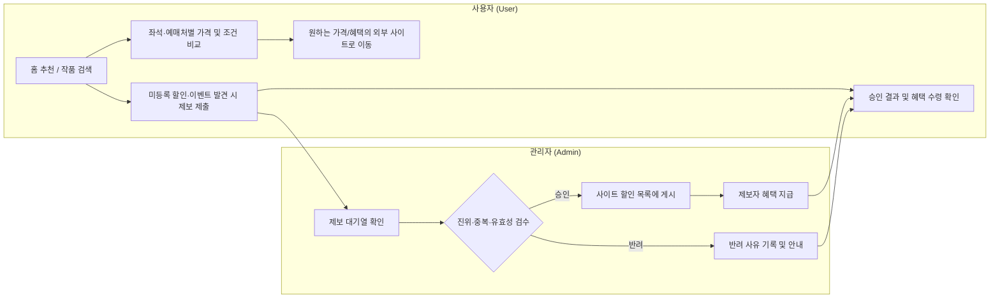

# MuDeal — Product Requirements Document (PRD)

| 항목 | 내용 |
|---|---|
| **프로젝트명** | MuDeal (가칭) |
| **문서 버전** | v0.3 (검증 채널·OCR·싱어롱/특전 반영) |
| **작성일** | 2026-11-24 |
| **문서 상태** | 초안 (혜택 형태 미결, 연동 채널·OCR 전략 확정) |
| **연관 문서** | [DESIGN.md](DESIGN.md) · [서비스 기획서](waterfall/00-기획/서비스기획서.md) · [비즈니스 정책서](waterfall/00-기획/비즈니스정책서.md) · [워터폴 템플릿 안내](waterfall/README.md) |

---

## 1. 제품 개요 (Product Overview)

### 1.1 한 줄 정의
> **흩어져 있는 전국 뮤지컬의 티켓 할인·로터리·싱어롱·커튼콜 데이·특전(굿즈) 이벤트를 한곳에 모아 비교하고, 원하는 예매처로 바로 이동해 구매할 수 있도록 돕는 뮤지컬 할인·이벤트 비교 서비스**

### 1.2 문제 정의 및 배경
- 한국 뮤지컬 시장은 기본적으로 **정찰제**로 운영되지만, 실제로는 **NOL티켓(구 인터파크)**, **YES24티켓(YES24데이·엔젤티켓)**, **엘티켓(L.TICKET)**, **티켓링크**, **타임티켓** 등 여러 예매처와 공연장 공식 사이트에서 비정기 할인·로터리·이벤트가 분산 발생한다.
- 관객에게 중요한 정보는 단순 할인가뿐만 아니라 **싱어롱 데이 회차, 스페셜 커튼콜(커튼콜 데이) 날짜, 포토카드·스페셜 티켓·굿즈 특전 증정 조건**까지 포함되는데, 상당수가 HTML 텍스트가 아닌 **예매처 공지 이미지** 속에 숨어 있어 놓치기 쉽다.
- 특가·로터리·특전 이벤트는 기간이 짧아 수동 탐색 비용이 크고, 자동 수집만으로는 제작사 SNS발 깜짝 공지까지 모두 포착하기 어렵다.

### 1.3 핵심 원칙 (Product Boundary)
1. **비교와 연결에 집중 (결제 미제공)**: MuDeal은 자체 결제·발권·환불을 제공하지 않는다. 가격·할인 조건·이벤트/특전 정보를 투명하게 비교하고, 사용자가 선택한 외부 예매처/할인 사이트로 이동(아웃바운드 링크)하도록 돕는다.
2. **안전한 하이브리드 수집 + Vision/OCR + 관리자 검수**:
   - **KOPIS 오픈 API**로 전국 뮤지컬 공식 기본정보와 좌석별 정가를 자동 기준 DB로 구축한다.
   - 실제 200 OK 응답이 검증된 **1차 채널(NOL티켓·엘티켓·YES24티켓·티켓링크)**과 **2차 보조 공연장(샤롯데·예술의전당·세종문화회관·클립서비스)**은 **저빈도 배치 수집 + 신규 공지 이미지 Vision/OCR 추출**을 통해 **관리자 검수 대기열 초안(DRAFT)**으로 생성하고, 관리자 승인 후 원문 링크와 함께 게시한다.
   - **사용자 제보 → 관리자 검수·승인 → 제보자 혜택 지급** 루프로 자동 수집이 놓치는 깜짝 특가·SNS발 특전 공지까지 보완한다.

---

## 2. 역할(Role) 및 권한 정의

서비스는 **사용자(User)**와 **관리자(Admin)** 두 가지 역할로 구성된다.

| 구분 | 사용자 (User) | 관리자 (Admin) |
|---|---|---|
| **핵심 목적** | 할인 뮤지컬 탐색, 예매처별 가격 비교, 외부 구매 이동, 누락 할인 제보 및 혜택 수령 | 제보된 할인 정보 검수·반영 여부 결정, 제보자 혜택 지급, 공연/할인 정보 운영 관리 |
| **탐색·비교** | 홈 추천 조회, 작품 검색, 좌석별·채널별 가격 비교, 외부 링크 이동 | 동일 (미게시/만료 포함 전체 조회) |
| **제보·검수** | 미등록 할인·이벤트 제보, 내 제보 처리 상태 확인, 마감/오류 신고 | 제보 대기열 조회, 사실 확인(링크/가격/조건), **승인(게시)** 또는 **반려(사유 기록)** |
| **혜택(리워드)** | 승인된 제보에 대한 혜택 수령 및 이력 확인 | 승인 시 혜택 지급 처리, 지급 상태/이력 관리 |
| **콘텐츠 관리** | 불가 | 공연·할인·이벤트 직접 등록/수정/만료 처리, 홈 추천·스포트라이트 큐레이션 |

> **확정된 접근 권한 정책**:
> - **비로그인 사용자**: 홈 탐색, 전국 뮤지컬 작품 검색, 가격 비교, 외부 예매처 이동 허용 (진입 장벽 최소화)
> - **로그인 사용자 (카카오/구글 소셜 로그인 우선)**: 할인 제보, 제보 내역·혜택 수령 확인, (확장 시) 관심 작품 찜·할인 알림

---

## 3. 핵심 사용자 여정 (Core Flows)

---

## 4. 기능 요구사항 (Functional Requirements)

### 4.1 사용자(User) 기능

| ID | 영역 | 기능명 | 상세 내용 | 우선순위 |
|---|---|---|---|---|
| **FR-U01** | 홈 | 할인·이벤트 뮤지컬 추천 | 마감임박 특가, 오늘의 로터리/스페셜 데이(YES24데이·NOL 로터리), 싱어롱·커튼콜·특전(굿즈) 이벤트, 할인율 상위, 신규 등록 뮤지컬을 섹션별로 노출 | P1 |
| **FR-U02** | 홈 | 할인·이벤트 유형 필터 | `전체`, `타임세일`, `로터리`, `할인사이트`, `싱어롱·커튼콜`, `굿즈·특전`, `오늘 마감` 칩 필터로 빠른 탐색 | P1 |
| **FR-U03** | 검색 | 작품·공연장·이벤트 검색 | 작품명, 공연장명, 지역, 이벤트 키워드(`싱어롱`, `커튼콜`, `포토카드`, `YES24데이`)로 검색하고 최저가·최대 할인율·이벤트 배지·비교 예매처 수 표시 | P1 |
| **FR-U04** | 비교 | 좌석·예매처 가격 비교 및 이벤트/특전 안내 | 작품 상세에서 좌석등급(`VIP/R/S/A/전석`)별 예매처 정가·할인가·할인율·수수료·조건(`무조건` vs `추첨/조건부`) 비교 + **싱어롱·커튼콜 데이 회차 및 포토카드/특전 증정 조건** 확인 | P1 |
| **FR-U05** | 이동 | 외부 예매처 아웃바운드 이동 | 각 가격 행에서 `예매처 이동 ↗` 클릭 시 해당 할인/예매 페이지(새 탭)로 이동하며 클릭 이벤트 기록 (자체 결제 없음) | P1 |
| **FR-U06** | 제보 | 미등록 할인·이벤트 제보 | 로그인 사용자가 사이트에 없는 할인 정보를 제출 (필수: 작품명, 예매처/사이트명, 할인 링크 URL, 할인가 또는 할인율 / 선택: 좌석등급, 할인 조건, 마감일, 증빙 스크린샷) | P1 |
| **FR-U07** | 마이 | 제보 내역 및 혜택 확인 | 내가 제출한 제보의 상태(`검수중` / `승인됨` / `반려됨` + 반려 사유)와 지급된 혜택 내역 조회 | P1 |
| **FR-U08** | 비교 | 품절/마감 오류 신고 | 이미 매진되거나 가격이 변동된 링크에 대해 사용자가 간단히 오류/마감 제보 | P2 |
| **FR-U09** | 리텐션 | 관심 작품 찜 및 할인 알림 | 원하는 뮤지컬을 찜하고, 새 할인/로터리 등록 시 알림 수신 | P2 |

### 4.2 관리자(Admin) 기능

| ID | 영역 | 기능명 | 상세 내용 | 우선순위 |
|---|---|---|---|---|
| **FR-A01** | 검수 | 통합 검수 대기열 조회 (사용자 제보 + 자동 수집/OCR 초안) | 사용자 제보와 외부 배치·Vision/OCR이 생성한 초안(`DRAFT`)을 탭으로 구분 조회하고 원본 링크·공지 이미지·기존 등록 딜과 대조 확인 | P1 |
| **FR-A02** | 검수 | 승인 및 사이트 반영 | 검수 통과 시 보정 후 할인/이벤트(싱어롱·커튼콜·특전 포함)를 정식 게시 (혜택은 사용자 제보 승인 건에만 지급) | P1 |
| **FR-A03** | 검수 | 제보 반려 및 사유 기록 | 중복 제보, 종료된 이벤트, 확인 불가 링크, 허위 정보 등 반려 시 정형화된 사유(또는 직접 입력)를 기록해 사용자에게 안내 | P1 |
| **FR-A04** | 혜택 | 제보자 혜택 지급 관리 | 제보 승인 시 제보자에게 혜택을 지급(자동 적립 또는 관리자 지급 완료 처리)하고 지급 이력 및 누적 현황 관리 | P1 |
| **FR-A05** | 운영 | 공연·할인·이벤트 CRUD | 공연 기본 정보(작품명, 포스터, 공연장, 기간, 좌석별 정가)와 예매처별 할인/이벤트를 직접 등록·수정·만료(비노출) 처리 | P1 |
| **FR-A06** | 큐레이션 | 홈 추천/배너 관리 | 홈 상단 히어로 배너, 스포트라이트 밴드(Yes24데이·NOL 로터리 등), 추천 섹션 노출 순서 및 기간 관리 | P2 |
| **FR-A07** | 운영 | 오류/마감 신고 처리 | 사용자가 신고한 품절·가격 불일치 딜을 확인하고 즉시 수정 또는 마감 처리 | P2 |

---

## 5. MVP 스코프 정의 (In-Scope vs Out-of-Scope)

### 5.1 포함 항목 (In-Scope — MVP v1.0)

| ID | 항목 | 연관 FR | 우선순위 | 비고 |
|---|---|---|---|---|
| **MVP-001** | 홈 할인 뮤지컬 추천 및 할인 유형 필터 | FR-U01, FR-U02 | P1 | `DESIGN.md` 와인/버건디 5:7 포스터 그리드 적용 |
| **MVP-002** | 뮤지컬 검색 및 좌석·예매처별 가격 비교 화면 | FR-U03, FR-U04 | P1 | 무조건 할인 vs 추첨/조건부 구분 명시 |
| **MVP-003** | 외부 예매처/할인 사이트 아웃바운드 이동 | FR-U05 | P1 | 결제 미제공, 클릭 로그 수집 |
| **MVP-004** | 사용자 로그인 및 미등록 할인 정보 제보 + 마이페이지(상태/혜택 조회) | FR-U06, FR-U07 | P1 | 비로그인 탐색 허용, 제보 시 로그인 |
| **MVP-005** | 관리자 콘솔: 제보 검수(승인/반려) · 혜택 지급 · 공연/할인 CRUD | FR-A01~A05 | P1 | 최소 운영 가능한 어드민 UI |
| **MVP-006** | 품절/가격 오류 신고 및 관리자 처리 | FR-U08, FR-A07 | P2 | 정보 신선도 유지 |
| **MVP-007** | 홈 배너/스포트라이트 큐레이션 관리 | FR-A06 | P2 | MVP 초기엔 DB/어드민 플래그로 단순화 가능 |

### 5.2 제외 항목 (Out-of-Scope) 및 제외 근거

| ID | 제외 항목 | 제외 근거 | MVP 대안 | v2 진입 조건 |
|---|---|---|---|---|
| **EX-001** | **자체 결제·예매·환불 기능** | 서비스 본질이 비교·연결이며, 티켓 발권/정산/PG 계약 복잡도와 법적 리스크가 큼 | 외부 예매처/할인 사이트 아웃바운드 링크 연결 | 영구 제외 (핵심 경계) |
| **EX-002** | **초단위 실시간 잔여좌석 동기화** | 외부 티켓사별 좌석 API 미공개·차단 리스크로 MVP 과투자 우려 | KOPIS API(전국 공연 메타·정가) + 주요 할인/예매처 정기 배치 연동 + 사용자 제보·품절 신고 병행 | 외부 티켓사 공식 제휴 API 확보 시 |
| **EX-003** | **혜택(포인트) 현금 환급 / 자체 커머스 몰** | 전자금융/정산 복잡도 증가 | 단순 리워드 형태(기프티콘 수동 지급, 등급/배지, 포인트 적립 등 — `DEC-001` 확정 후 적용) | 월간 제보 승인 건수 및 리워드 예산 규모 검증 후 |
| **EX-004** | **커뮤니티(자유게시판·관람 후기·양도 거래)** | 스팸·사기(암표/양도) 관리 비용 급증 및 핵심 가치 분산 | 외부 예매처 리뷰 요약/평점 참고 링크 또는 미제공 | 핵심 비교 리텐션 확보 후 검토 |
| **EX-005** | **네이티브 모바일 앱 (iOS/Android)** | 웹 기반 반응형으로 탐색·링크 이동 검증이 훨씬 빠름 | 반응형 웹 (`DESIGN.md` 모바일 하단 탭바/바텀시트 규칙 준수) | 재방문율 및 푸시 알림 수요 검증 후 |

---

## 6. 데이터 모델 개요 (고수준)

상세 ERD는 Phase 2(`데이터베이스설계서.md`)에서 확정하며, PRD 기준 핵심 엔티티는 다음과 같다.

- **Show (뮤지컬 작품)**: 작품명, 포스터, 공연장, 공연 기간, 좌석등급별 정가(기준가), 상태(공연중/예정/종료)
- **Deal (할인/이벤트 링크)**: 연결된 `Show`, 예매처/플랫폼명, 할인 유형(`타임세일`, `로터리`, `할인사이트`, `카드/제휴` 등), 좌석등급, 할인가, 할인율, 할인 조건 요약, 무조건/조건부 구분, 외부 URL, 유효기간, 상태(`게시중`, `마감`, `숨김`), 출처(`관리자` / `사용자 제보`)
- **DealReport (사용자 제보)**: 제보자(`User`), 작품명/연결 `Show`, 예매처명, 링크 URL, 제보 가격/할인 정보, 증빙(선택), 검수 상태(`대기`, `승인`, `반려`), 검수 관리자, 반려 사유, 생성/처리 일시
- **Reward (제보자 혜택)**: 대상 `User`, 연관 `DealReport`, 혜택 유형(`DEC-001` 확정 필요), 지급량/내용, 지급 상태(`대기`, `지급완료`), 지급 일시
- **User (계정)**: 식별자, 닉네임, 이메일/소셜 ID, 역할(`USER` / `ADMIN`), 누적 승인 제보 수

---

## 7. 비기능 요구사항 및 UX 기준

1. **디자인 시스템 준수**: [DESIGN.md](DESIGN.md)의 와인/버건디(`#6E182B`, `#8A1E37`, `#2B0D16`) + 샴페인 골드(`#B89352`) 컬러 시스템, `5:7` 포스터 그리드, `tabular-nums` 숫자 정렬, 반응형 브레이크포인트를 따른다.
2. **가격·조건 투명성**: 정가 대비 할인가와 할인율, 예매 수수료 여부, 추첨/조건부 여부를 사용자가 오해하지 않도록 명확히 표기하며, 최종 결제 금액은 외부 예매처 기준임을 고지한다.
3. **권한 분리 및 보안**: 관리자 API·화면은 서버 측 Role(`ADMIN`) 검증으로 보호하며, 사용자 제보 URL은 `http://`·`https://` 스킴 검증 및 악성 링크 필터링을 적용한다.
4. **외부 링크 신뢰성**: 아웃바운드 링크는 새 탭(`rel="noopener noreferrer"`)으로 열고, 만료일 경과 딜은 자동 마감 표기 또는 숨김 처리한다.

---

## 8. 성공 지표 (초기 KPI 가설)

| 지표 | 정의 | 확인 목적 |
|---|---|---|
| **아웃바운드 클릭률 (CTR)** | 작품 상세/비교 조회 대비 외부 예매처 이동 클릭 비율 | 가격 비교 정보가 실제 구매 탐색에 도움이 되는지 검증 |
| **검색→비교 전환율** | 검색 실행 후 작품 가격 비교 화면 진입 비율 | 검색 및 가격 비교 UX 유효성 검증 |
| **제보 제출 수 & 승인률** | 주간 사용자 제보 건수 및 관리자 승인 비율 | 제보 흐름의 편의성과 혜택 동기 유효성 검증 |
| **제보 검수 리드타임** | 제보 제출부터 관리자 승인/반려까지 평균 소요 시간 | 할인 정보의 신선도(마감 전 게시) 관리 |

---

## 9. 결정 현황 및 미결 사항 (Decisions & Open Questions)

| ID | 항목 | 결정 내용 / 검토 사항 | 영향 범위 | 상태 |
|---|---|---|---|---|
| **DEC-001** | **제보자 혜택(리워드) 형태 및 중복 제보 세부 규칙** | 승인 시 혜택 지급 구조는 확정. 구체적 혜택 형태(포인트/기프티콘/배지 등)와 중복 제보 지급 규칙은 추후 확정 | FR-U07, FR-A04, `BP-REPORT-004` | **미결** |
| **DEC-002** | **초기 데이터 확보 및 연동·OCR 전략** | **확정**: ① KOPIS 오픈 API(기준 DB 자동 반영) ② 1차 검증 4개 채널(NOL티켓·엘티켓·YES24티켓·티켓링크) 저빈도 배치 수집 ③ NOL/YES24/엘티켓 신규 공지 이미지 **Vision AI/OCR 자동 해석**(싱어롱·커튼콜·굿즈/특전·상세 할인표 추출) ④ 2차 공연장(샤롯데·예술의전당·세종·클립서비스) 보조 수집. KOPIS 외 데이터는 **검수 초안 생성 → 관리자 승인 게시** 원칙 적용 **조건부 확장**: 타임티켓·LG아트센터·충무아트센터(CSR/SPA)는 후속 확장 | MVP-001, `BP-SYNC`, `FR-001`, `FR-009` | **1차 채널·OCR 확정** (Vision 모델 비용/배치 주기 세부 튜닝만 남음) |
| **DEC-003** | **인증/로그인 방식** | **확정**: 비로그인 탐색·비교·이동 허용 + 제보·혜택 확인 시 소셜 로그인(카카오/구글) 우선 (이메일 가입 MVP 제외) | FR-U06, FR-U07, `BP-AUTH` | **확정** |
| **DEC-004** | **수익 모델 방향** | **MVP 확정**: 완전 무료(무광고, 수익화 미적용) **v2 미결**: 제휴(Affiliate) 링크 / 스폰서드 배너 검토 | 장기 로드맵 (MVP 범위 외) | **MVP 확정 / v2 미결** |
| **DEC-005** | **초기 대상 공연 범위** | **확정**: 전국 뮤지컬 전체 대상 (대극장·중소극장·대학로·지역 포함) | MVP-001, MVP-002 | **확정** |
