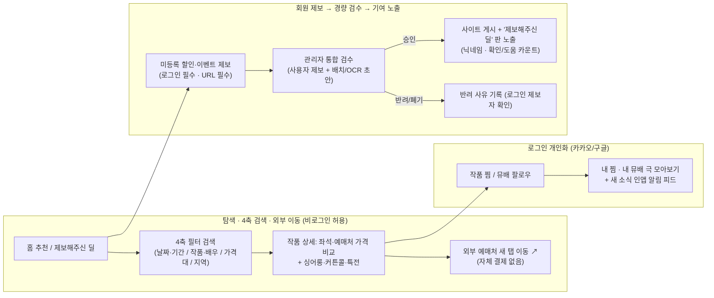

# MuDeal — Product Requirements Document (PRD)

| 항목 | 내용 |
|---|---|
| **프로젝트명** | MuDeal (가칭) |
| **문서 버전** | v1.2 (할인·특전·싱어롱/특별 커튼콜 3대 축 집중 · 일반 티켓오픈 제외 · 1단 헤더 · 토스 UX 점검 반영) |
| **작성일** | 2026-11-26 |
| **문서 상태** | 구현·QA 완료 기준선 |
| **연관 문서** | [DESIGN.md](DESIGN.md) · [서비스 기획서](waterfall/00-기획/서비스기획서.md) · [비즈니스 정책서](waterfall/00-기획/비즈니스정책서.md) · [워터폴 템플릿 안내](waterfall/README.md) |

---

## 1. 제품 개요 (Product Overview)

### 1.1 한 줄 정의
> **흩어져 있는 전국 뮤지컬의 티켓 할인·로터리·싱어롱·커튼콜 데이·특전(굿즈) 이벤트를 날짜·작품/배우·가격대·지역 필터로 한눈에 비교하고, 원하는 예매처로 바로 이동해 구매하며, 좋아하는 작품과 뮤지컬 배우의 새 소식을 모아보는 반응형 웹 플랫폼**

### 1.2 문제 정의 및 배경
- 한국 뮤지컬 시장은 기본적으로 **정찰제**로 운영되지만, 실제로는 **NOL티켓(구 인터파크)**, **YES24티켓(YES24데이·엔젤티켓)**, **엘티켓(L.TICKET)**, **티켓링크**, **타임티켓** 및 공연장 공식 사이트에서 비정기 할인·로터리·이벤트가 분산 발생한다.
- 관객의 탐색 방식은 단일하지 않다. ① **특정 날짜/기간에 볼 만한 극**을 찾거나, ② **특정 뮤지컬(또는 좋아하는 배우 출연작)**을 싸게 보려 하거나, ③ **예산(가격대)**에 맞는 극을 찾거나, ④ **대학로·서울·경기·지방 등 지역** 기준으로 찾는 등 복합 조건 탐색이 필요하다.
- 단순 할인가뿐 아니라 **싱어롱 데이 회차, 커튼콜 데이 날짜, 포토카드·스페셜 티켓·굿즈 특전 증정 조건**도 중요한데, 상당수가 예매처 **공지 이미지** 속에 있어 놓치기 쉽다.
- 무료 비교 서비스 구조에서 금전적 제보 보상은 적자와 어뷰징을 유발하므로, **로그인 회원이 안전하게 제보(URL 필수)**하고 **"제보해주신 딜" 전용 판과 기여 지표(확인/이동 수·도움이 됐어요)**로 심리적 보상을 제공하는 지속 가능한 운영 모델이 적합하다.

### 1.3 핵심 원칙 (Product Boundary)
1. **비교와 연결에 집중 (결제 영구 미제공)**: MuDeal은 자체 결제·발권·환불을 제공하지 않는다. 가격·할인 조건·이벤트/특전을 비교하고 사용자가 선택한 외부 예매처/할인 사이트로 새 탭 이동(아웃바운드 링크)하도록 돕는다.
2. **안전한 하이브리드 수집 + Vision/OCR + 경량 관리자 검수**:
   - **KOPIS 오픈 API**로 전국 뮤지컬 기본정보, 좌석별 공식 정가(`pcseguidance`), **출연진(`prfcast`)**을 자동 기준 DB로 구축한다.
   - 실제 200 OK 응답이 검증된 **1차 채널(NOL티켓·엘티켓·YES24티켓·티켓링크)**과 **2차 보조 공연장(샤롯데·예술의전당·세종문화회관·클립서비스)**은 **저빈도 배치 수집 + 신규 공지 이미지 Vision/OCR 추출**을 통해 **관리자 검수 초안(`DRAFT`)**을 생성하고, 승인 후 원문 링크와 함께 게시한다.
3. **회원 제보 + "제보해주신 딜" 커뮤니티 명예 구조 (금전 보상 없음)**:
   - 위험한 악성 링크·스팸 방지를 위해 **할인·이벤트 제보는 로그인 회원(`USER`) 전용**으로 운영하며 원문 URL(`https://`)을 필수로 받는다.
   - 승인된 제보는 홈/전용 섹션 **"제보해주신 딜"** 판에 제보자 닉네임(관리자 마스킹 가능)과 **`N명 확인` · `도움이 됐어요`** 카운트와 함께 노출해 기여감을 제공한다.
4. **로그인 = 개인화 + 신뢰 기반 제보**:
   - 카카오/구글 소셜 로그인은 **뮤지컬 찜, 뮤배 팔로우(출연극 모아보기), 스토리 바 미확인 피드(자동 읽음·최근 소식 다시 보기·소식 저장), 마이페이지 내장 캘린더, 검색 프리셋 저장, 할인 제보·오류 신고**를 위해 제공한다.

---

## 2. 역할(Role) 및 권한 정의

| 구분 | 비로그인 사용자 (`GUEST`) | 로그인 사용자 (`USER`, 카카오/구글) | 관리자 (`ADMIN`) |
|---|---|---|---|
| **탐색·비교·이동** | 홈 3분류 탐색(**할인·특전·싱어롱/특별 커튼콜**), 마감임박, `제보해주신 딜`, 4축 검색·필터(진행 중인 딜/이벤트 기준), 작품 상세(공연장 클릭 모아보기), 외부 예매처 이동 | 동일 | 동일 (미게시/초안 포함 전체) |
| **제보·기여** | `도움이 됐어요` 반응만 가능 (제보는 로그인 유도) | **미등록 할인·특전·이벤트 제보 (URL 필수)**, 마이페이지 내 제보 상태·누적 기여(`N명 확인/도움`) 조회, 품절/가격 오류 신고 | **통합 검수 대기열**(사용자 제보 + 자동 수집/OCR 초안) 승인·게시(닉네임 마스킹 가능) 또는 반려/폐기 |
| **개인화** | 불가 (로그인 유도) | **뮤지컬 찜**, **뮤배 팔로우**(할인 없어도 기본정보 표시), **스토리 바 → 상세 피드(자동 읽음·최근 소식 다시 보기·소식 저장)**, **내장 캘린더**, 검색 프리셋 | 동일 |
| **운영 관리** | 불가 | 불가 | 공연·배우 매핑·딜 CRUD, 자동 잠금(`admin_locked`) 관리, OCR 일일 상한 모니터링, 홈 큐레이션, 오류 신고 처리 |

---

## 3. 핵심 사용자 여정 (Core Flows)

---

## 4. 기능 요구사항 요약

### 4.1 탐색 · 4축 검색 · 비교 · 이동 (`GUEST`+)
- **FR-U01 (홈 3분류 탐색 · 마감임박 · 제보해주신 딜)**: 1단 헤더(`MuDeal` · 인라인 검색 · 맞춤 검색 · 할인 제보 · MY/로그인), 3열 히어로, **`혜택별로 뮤지컬 둘러보기` (`할인` · `특전` · `싱어롱/특별 커튼콜` 인플레이스 탭)**, 마감임박 특가, **`제보해주신 딜` 전용 섹션**. *(할인이 없는 일반 티켓오픈은 범위 제외 — 조기예매 할인만 `할인`으로 통합)*
- **FR-U02 (4축 복합 필터 검색 · URL 공유 · 조건부 세부 칩)**:
  1. **날짜/기간**: 특정 관람일 또는 기간(`dateFrom`~`dateTo`, 프리셋 `오늘`/`이번 주말`/`이번 달`)에 공연 중이며 유효한 딜 필터
  2. **이름 검색**: 뮤지컬 작품명, 공연장명, **출연 배우명**, 이벤트 키워드 검색 (진행 중인 할인·이벤트가 없으면 *"현재 진행 중인 할인/이벤트가 없어요"* 안내 + 제보 CTA 표시)
  3. **가격대**: 프리셋(`3만원 이하`, `5만원 이하`, `7만원 이하`, `10만원 이하`) + 최소/최대 금액 직접 입력
  4. **지역**: **`서울 · 대학로(혜화)`** 별도 분리 + `서울(기타)`, `경기·인천`, `부산`, `대구`, `대전·충청`, `광주·전라`, `강원·제주` 전국 필터 (지역 투어 혼동 방지를 위해 카드에 지역 태그 표기)
  5. **조건부 할인 세부 칩 & 동적 OG 공유**: `무조건 할인만` 외 `마티네`, `재관람`, `청년/학생`, `직장인`, `카드/제휴` 세부 필터 + URL 쿼리 동기화·동적 OG 미리보기 공유 + 로그인 시 프리셋 저장(최대 5개)
- **FR-U03 (작품 상세 · 가격 비교 · 이벤트/특전 · 공연장 링크)**: 좌석등급(`VIP/R/S/A/전석`) 탭별 가격 비교 + **싱어롱·커튼콜·특전 안내** + 출연진(배우 팔로우 연동, 모노그램/최근 포스터 아바타) + **공연장명 클릭 시 해당 공연장 진행 작품 모아보기** + SSR 동적 OG 공유 카드
- **FR-U04 (외부 예매처 이동)**: 새 탭 아웃바운드 이동(`rel="noopener noreferrer"`), 클릭 집계(제보 딜 기여 수 연동), 외부 기준 면책 고지

### 4.2 제보 & 커뮤니티 기여 (`USER` 제보 / `GUEST`+ 조회·도움)
- **FR-U05 (회원 전용 할인/이벤트 제보)**: 악성 링크·스팸 방지를 위해 로그인 회원(`USER`)만 제보 가능(원문 URL `https://` 필수, 증빙 이미지 선택 5MB, KST 일 10건 한도).
- **FR-U06 (`제보해주신 딜` 판 & 도움이 됐어요)**: 승인된 사용자 제보 딜 모아보기, 제보자 크레딧, `N명 확인`(아웃바운드 클릭 기반) 및 `도움이 됐어요` 반응 카운트 제공.

### 4.3 로그인 개인화 (`USER` 전용 — 카카오/구글 소셜 로그인)
- **FR-U07 (뮤지컬 찜)**: 관심 작품 찜 토글 및 마이페이지 `찜한 뮤지컬` 모아보기 (진행 중 할인이 없어도 기본 공연 정보 표시).
- **FR-U08 (뮤지컬 배우 팔로우 & 내 뮤배 극)**: KOPIS `prfcast` 기반 배우 팔로우 → **`내 뮤배 출연작 모아보기`** (진행 중 할인이 없어도 기본 공연 정보 표시).
- **FR-U09 (마이페이지: 스토리 바 자동읽음/저장 피드 · 내 캘린더 · 내 기여)**:
  - **스토리 바 → 미확인 피드 (자동 읽음 + 최근 소식 다시 보기 + 저장하기)**: 상단 원형 썸네일 바(배우 모노그램/최근 포스터 · 찜 작품 포스터, 새 소식 시 와인/골드 링)를 누르면 **미확인 새 소식만 X/인스타 피드 카드 형식으로 스크롤 표시되며 열람 시 자동 읽음 처리**된다. 각 배우/작품 프로필에서 **`최근 소식 다시 보기`(30일)** 버튼과 개별 카드 **`🔖 저장하기`** 기능을 제공한다.
  - **내 뮤지컬 캘린더**: 마이페이지 내장 월간 캘린더에 찜·팔로우 작품의 주요 소식(로터리 마감·싱어롱/커튼콜·특전 회차)을 자동 표시하고, 원하는 소식을 **캘린더에 담거나 직접 개인 일정(관극·예매 메모)**을 CRUD 가능.
  - **내 제보 기여 & 검색 프리셋**: 제보 검수 상태·누적 확인/도움 수 조회 및 검색 프리셋 관리.
- **FR-U10 (품절/가격 오류 신고, P2)**: 로그인 사용자가 만료·매진·가격 불일치 딜 신고.

### 4.4 관리자 경량 운영 (`ADMIN` 전용)
- **FR-A01 (통합 검수 대기열)**: `사용자 제보` 탭 + `자동 수집·OCR 초안(DRAFT)` 탭 분리 조회, 원문 링크·OCR 추출 JSON·기존 딜 대조 후 **승인(게시)** 또는 **반려/폐기**. (금전 혜택 지급 기능 없음)
- **FR-A02 (공연·배우·딜 CRUD & 잠금)**: 공연·배우 매핑(동명이인/오타 보정)·할인/이벤트 수동 CRUD, `admin_locked` 제어, 배치 실행 모니터링.
- **FR-A03 (홈 큐레이션 & 오류 신고 처리, P2)**: 홈 히어로/스포트라이트 배너 관리, 사용자 오류 신고 확인 및 딜 수정/마감.

---

## 5. MVP 스코프 (In-Scope vs Out-of-Scope)

### 5.1 포함 항목 (MVP v1.0)
- **MVP-001**: KOPIS 오픈 API(전국 공연 메타·좌석 정가·출연진 `prfcast`) + 1차 검증 4개 예매처(NOL·엘티켓·YES24·티켓링크)·2차 공연장 4곳 저빈도 배치 + 신규 공지 이미지 Vision/OCR → `DRAFT` 초안 파이프라인
- **MVP-002**: 홈 추천, 로터리/스페셜 데이 다크 밴드, **`제보해주신 딜` 전용 섹션**(닉네임·확인/도움 카운트)
- **MVP-003**: **4축 복합 필터 검색**(날짜/기간 · 작품/배우명 · 가격대 · `대학로` 분리 전국 지역 + 조건부 세부 칩 `마티네/재관람/청년·학생/직장인` + URL 공유/프리셋 저장) + 작품 상세(좌석/예매처 가격 비교 + 싱어롱·커튼콜·특전 + 출연 배우)
- **MVP-004**: 외부 예매처 아웃바운드 이동 및 클릭/기여 집계 (자체 결제 없음)
- **MVP-005**: 로그인 회원 전용 할인·이벤트 제보 (`https://` URL 필수 + KST 일 10건 한도 + 증빙 이미지 5MB)
- **MVP-006**: 소셜 로그인(카카오/구글) 및 **개인화 기능** (뮤지컬 찜, 뮤배 팔로우·`내 뮤배 극`, **스토리 바 기반 미확인 새 소식 피드(X/인스타형)**, **마이페이지 내장 캘린더(자동 표시+담기+직접 입력)**, 검색 프리셋 저장, 내 제보 기여 이력)
- **MVP-007**: 경량 관리자 콘솔 (통합 검수: 사용자 제보 + 배치/OCR 초안 승인/반려, 공연·배우·딜 CRUD 및 `admin_locked` 관리)
- **MVP-008 (P2)**: 품절/가격 오류 신고 및 관리자 처리 / **MVP-009 (P2)**: 홈 배너·스포트라이트 큐레이션 관리

### 5.2 제외 항목 (Out-of-Scope)
- **EX-001 (영구 제외)**: 자체 결제·예매·발권·환불 기능
- **EX-002 (영구/장기 제외)**: 제보자 금전 보상·포인트·기프티콘 지급 및 정산 시스템 (→ `제보해주신 딜` 명예/기여 지표로 대체)
- **EX-003**: 초단위 실시간 잔여좌석 동기화 (→ 정기 배치 + 최종 확인 시각 + 오류 신고)
- **EX-004**: 이메일/비밀번호 자체 회원가입 (→ 카카오/구글 소셜 로그인)
- **EX-005**: 이메일·웹푸시·카카오톡 외부 알림 발송 (→ MVP는 마이페이지 소식 피드 + 인앱 알림 배지, 외부 발송은 v2)
- **EX-006**: 자유 커뮤니티·관람 후기·티켓 양도 거래
- **EX-007**: 광고 배너·유료 구독 모델 (MVP 완전 무료) / **EX-008**: 네이티브 모바일 앱 (반응형 웹 집중)

---

## 6. 결정 현황 (Decisions)

| ID | 항목 | 확정 내용 | 상태 |
|---|---|---|---|
| **DEC-001** | 제보자 보상·제보 권한 | **금전 혜택 폐지 확정** → 악성 링크 방지를 위해 **회원 전용 제보(`https://` URL 필수)** + **`제보해주신 딜` 전용 섹션**에 제보자 닉네임(관리자 마스킹 가능)·확인(이동) 수·`도움이 됐어요` 카운트 노출 | **확정** |
| **DEC-002** | 데이터 연동·OCR | KOPIS API(공연·정가·출연진) 자동 Upsert + 1차 4개 예매처·2차 4개 공연장 저빈도 배치(3요소 매칭) + 신규 공지 이미지 Vision/OCR(일일 호출 상한 적용) → `DRAFT` 검수 후 게시 | **확정** |
| **DEC-003** | 인증·개인화 범위 | 탐색·비교·이동은 비로그인 허용 / 카카오·구글 소셜 로그인은 **제보 + 작품 찜 + 뮤배 팔로우 + 스토리 바 자동읽음/다시보기/저장 피드 + 내장 캘린더 + 프리셋** 용도 (외부 발송 v2) | **확정** |
| **DEC-004** | 검색 필터·대상 범위 | 전국 뮤지컬 대상 / **4축 필터**(날짜·기간 / 작품·배우명 / 가격대 / 지역 `서울-대학로` 별도 분리) + 조건부 세부 칩 + 동적 OG 공유 + 공연장 모아보기 | **확정** |
| **DEC-005** | 기술 스택·배포 | 반응형 웹(Next.js `vinext` + Tailwind CSS) on **Cloudflare Workers + D1(Drizzle) + R2 + Cron/Queues/Workflows** · MVP 완전 무료 | **확정** |
