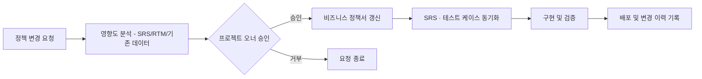

# 비즈니스 정책서 (Business Policy Document) — MuDeal

> 본 문서는 [서비스기획서.md](서비스기획서.md), [PRD.md](../../PRD.md), [DESIGN.md](../../DESIGN.md)를 바탕으로 **MuDeal**의 비즈니스 동작 규칙을 **목적 / 규칙 / 예시 / 변경이력** 구조로 정의한 Phase 0(기획) 산출물입니다.
> AI(Gemini / Antigravity 등)와 개발·QA팀이 구현 및 테스트 시 모호함 없이 동일한 규칙을 적용할 수 있도록 구체적인 조건과 경계값을 명시하며, 아직 결정되지 않은 항목(제보자 혜택 형태·중복 제보 지급 규칙, 배치 주기 등)은 임의로 확정하지 않고 `미결`로 기록합니다.

| 항목 | 내용 |
|------|------|
| **문서 ID** | BPD-MUDEAL-v0.1 |
| **프로젝트명** | MuDeal (가칭) |
| **문서 버전** | v0.1 |
| **작성일** | 2026-11-24 |
| **작성자** | 기획팀 / Gemini (Antigravity) |
| **승인자** | 프로젝트 오너 (미결 — G0 승인 대기) |
| **문서 상태** | 초안 |

---

## 변경 이력

| 버전 | 날짜 | 작성자 | 변경 내용 |
|------|------|--------|-----------|
| v0.1 | 2026-11-24 | Gemini (Antigravity) | MuDeal 핵심 정책 초안 작성 (`BP-AUTH`, `BP-DEAL`, `BP-SYNC`, `BP-REPORT`, `BP-NOTI`, `BP-RESET`, `BP-ERROR`, `BP-STAT` / 결제·광고 정책 제외 명시) |
| v0.2 | 2026-11-24 | Gemini (Antigravity) | 실제 검증 채널(KOPIS·NOL·엘티켓·YES24·티켓링크+공연장 4곳), 공지 이미지 Vision/OCR 초안 검수 원칙, 싱어롱·커튼콜·특전(굿즈) 이벤트 표기 규칙 반영 |

---

## 목차

1. [문서 개요](#1-문서-개요)
2. [정책 목록 및 요약](#2-정책-목록-및-요약)
3. [인증/권한 정책 (BP-AUTH)](#3-인증권한-정책-bp-auth)
4. [할인 비교·표기·외부 이동 정책 (BP-DEAL)](#4-할인-비교표기외부-이동-정책-bp-deal)
5. [외부 사이트 데이터 연동·갱신 정책 (BP-SYNC)](#5-외부-사이트-데이터-연동갱신-정책-bp-sync)
6. [사용자 제보·검수·혜택 정책 (BP-REPORT)](#6-사용자-제보검수혜택-정책-bp-report)
7. [알림 정책 (BP-NOTI)](#7-알림-정책-bp-noti)
8. [기준 시간대 및 마감 전환 정책 (BP-RESET)](#8-기준-시간대-및-마감-전환-정책-bp-reset)
9. [에러 및 외부 링크 장애 처리 정책 (BP-ERROR)](#9-에러-및-외부-링크-장애-처리-정책-bp-error)
10. [통계/카운팅 정책 (BP-STAT)](#10-통계카운팅-정책-bp-stat)
11. [MVP 정책 적용 범위](#11-mvp-정책-적용-범위)
12. [정책 변경 관리](#12-정책-변경-관리)

---

## 1. 문서 개요

### 1.1 목적

이 문서는 **MuDeal** 서비스의 비즈니스 동작 규칙을 한곳에 모아 정의한다.

- SRS(요구사항 명세서)에 규칙이 흩어져 누락되거나 충돌하는 문제를 방지한다.
- "목적 / 규칙 / 예시(정상·경계·에러)" 구조를 통해 기획·개발·QA 및 AI 코딩 도구(Gemini / Antigravity)가 동일한 기준으로 구현하고 경계값 테스트를 도출할 수 있게 한다.

**대상 독자:**

| 독자 | 활용 방법 |
|------|-----------|
| AI 에이전트 (Gemini / Antigravity 등) | 구현 시 규칙 ID(`BP-*`) 직접 참조, 예시의 `상황 -> 결과`를 검증 테스트 케이스로 활용 |
| 개발팀 | 백엔드 검증·상태 전이·배치 로직의 기준 문서 |
| QA팀 | 정상/경계/에러 테스트 케이스 도출 기준 |
| 기획/운영팀 | 정책 변경 관리 및 관리자 검수 운영 기준 |

### 1.2 관련 문서

| 문서명 | 관계 |
|--------|------|
| [서비스 기획서](서비스기획서.md) | 사용자 문제, 서비스 목표, MVP 포함/제외 범위, 미결 결정(`DEC-*`) |
| [PRD.md](../../PRD.md) | 서비스 핵심 경계(결제 미제공) 및 역할 요약 |
| [DESIGN.md](../../DESIGN.md) | 가격 표기(`tabular-nums`), 조건부 배지, 최저가 강조 UI 규격 |
| [요구사항 명세서 (SRS)](../01-요구사항분석/요구사항명세서-SRS.md) | 각 기능 요구사항(FR)에서 본 문서의 개별 규칙 ID(`BP-*`) 참조 |

---

## 2. 정책 목록 및 요약

> 프로젝트에 해당하지 않는 정책(`BP-PAY` 과금/결제, `BP-CONTENT` 유료 해금, `BP-AD` 광고)은 활성 정책에서 제외하고 [11.2 MVP에서 제외하는 정책](#112-mvp에서-제외하거나-해당-없는-정책)에 사유를 기록한다.

| 정책 ID | 정책 카테고리 | 핵심 규칙 요약 | MVP 적용 | 섹션 |
|---------|-------------|---------------|----------|------|
| **BP-AUTH** | 인증/권한 정책 | 비로그인 탐색 허용, 제보·혜택은 카카오/구글 소셜 로그인 필수, `USER`/`ADMIN` 권한 분리 | Y | [3장](#3-인증권한-정책-bp-auth) |
| **BP-DEAL** | 할인 비교·표기·외부 이동 정책 | 정가·할인가·할인율 산출, 무조건/조건부 분리, 최저가 정렬, 새 탭 외부 이동 및 면책 고지 | Y | [4장](#4-할인-비교표기외부-이동-정책-bp-deal) |
| **BP-SYNC** | 외부 데이터 연동·갱신 정책 | KOPIS API + 주요 사이트 정기 배치 연동, 출처 우선순위, 연동 실패 시 기존 데이터 보존 | Y | [5장](#5-외부-사이트-데이터-연동갱신-정책-bp-sync) |
| **BP-REPORT** | 사용자 제보·검수·혜택 정책 | 제보 입력 검증, 관리자 승인(게시)/반려(사유) 전이, 오류 신고, 혜택 지급 구조(세부 혜택 `미결`) | Y | [6장](#6-사용자-제보검수혜택-정책-bp-report) |
| **BP-NOTI** | 알림 정책 | 제보 처리 결과 인앱/이메일 안내(MVP), 야간 발송 제한, 찜 할인 알림은 선택/v2 | 부분 | [7장](#7-알림-정책-bp-noti) |
| **BP-RESET** | 기준 시간대 및 마감 전환 정책 | `KST (UTC+9)` 단일 기준, 마감 시각 도래 시 자동 만료, D-Day 산출 기준 | Y | [8장](#8-기준-시간대-및-마감-전환-정책-bp-reset) |
| **BP-ERROR** | 에러 및 외부 링크 장애 처리 정책 | API 오류 코드별 처리, 제보 입력 임시 보존, 외부 링크/배치 실패 대응 | Y | [9장](#9-에러-및-외부-링크-장애-처리-정책-bp-error) |
| **BP-STAT** | 통계/카운팅 정책 | 아웃바운드 클릭 집계, 조회수 중복 제어, 수치 표기(`tabular-nums`) | Y | [10장](#10-통계카운팅-정책-bp-stat) |

---

## 3. 인증/권한 정책 (BP-AUTH)

### 3.1 목적

비로그인 사용자의 탐색·비교 진입 장벽을 없애면서, 할인 제보와 혜택 수령·관리자 운영 기능은 인증된 사용자와 역할(`USER`/`ADMIN`)에 따라 안전하게 통제한다.

### 3.2 규칙

#### BP-AUTH-001: 회원가입 및 로그인 수단

| 규칙 ID | 규칙 | 비고 |
|---------|------|------|
| BP-AUTH-001-1 | MVP 회원가입 및 로그인은 **소셜 로그인(카카오, 구글)**을 지원한다. 이메일/비밀번호 자체 가입은 MVP에서 제공하지 않는다(`EX-003`) | 소셜 계정 고유 ID(`provider + provider_user_id`)로 식별 |
| BP-AUTH-001-2 | 최초 소셜 로그인 시 서비스 약관 및 개인정보 처리방침 필수 동의 완료 후 계정을 생성한다 | |
| BP-AUTH-001-3 | 동일 소셜 제공자의 고유 ID로 재로그인 시 기존 계정에 연결하며, 중복 계정을 생성하지 않는다 | |

#### BP-AUTH-002: 세션 및 토큰 관리

| 규칙 ID | 규칙 | 비고 |
|---------|------|------|
| BP-AUTH-002-1 | 로그인 세션은 보안 토큰(Access Token / Refresh Token 또는 HttpOnly 세션 쿠키)으로 관리한다. 세부 만료 시간은 Phase 2 설계 시 확정하되, 기본안은 Access `30분` / Refresh `14일`로 둔다 | 세부 시간 Phase 2 확정 |
| BP-AUTH-002-2 | 비로그인 사용자가 로그인 필수 기능(할인 제보, 마이페이지, 찜)에 접근하면 로그인 화면으로 유도하고, 로그인 완료 후 원래 요청했던 경로로 자동 복귀시킨다 | 탐색 이탈 최소화 |
| BP-AUTH-002-3 | 관리자(`ADMIN`) 콘솔 경로(`/admin/*`) 및 관리자 API는 모든 요청에서 서버 측 역할 검증을 수행하며, 비인가 접근 시 `403 Forbidden`을 반환한다 | 프론트엔드 숨김만으로 통제 금지 |

#### BP-AUTH-003: 역할 및 접근 권한 매트릭스

| 기능 영역 | 비로그인 (`GUEST`) | 일반 사용자 (`USER`) | 관리자 (`ADMIN`) |
|-----------|-------------------|---------------------|------------------|
| 홈 추천·필터·검색·가격 비교 | 허용 | 허용 | 허용 |
| 외부 예매처 아웃바운드 이동 | 허용 | 허용 | 허용 |
| 미등록 할인·이벤트 제보 제출 | 불가 (로그인 유도) | 허용 | 허용 |
| 내 제보 상태·혜택 지급 내역 조회 | 불가 (로그인 유도) | 본인 건만 허용 | 전체 조회 가능 |
| 품절/가격 오류 신고 (`MVP-008`) | 불가 (로그인 유도) | 허용 | 허용 |
| 제보 검수(승인/반려) · 혜택 지급 처리 | 불가 (`401`) | 불가 (`403`) | 허용 |
| 공연·할인·이벤트 CRUD · 홈 큐레이션 | 불가 (`401`) | 불가 (`403`) | 허용 |

### 3.3 예시

**정상 케이스:**
```
상황: 비로그인 사용자가 뮤지컬 "오페라의 유령"을 검색해 R석 예매처별 가격을 비교하고 유니켓 링크를 클릭한다
결과: 로그인 요구 없이 비교표가 즉시 표시되며, 클릭 시 새 탭으로 유니켓 페이지가 열리고 익명 아웃바운드 클릭이 기록된다
```
```
상황: 비로그인 사용자가 작품 상세에서 "없는 할인 제보하기" 버튼을 클릭한다
결과: 카카오/구글 소셜 로그인 화면으로 이동하며, 로그인 완료 후 해당 작품이 자동 선택된 제보 작성 화면으로 복귀한다
```

**경계 케이스:**
```
상황: 일반 사용자(USER)가 브라우저 주소창에 `/admin/reports`를 직접 입력해 접속하거나 관리자 승인 API를 호출한다
결과: 서버가 역할 검증 후 `403 Forbidden`을 반환하고, 화면에는 "접근 권한이 없습니다" 안내와 홈 이동 링크를 표시한다
```

**에러 케이스:**
```
상황: 로그인 사용자의 세션/Refresh Token이 만료된 상태에서 할인 제보 제출을 클릭한다
결과: `401 Unauthorized` 응답을 받으며, 작성 중이던 제보 입력값을 브라우저 로컬에 임시 저장(`BP-ERROR-002-1`)한 뒤 재로그인을 안내한다
```

### 3.4 변경이력

| 날짜 | 규칙 ID | 변경 내용 | 변경 사유 |
|------|---------|-----------|-----------|
| 2026-11-24 | BP-AUTH-001~003 | 최초 작성 | 사용자 확정(비로그인 탐색, 소셜 로그인 우선) |

---

## 4. 할인 비교·표기·외부 이동 정책 (BP-DEAL)

### 4.1 목적

서로 다른 예매처와 할인 사이트의 가격·할인율·조건을 사용자가 오해 없이 공정하게 비교하고, 안전하게 외부 구매 사이트로 이동할 수 있도록 표준 규칙을 정의한다.

### 4.2 규칙

#### BP-DEAL-001: 가격 및 할인율 산출·표기

| 규칙 ID | 규칙 | 비고 |
|---------|------|------|
| BP-DEAL-001-1 | 할인율(%)은 `floor((기준 정가 - 할인가) / 기준 정가 × 100)`(소수점 이하 버림, 정수 %)으로 산출한다. 정가 정보(`기준 정가`)가 없거나 `할인가 >= 기준 정가`인 경우 할인율을 표시하지 않고 할인가만 노출한다 | 과장 할인율 표기 방지 |
| BP-DEAL-001-2 | 기준 정가는 동일 작품·동일 좌석등급의 KOPIS 공식 정가를 우선 적용하며, KOPIS 정가가 누락된 경우 관리자 입력 정가를 사용한다 | |
| BP-DEAL-001-3 | 모든 가격·할인율·날짜 숫자는 천 단위 콤마와 원 단위(예: `66,000원`, `45%`) 및 고정폭 숫자(`tabular-nums`)로 표기한다 | `DESIGN.md` 일치 |
| BP-DEAL-001-4 | 홈·검색 카드에서는 `[최대 할인율%] [최저가~]`만 간결히 표기하고, 정가 취소선(`50,000원`)과 예매 수수료·할인 조건 상세는 가격 비교표(상세 화면)에서 표기한다 | 정보 과밀 방지 |

#### BP-DEAL-002: 할인·이벤트 유형 분류 및 최저가 정렬

| 규칙 ID | 규칙 | 비고 |
|---------|------|------|
| BP-DEAL-002-1 | 모든 등록 항목은 성격에 따라 **가격 할인**(`TIMESALE`, `LOTTERY`, `DISCOUNT_SITE`, `CARD_EVENT`, `SPECIAL_DAY`) 또는 **현장 이벤트·특전**(`SINGALONG` 싱어롱 데이, `CURTAIN_CALL` 커튼콜 데이, `PERK_GOODS` 포토카드·스페셜 티켓·굿즈 증정)으로 분류한다. 가격 할인은 **`무조건 할인`** vs **`추첨/조건부 할인`**을 반드시 구분 표기한다 | 순수 이벤트·특전(`SINGALONG`/`CURTAIN_CALL`/`PERK_GOODS`)은 별도 할인가 없이 회차·증정 조건만으로도 게시 가능 |
| BP-DEAL-002-2 | 작품 상세의 최저가 요약 영역은 `일반(무조건) 최저가`와 `추첨/조건부 최저가`를 혼동되지 않게 구분해 안내하며, `싱어롱·커튼콜·특전` 이벤트는 가격 비교표와 별도 영역(또는 전용 탭/배지)으로 명확히 구분 노출한다 | 로터리·정가 특전 이벤트를 일반 최저가로 오인 방지 |
| BP-DEAL-002-3 | 가격 비교표의 기본 정렬은 **`할인가 오름차순`**으로 한다. 할인가가 동일한 경우 ① `무조건 할인` 우선 ② 마감일이 더 여유로운 딜 우선 ③ 최근 확인(갱신) 시각이 최신인 딜 우선으로 정렬한다 | |
| BP-DEAL-002-4 | 기본 정렬 기준 1위 행에는 `최저가` 배지(Champagne Gold `#B89352`)를 표시한다. 단, `무조건 할인`이 1건 이상 존재할 때 `추첨/조건부` 딜만 더 저렴한 경우 `조건부 최저가`로 라벨을 구분한다 | |

#### BP-DEAL-003: 외부 예매처 이동(아웃바운드) 및 면책 고지

| 규칙 ID | 규칙 | 비고 |
|---------|------|------|
| BP-DEAL-003-1 | MuDeal은 어떠한 경우에도 결제·예매·취소·환불을 처리하지 않는다(`EX-001`). 구매 액션 버튼은 모두 외부 사이트 이동(`예매처 이동 ↗`)으로 동작한다 | |
| BP-DEAL-003-2 | 외부 링크는 `https://`(불가피한 레거시 사이트에 한해 관리자 승인 시 `http://`) 스킴만 허용하며, `javascript:`·`data:` 등 비안전 스킴은 저장 및 렌더링 단계에서 차단한다 | XSS/피싱 방지 |
| BP-DEAL-003-3 | 외부 링크 클릭 시 새 탭(`target="_blank" rel="noopener noreferrer"`)으로 열며, 내부 클릭 집계 엔드포인트 또는 이벤트 로깅을 거친다 | |
| BP-DEAL-003-4 | 가격 비교표 하단에는 *"표시된 가격과 혜택은 최종 확인 시각 기준이며, 실제 결제 금액·잔여 좌석·수수료는 이동한 외부 예매처 기준이 적용됩니다."* 면책 문구와 최종 확인 시각을 항상 표시한다 | |

### 4.3 예시

**정상 케이스:**
```
상황: 뮤지컬 A의 R석 정가가 110,000원이고, 유니켓(무조건 할인) 77,000원, NOL 로터리(추첨) 30,000원이 등록되어 있다
결과: 할인율은 각각 30%, 72%로 산출된다.
      최저가 요약에는 "일반 최저가 77,000원 (30%)"과 "로터리/조건부 최저가 30,000원 (72%)"을 구분 표시하고,
      비교표 행에서도 각각 `무조건`, `추첨/조건부` 배지로 명확히 구분한다
```

**경계 케이스:**
```
상황: 기준 정가 100,000원, 할인가 66,600원(계산상 33.4%)인 딜이 등록된다
결과: 소수점 버림 규칙(BP-DEAL-001-1)에 따라 할인율은 `33%`로 표기한다
```
```
상황: 예매처 A(무조건, 50,000원)와 예매처 B(카드 조건부, 50,000원)의 할인가가 동일하다
결과: 동일 가격 정렬 규칙(BP-DEAL-002-3)에 따라 예매처 A(무조건)가 예매처 B보다 상단에 노출된다
```

**에러 케이스:**
```
상황: 외부 URL 필드에 `javascript:alert(1)` 또는 도메인이 누락된 문자열이 입력된다
결과: 검증 실패(`400 Bad Request`)로 저장을 거부하고 "올바른 https:// 링크 주소를 입력해주세요" 메시지를 표시한다
```

### 4.4 변경이력

| 날짜 | 규칙 ID | 변경 내용 | 변경 사유 |
|------|---------|-----------|-----------|
| 2026-11-24 | BP-DEAL-001~003 | 최초 작성 | PRD 핵심 경계(결제 미제공) 및 DESIGN 비교표 규칙 반영 |

---

## 5. 외부 사이트 데이터 연동·갱신 정책 (BP-SYNC)

### 5.1 목적

KOPIS API와 주요 할인·예매처의 정기 배치 연동을 통해 전국 뮤지컬 기본 정보와 할인 데이터를 최신 상태로 유지하되, 외부 사이트 장애나 데이터 충돌 시 서비스 신뢰도가 훼손되지 않도록 한다.

### 5.2 규칙

#### BP-SYNC-001: 검증된 연동 소스 및 저빈도 수집 원칙

| 규칙 ID | 규칙 | 비고 |
|---------|------|------|
| BP-SYNC-001-1 | **공연 기본 메타(작품명, 포스터, 공연장, 지역, 공연 기간, 좌석별 공식 정가 `pcseguidance`, 공식 예매처 링크)**는 **KOPIS 오픈 API**(`kopis.or.kr/openApi/restful/pblprfr`)를 기준 소스(Source of Truth)로 매일 1회 자동 Upsert한다 | 법적·차단 리스크 0 |
| BP-SYNC-001-2 | **1차 할인·이벤트 수집 채널**은 HTTP 200 OK 응답이 검증된 **NOL티켓**(`지금 할인중` SSR JSON·오픈예정·공지 이미지), **엘티켓**(좌석별 최대할인가·할인율·안내 이미지), **YES24티켓**(장르 목록·티켓오픈 공지·상세 최저~최고가·이미지), **티켓링크**(랭킹·공지 JSON 본문) 4곳으로 하며, 봇 방어(Cloudflare·STCLab 등) 및 서버 부하 배려를 위해 **저빈도 배치**로만 호출한다 | 2차 보조: 샤롯데·예술의전당·세종문화회관·클립서비스(공연장 공식 SSR) / 3차 조건부: 타임티켓·LG/충무아트센터(CSR) |
| BP-SYNC-001-3 | **검수 초안 생성 원칙 (직접 자동 게시 금지)**: KOPIS 기본 공연 메타 외에 외부 예매처에서 수집한 할인·공지 및 Vision/OCR 추출 결과는 **사용자 화면에 바로 자동 게시하지 않고 `DRAFT(검수 대기 초안)` 상태로 적재**한다. 관리자가 사실·중복·링크를 확인하고 승인한 건만 정식 게시하며 항상 원문 예매처 링크로 연결한다 | 저작권·약관·OCR 오인식 리스크 차단 |

#### BP-SYNC-002: 공지 이미지 Vision/OCR 해석 및 저작권·중복 방지

| 규칙 ID | 규칙 | 비고 |
|---------|------|------|
| BP-SYNC-002-1 | NOL·YES24·엘티켓 상세/공지에서 신규 이미지 URL이 감지되면 `image_url` 또는 콘텐츠 해시(`image_hash`)로 기존 처리 이력을 확인해 **이미 해석한 이미지는 재호출하지 않는다** | Vision/OCR 비용 통제 |
| BP-SYNC-002-2 | Vision/OCR은 이미지에서 **싱어롱 데이 회차/날짜, 커튼콜 데이 날짜, 포토카드/스페셜 티켓/굿즈 특전 증정 조건, 상세 할인표(카드·재관람·조기예매)** 같은 사실 정보만 구조화 JSON으로 추출해 `DRAFT` 초안을 생성한다. **원본 공지 이미지는 MuDeal 사용자 화면에 무단 재배포/호스팅하지 않고** 원문 예매처 링크로만 안내한다 | 저작권 보호 필수 |
| BP-SYNC-002-3 | 동일 작품·예매처·좌석등급·유형의 기존 딜이 존재할 때 관리자가 수동 보정·강제 마감(`admin_locked = true`)한 건은 후속 배치나 초안으로 임의 덮어쓰기하지 않는다 | 관리자 판단 최우선 |
| BP-SYNC-002-4 | 모든 게시 딜·이벤트에는 `source_type`(`SYNC_APPROVED` / `OCR_APPROVED` / `ADMIN` / `USER_REPORT`)과 `last_verified_at`(최종 확인 시각)을 기록한다 | 신뢰도 및 KPI 측정용 |

#### BP-SYNC-003: 연동 실패 및 공연 종료 처리

| 규칙 ID | 규칙 | 비고 |
|---------|------|------|
| BP-SYNC-003-1 | 특정 외부 사이트 배치 수집이 실패(타임아웃, 5xx, 파싱 오류)해도 기존에 정상 수집된 딜을 즉시 일괄 삭제하지 않는다. 직전 정상 데이터를 유지하고 실패 로그 및 관리자 경고를 기록한다 | 일시 장애 시 빈 화면 방지 |
| BP-SYNC-003-2 | 동일 외부 소스가 연속 `3회` 이상 수집 실패하면 관리자에게 알림을 발송하고, 해당 소스 딜의 최종 확인 시각이 기준 시간(`24시간`, 조정 가능)을 초과하면 UI에 *"변동 가능성 있음"* 보조 안내를 표시한다 | |
| BP-SYNC-003-3 | KOPIS 기준 공연 종료일이 지난 작품은 상태를 `종료`로 자동 전환하고, 해당 작품에 연결된 모든 `게시중` 딜을 함께 `마감` 처리한다 | |

### 5.3 예시

**정상 케이스:**
```
상황: KOPIS 일일 배치에서 부산 소향씨어터 신규 뮤지컬과 좌석별 정가가 수집된다
결과: 신규 Show 레코드가 생성되고, 이후 할인 배치 또는 사용자 제보가 해당 작품과 매핑될 수 있는 상태가 된다
```

**경계 케이스:**
```
상황: 관리자가 오류 신고를 받고 특정 예매처 딜을 수동 `마감` 처리(`admin_locked = true`)한 뒤, 2시간 뒤 정기 배치가 실행된다
결과: 배치 작업은 잠금 플래그를 확인해 해당 딜을 다시 `게시중`으로 되돌리지 않는다
```

**에러 케이스:**
```
상황: 타임티켓 HTML/API 응답 구조 변경으로 할인 배치 수집이 실패한다
결과: 기존 타임티켓 딜은 즉시 삭제되지 않고 유지되며, 실패 내역이 배치 로그에 기록된다. 3회 연속 실패 시 관리자에게 파서 점검 알림이 발송된다
```

### 5.4 변경이력

| 날짜 | 규칙 ID | 변경 내용 | 변경 사유 |
|------|---------|-----------|-----------|
| 2026-11-24 | BP-SYNC-001~003 | 최초 작성 | 사용자 확정(KOPIS + 주요 사이트 정기 배치 연동, 전국 뮤지컬 대상) |

---

## 6. 사용자 제보·검수·혜택 정책 (BP-REPORT)

### 6.1 목적

사이트에 누락된 할인·이벤트 정보를 사용자가 손쉽게 제보하고, 관리자가 일관된 기준으로 검수해 게시 여부와 제보자 혜택을 투명하게 관리할 수 있도록 한다.

### 6.2 규칙

#### BP-REPORT-001: 할인 제보 제출

| 규칙 ID | 규칙 | 비고 |
|---------|------|------|
| BP-REPORT-001-1 | 로그인한 사용자(`USER`)만 미등록 할인·이벤트를 제보할 수 있다(`BP-AUTH-003`) | |
| BP-REPORT-001-2 | 제보 필수 입력 항목은 ① **작품명**(기존 작품 선택 또는 미등록 작품명 직접 입력) ② **예매처/할인 사이트명** ③ **할인/이벤트 URL**(`BP-DEAL-003-2` 검증) ④ **할인가 또는 할인율**이다. 선택 항목은 좌석등급, 할인 조건(무조건/조건부), 마감일, 메모/증빙 이미지이다 | |
| BP-REPORT-001-3 | 스팸 방지를 위해 동일 사용자의 제보 제출은 **1일 최대 `10건`**(임시 기본값, 운영 중 조정 가능)으로 제한한다. 한도 초과 시 `429`와 안내 메시지를 반환한다 | |

#### BP-REPORT-002: 관리자 검수 및 상태 전이

| 규칙 ID | 규칙 | 비고 |
|---------|------|------|
| BP-REPORT-002-1 | 제보 상태는 **`검수대기(PENDING)` → `승인(APPROVED)` 또는 `반려(REJECTED)`**의 단방향 전이를 원칙으로 한다 | |
| BP-REPORT-002-2 | 관리자는 제보 URL의 실제 유효성, 가격·할인 조건 일치 여부, 현재 진행 여부, 기존 등록 딜과의 중복 여부를 확인한 뒤 승인 또는 반려를 결정한다 | |
| BP-REPORT-002-3 | **승인(`APPROVED`)** 시 관리자는 필요 항목(작품 매핑, 좌석등급, 정가 대조, 조건 라벨)을 보정한 뒤 정식 `Deal`(`source_type = USER_REPORT`)로 게시한다 | |
| BP-REPORT-002-4 | **반려(`REJECTED`)** 시 관리자는 반드시 반려 사유를 선택 또는 입력해야 한다(예: `이미 등록된 할인(중복)`, `종료/매진된 이벤트`, `링크 확인 불가/오류`, `할인 조건 불일치`, `기타`). 반려 사유는 사용자 마이페이지에 그대로 노출된다 | 투명성 확보 |

#### BP-REPORT-003: 품절/가격 오류 신고 (`MVP-008`, P2)

| 규칙 ID | 규칙 | 비고 |
|---------|------|------|
| BP-REPORT-003-1 | 사용자는 게시 중인 딜에 대해 `매진/종료`, `가격 다름`, `링크 오류`, `조건 다름` 유형으로 오류 신고를 접수할 수 있다 | |
| BP-REPORT-003-2 | 오류 신고 접수만으로 딜을 즉시 자동 삭제하지 않으며, 관리자 확인 후 수정 또는 `마감` 처리한다(단, 향후 임계치 초과 시 임시 경고 표시는 v2 검토) | 악의적 신고로 인한 정상 딜 삭제 방지 |

#### BP-REPORT-004: 제보자 혜택 지급 및 중복 제보 기준 (`미결 — DEC-001`)

| 규칙 ID | 규칙 | 비고 |
|---------|------|------|
| BP-REPORT-004-1 | **혜택 지급 대상은 오직 사용자가 직접 제출한 제보(`USER_REPORT`) 중 관리자가 `승인(APPROVED)`한 건으로 한정한다.** 자동 배치·OCR 초안(`DRAFT`)의 승인 건에는 혜택 레코드를 생성하지 않는다. 승인된 사용자 제보에는 연결된 `Reward`(초기 상태: `지급대기` 또는 즉시 `지급완료`)가 생성된다 | 기본 구조 확정 |
| BP-REPORT-004-2 | **혜택의 구체적 형태(포인트/기프티콘/등급·배지 등) 및 단가**는 현재 **`미결 (DEC-001)`**이다 | 확정 전 임의 금액/포인트 하드코딩 금지 |
| BP-REPORT-004-3 | **동일 할인/이벤트에 대한 복수 사용자의 중복 제보 처리 및 혜택 지급 기준**(예: 최초 유효 제보자 1명 지급 여부)은 혜택 정책 확정 시 함께 확정한다(**`미결 — DEC-001`**) | 확정 전까지 관리자 검수 시 기존 등록·먼저 접수된 대기 건 확인 후 반려 사유 안내 |

### 6.3 예시

**정상 케이스:**
```
상황: 로그인 사용자가 사이트에 없는 "지방 투어 뮤지컬 B - 유니켓 40% 할인" 링크를 필수 항목을 모두 채워 제보한다
결과: 제보가 `검수대기(PENDING)` 상태로 저장되고, 사용자 마이페이지 목록에 "검수중"으로 표시되며 관리자 대기열에 노출된다
```
```
상황: 관리자가 해당 제보 링크를 확인해 사실로 판정하고 `승인(APPROVED)` 처리한다
결과: 해당 할인이 사이트 비교표에 즉시 게시되고(`source_type = USER_REPORT`), 제보자와 연결된 혜택 지급 레코드가 생성되어 마이페이지에 반영된다
```

**경계 케이스:**
```
상황: 관리자가 제보를 `반려(REJECTED)`하려 하나 반려 사유를 입력하지 않고 저장 버튼을 누른다
결과: `BP-REPORT-002-4`에 따라 저장이 차단되고 "반려 사유를 선택하거나 입력해주세요" 오류 메시지를 표시한다
```
```
상황: 사용자가 당일 이미 10건의 제보를 제출한 상태에서 11번째 제보를 시도한다
결과: `429 Too Many Requests` 응답과 함께 "오늘의 제보 가능 횟수(10건)를 모두 사용했습니다. 내일 다시 이용해주세요." 안내를 표시한다
```

**에러 케이스:**
```
상황: 관리자가 이미 `승인` 처리된 제보 건에 대해 중복 승인 요청을 보낸다
결과: 멱등성 검증으로 중복 `Deal` 및 중복 `Reward` 생성을 차단하고 "이미 처리된 제보입니다" 안내를 반환한다
```

### 6.4 변경이력

| 날짜 | 규칙 ID | 변경 내용 | 변경 사유 |
|------|---------|-----------|-----------|
| 2026-11-24 | BP-REPORT-001~004 | 최초 작성 | 사용자 확정(기본 검수 흐름 정의, 세부 혜택·중복 규칙 `DEC-001` 미결 유지) |

---

## 7. 알림 정책 (BP-NOTI)

### 7.1 목적

제보 검수 결과를 사용자에게 적시에 전달하되, 불필요한 알림 피로와 야간 발송 불편을 방지한다.

### 7.2 규칙

| 규칙 ID | 알림 유형 | 채널 | 발송 조건 | 사용자 설정 가능 | MVP 포함 |
|---------|-----------|------|-----------|-----------------|----------|
| BP-NOTI-001-1 | 제보 승인/반려 결과 | 인앱(마이페이지 배지) + 선택 이메일 | 관리자가 제보를 승인 또는 반려했을 때 | 인앱 필수 / 이메일 선택 | Y (인앱 우선) |
| BP-NOTI-001-2 | 혜택 지급 완료 안내 | 인앱(마이페이지) | 관리자가 혜택 지급 상태를 `지급완료`로 변경했을 때 | 필수 | Y |
| BP-NOTI-001-3 | 찜한 작품 신규 할인·로터리 알림 | 이메일 / 웹 푸시 | 관심 작품에 신규 딜이 게시될 때 | Y | P3 / v2 |
| BP-NOTI-002-1 | 야간 알림 발송 제한 | 외부 푸시/이메일(마케팅·선택 알림) | **22:00 ~ 08:00 KST** 발송 금지 (다음 날 08:00 이후 순차 발송) | - | v2(외부 알림 도입 시) |

### 7.3 예시

```
상황: 관리자가 오후 3시에 사용자의 제보를 승인한다
결과: 마이페이지 제보 상태가 `승인됨`으로 즉시 갱신되며, 사용자가 다음 접속 시 인앱 알림(미확인 표시)으로 결과를 확인한다
```

### 7.4 변경이력

| 날짜 | 규칙 ID | 변경 내용 | 변경 사유 |
|------|---------|-----------|-----------|
| 2026-11-24 | BP-NOTI-001~002 | 최초 작성 | MVP 제보 결과 안내 중심 최소화 |

---

## 8. 기준 시간대 및 마감 전환 정책 (BP-RESET)

### 8.1 목적

할인 마감일, `D-Day` 표기, 일일 제보 한도 리셋의 시간 기준을 단일화해 마감 시점 경계 오류를 방지한다.

### 8.2 규칙

| 규칙 ID | 규칙 | 비고 |
|---------|------|------|
| BP-RESET-001-1 | 서비스의 모든 날짜·시각 기준 시간대는 **`KST (UTC+9)`**로 통일한다 | 사용자 기기 로컬 시간과 무관 |
| BP-RESET-001-2 | 일일 제보 횟수 한도(`BP-REPORT-001-3`) 및 일일 집계는 **매일 `00:00:00 KST`**에 리셋한다 | |
| BP-RESET-001-3 | 마감 시각이 지정된 딜은 **`마감 시각 이상(>=)`**이 되는 시점부터 `마감` 상태로 전환한다. 마감일만 존재하고 시각이 없는 경우 해당 일자의 **`23:59:59 KST` 경과 시(익일 `00:00:00 KST`)** 마감 처리한다 | |
| BP-RESET-001-4 | `D-Day` 배지는 KST 날짜 기준으로 산출한다. 마감 당일은 `오늘 마감(D-Day)`, 1일 남은 경우 `D-1`로 표기한다 | |

### 8.3 예시

**정상 케이스:**
```
상황: "Yes24데이" 딜의 마감 시각이 `2026-12-01 23:59:59 KST`이다. 현재 시각은 `2026-12-01 14:00:00 KST`이다
결과: 카드와 비교표에 `오늘 마감` 배지가 노출되며 정상 클릭 및 이동이 가능하다
```

**경계 케이스:**
```
상황: 마감 시각이 `2026-12-01 18:00:00 KST`인 로터리 딜에 대해 현재 시각이 정확히 `2026-12-01 18:00:00 KST`가 된다
결과: `BP-RESET-001-3`에 따라 즉시 `마감` 상태로 전환되어 활성 최저가 비교 목록에서 제외(또는 하단 마감 처리)된다
```

### 8.4 변경이력

| 날짜 | 규칙 ID | 변경 내용 | 변경 사유 |
|------|---------|-----------|-----------|
| 2026-11-24 | BP-RESET-001 | 최초 작성 | KST 기준 마감 및 D-Day 일관성 확보 |

---

## 9. 에러 및 외부 링크 장애 처리 정책 (BP-ERROR)

### 9.1 목적

네트워크 오류, 서버 장애, 외부 예매처 링크 오류 발생 시 사용자 혼란과 입력 유실을 최소화한다.

### 9.2 규칙

| 규칙 ID | 규칙 | 비고 |
|---------|------|------|
| BP-ERROR-001-1 | 클라이언트 읽기(GET) API 호출이 네트워크 오류 또는 일시적 5xx로 실패하면 최대 `2회` 재시도 후, 실패 시 "일시적인 오류가 발생했습니다. 다시 시도해주세요" 메시지와 수동 `다시 시도` 버튼을 표시한다 | 쓰기(POST/PUT) 자동 재시도 금지(중복 제보 방지) |
| BP-ERROR-002-1 | 사용자가 할인 제보 폼 작성 중 세션 만료(`401`)나 네트워크 오류가 발생하면 입력 중인 텍스트 데이터를 브라우저 `sessionStorage`/`localStorage`에 임시 보존한다(정상 제출 완료 시 즉시 삭제) | 입력 유실 방지 |
| BP-ERROR-002-2 | 외부 예매처 링크로 이동한 이후 외부 사이트에서 발생하는 접속 오류·매진·결제 실패는 MuDeal이 직접 제어할 수 없으므로, 상세 화면의 `품절/링크 오류 신고`(`MVP-008`) 경로를 함께 제공한다 | |

#### BP-ERROR-003: HTTP 상태별 표준 처리

| HTTP 상태 | 사용자 표시 메시지 | 시스템 동작 |
|-----------|------------------|------------|
| `400` | "입력 정보를 다시 확인해주세요." | 실패 필드와 검증 사유 반환 |
| `401` | "로그인이 필요한 기능입니다." | 소셜 로그인 화면으로 유도 (복귀 URL 유지) |
| `403` | "접근 권한이 없습니다." | 요청 거부 + 홈 이동 안내 |
| `404` | "요청하신 공연 또는 할인 정보를 찾을 수 없습니다." | 404 안내 화면 + 홈/검색 이동 링크 |
| `429` | "요청 횟수 제한을 초과했습니다. 잠시 후 다시 시도해주세요." | Rate Limit 초과 안내 (제보 한도 포함) |
| `500` / `503` | "일시적인 오류가 발생했습니다. 잠시 후 다시 시도해주세요." | 서버 에러 로그 기록 + 운영 알림 |

### 9.3 예시

```
상황: 사용자가 제보 폼을 작성해 제출을 눌렀으나 순간적인 네트워크 단절이 발생한다
결과: 작성 중인 폼 내용이 로컬에 임시 저장되고, "네트워크 연결을 확인한 뒤 다시 제출해주세요" 안내와 재시도 버튼이 표시된다
```

### 9.4 변경이력

| 날짜 | 규칙 ID | 변경 내용 | 변경 사유 |
|------|---------|-----------|-----------|
| 2026-11-24 | BP-ERROR-001~003 | 최초 작성 | 제보 유실 방지 및 표준 에러 응답 정의 |

---

## 10. 통계/카운팅 정책 (BP-STAT)

### 10.1 목적

아웃바운드 클릭, 조회수, 찜 수 등 핵심 KPI와 화면 노출 수치의 집계 기준을 일관되게 유지한다.

### 10.2 규칙

| 규칙 ID | 대상 | 카운팅 기준 | 중복 처리 | 갱신 주기 |
|---------|------|------------|-----------|-----------|
| BP-STAT-001-1 | 아웃바운드 클릭 (`outbound_click`) | 사용자가 `예매처 이동 ↗` 클릭 시 1 증가 | 동일 세션·동일 딜 `10초` 이내 연속 중복 클릭 1건으로 집계 | 실시간 로그 + 일/주간 집계 |
| BP-STAT-001-2 | 작품 조회수 | 작품 상세(가격 비교) 페이지 진입 시 1 증가 | 동일 세션·동일 작품 `30분` 내 중복 미카운트 | 실시간 또는 주기 배치 |
| BP-STAT-001-3 | 찜 수 (P3/v2) | 로그인 사용자의 찜 토글 상태 기준 | 동일 사용자·동일 작품 1건만 허용(토글) | 실시간 |
| BP-STAT-002-1 | 수치 표시 형식 | 목록 카드에서 `1,000` 이상 수치는 `1.2K` 약식 허용, 상세 화면 및 어드민에서는 천 단위 콤마 정수(`1,234`) 표기 (`tabular-nums`) | - | - |

### 10.3 예시

```
상황: 사용자가 동일 작품의 유니켓 이동 버튼을 2초 간격으로 실수로 2번 클릭한다
결과: BP-STAT-001-1에 따라 아웃바운드 클릭 지표는 1건으로만 집계된다
```

### 10.4 변경이력

| 날짜 | 규칙 ID | 변경 내용 | 변경 사유 |
|------|---------|-----------|-----------|
| 2026-11-24 | BP-STAT-001~002 | 최초 작성 | KPI(North Star CTR) 집계 왜곡 방지 |

---

## 11. MVP 정책 적용 범위

### 11.1 MVP에서 적용하는 정책

| 정책 ID | 정책명 | MVP 적용 범위 | 간소화 사항 / 미결 연계 |
|---------|--------|--------------|------------------------|
| **BP-AUTH** | 인증/권한 | 전체 적용 | 카카오/구글 소셜 로그인만 우선 지원(이메일 가입 제외) |
| **BP-DEAL** | 할인 비교·표기·외부 이동 | 전체 적용 | 자체 결제 없음, 아웃바운드 링크 + 면책 고지 |
| **BP-SYNC** | 외부 데이터 연동·갱신 | 전체 적용 | 연동 대상 사이트·세부 주기 `DEC-002` 확정 후 배치 적용 |
| **BP-REPORT** | 사용자 제보·검수·혜택 | 기본 흐름 적용 | 혜택 형태 및 중복 제보 세부 규칙 `DEC-001` 확정 전까지 수동 지급 기록 구조 적용 |
| **BP-NOTI** | 알림 | 부분 적용 | MVP는 마이페이지 인앱 상태 확인 중심(찜 할인 푸시 알림은 P3/v2) |
| **BP-RESET** | 시간대·마감 전환 | 전체 적용 | KST 단일 기준 |
| **BP-ERROR** | 에러·장애 처리 | 전체 적용 | 읽기 재시도 + 제보 임시 저장 |
| **BP-STAT** | 통계/카운팅 | 핵심 지표 적용 | 아웃바운드 클릭·조회수 우선 집계 |

| 적용 규칙 ID | 대상·시행 시점 | 경계·예외·승인자 | 기존 데이터·진행 중 건 처리 | 관련 MVP·FR·TC |
|--------------|----------------|------------------|----------------------------|----------------|
| `BP-AUTH-001~003` | 전체 사용자 / MVP 출시 시 | 비로그인 탐색 허용, 제보·혜택 로그인 필수 / 프로젝트 오너 | 신규 서비스(해당 없음) | MVP-005 / FR-U06, FR-A01 / TC 미결 |
| `BP-DEAL-001~003` | 전체 게시 딜 / MVP 출시 시 | 할인율 소수점 버림, 무조건 우선 정렬, `https://` 스킴 검증 / 프로젝트 오너 | 신규 서비스 | MVP-002~004 / FR-U01~U05 / TC 미결 |
| `BP-SYNC-001~003` | KOPIS 및 연동 채널 / MVP 출시 시 | 관리자 잠금(`admin_locked`) 우선, 3회 실패 알림 / 개발 리드 | 연동 실패 시 직전 정상 데이터 유지 | MVP-001 / FR-A05 / TC 미결 |
| `BP-REPORT-001~004` | 로그인 제보자·관리자 / MVP 출시 시 | 일 10건 제한, 반려 사유 필수, 혜택 세부 규칙 `DEC-001` 미결 / 프로젝트 오너 | 정책 확정 전 승인 건은 지급대기 기록 후 일괄/수동 안내 | MVP-006, MVP-007 / FR-U06~U07, FR-A01~A04 / TC 미결 |
| `BP-RESET-001` | 전체 딜·제보 한도 / MVP 출시 시 | `>= 마감시각` 즉시 마감, KST 기준 / 프로젝트 오너 | 신규 서비스 | MVP-001, MVP-006 / TC 미결 |

### 11.2 MVP에서 제외하거나 해당 없는 정책

| 정책 ID | 정책명 | 제외 / 해당 없음 근거 | 도입 시점 |
|---------|--------|----------------------|-----------|
| **BP-PAY** | 과금/결제·환불 정책 | MuDeal은 자체 결제·발권·환불을 제공하지 않음(`EX-001`) | **영구 제외** |
| **BP-CONTENT** | 유료 콘텐츠 해금 정책 | 모든 공연·할인 비교 정보는 무료 공개가 원칙 | **해당 없음** |
| **BP-AD** | 광고 표시 정책 | MVP는 완전 무료·무광고로 핵심 가치 우선 검증(`EX-006`) | v2 수익화(`DEC-004`) 도입 시 별도 수립 |

---

## 12. 정책 변경 관리

### 12.1 정책 변경 프로세스



### 12.2 통합 변경 이력

| 날짜 | 정책 ID | 규칙 ID | 변경 전 | 변경 후 | 변경 사유 | 승인자 |
|------|---------|---------|---------|---------|-----------|--------|
| 2026-11-24 | 전체 | v0.1 | 템플릿 초안 | MuDeal 기준 8개 활성 정책 정의 (결제·광고 제외) | Phase 0 기획 초안 작성 | 미결 |

---

## 부록

### A. 정책 ID 체계

| 접두사 | 의미 | 예시 |
|--------|------|------|
| `BP-AUTH` | 인증/권한 정책 | `BP-AUTH-001-1` |
| `BP-DEAL` | 할인 비교·표기·외부 이동 정책 | `BP-DEAL-002-1` |
| `BP-SYNC` | 외부 사이트 데이터 연동·갱신 정책 | `BP-SYNC-002-2` |
| `BP-REPORT` | 사용자 제보·검수·혜택 정책 | `BP-REPORT-002-4` |
| `BP-NOTI` | 알림 정책 | `BP-NOTI-001-1` |
| `BP-RESET` | 기준 시간대 및 마감 전환 정책 | `BP-RESET-001-3` |
| `BP-ERROR` | 에러 및 외부 링크 장애 처리 정책 | `BP-ERROR-002-1` |
| `BP-STAT` | 통계/카운팅 정책 | `BP-STAT-001-1` |

### B. 승인

| 역할 | 이름 | 서명 | 날짜 |
|------|------|------|------|
| 기획 책임자 / 프로젝트 오너 | 미결 | | 미결 |
| 개발 리드 | 미결 | | 미결 |
| QA 리드 | 미결 | | 미결 |
