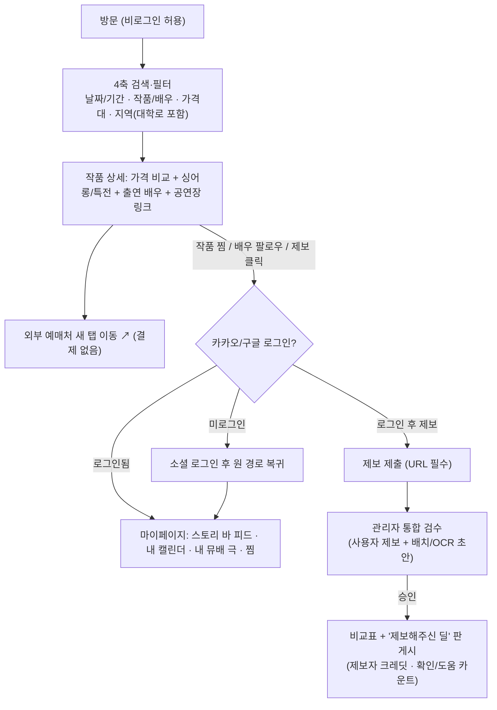

# 서비스 기획서 (Service Planning Document) — MuDeal

> 본 문서는 [PRD.md](../../PRD.md)와 [DESIGN.md](../../DESIGN.md)를 기반으로 확정한 **Phase 0(기획)** 산출물입니다.
> 핵심 기획 방향(**4축 복합 검색**, **회원 전용 제보 + "제보해주신 딜" 기여 판**, **로그인 = 작품 찜 · 뮤배 팔로우 · 스토리 바 자동읽음/저장 · 내장 캘린더**, **티켓오픈 임박 · KOPIS + 1차/2차 검증 채널 + Vision/OCR 초안 검수**, **자체 결제 미제공 · MVP 완전 무료**)이 모두 반영되어 있습니다.

| 항목 | 내용 |
|------|------|
| **문서 ID** | SPD-MUDEAL-v1.0 |
| **프로젝트명** | MuDeal (가칭) |
| **문서 버전** | v1.0 (기획 기준선) |
| **작성일** | 2026-11-25 |
| **작성자** | 기획팀 · Gemini (Antigravity) |
| **승인자** | 프로젝트 오너 (G0 검토 대기) |
| **문서 상태** | 검토 준비 |

---

## 변경 이력

| 버전 | 날짜 | 작성자 | 변경 내용 |
|------|------|--------|-----------|
| v0.1 | 2026-11-24 | Gemini (Antigravity) | 초기 초안 작성 |
| v0.2 | 2026-11-24 | Gemini (Antigravity) | 검증 채널(KOPIS·NOL·엘티켓·YES24·티켓링크+공연장 4곳), 공지 이미지 Vision/OCR, 싱어롱·특전 반영 |
| v1.0 | 2026-11-25 | Gemini (Antigravity) | 검색 4축 필터(날짜·작품/배우·가격대·대학로 분리 지역), 금전 혜택 폐지 → 비회원 제보 + `제보해주신 딜` 기여 판, 로그인 = 작품 찜·뮤배 팔로우·인앱 소식 피드 전환 |
| v1.1 | 2026-11-25 | Gemini (Antigravity) | 기획 최종 확정: 회원 전용 제보(URL 필수), 스토리 바 자동 읽음·다시 보기·저장, 마이페이지 내장 캘린더, `티켓오픈 임박`·동적 OG·공연장명 클릭 연결 반영 |

---

## 1. 서비스 개요

### 1.1 서비스명 및 컨셉

| 항목 | 내용 |
|------|------|
| 서비스명 | MuDeal (가칭) |
| 한 줄 설명 | 전국 뮤지컬의 할인·로터리·싱어롱·커튼콜·특전 이벤트를 날짜·작품/배우·가격대·지역 4축으로 비교하고 외부 예매처로 이동하며, 좋아하는 작품과 뮤지컬 배우의 새 소식을 모아보는 반응형 웹 플랫폼 |
| 서비스 유형 | 반응형 웹 플랫폼 (가격·이벤트 비교 + 팬덤 개인화 + 커뮤니티 제보 큐레이션) |
| 배포 환경 | Cloudflare Workers + Workers Static Assets (`Next.js / vinext` + Tailwind CSS + D1 + R2) |
| 대상 범위 | 전국 뮤지컬 전체 (`서울 · 대학로(혜화)` 별도 분리 + 전국 시/도) |

#### 사용자 문제와 근거

| 문제 ID | 사용자·상황·겪는 문제 | 현재 대안과 한계 | 관찰 근거 | 확인 상태 |
|---------|-----------------------|------------------|-----------|-----------|
| **OBJ-001** | 관객이 **"이번 주말 볼 만한 극 / 5만원 이하 / 대학로 / 특정 작품"** 등 다양한 조건으로 저렴한 뮤지컬을 찾을 때 여러 예매처·할인 사이트를 일일이 방문해야 함 | 각 예매처 순회 검색 / 탐색 시간 과다, 조건별 교차 비교 불가 | 도메인 분석 + 실제 5개 예매처 응답 검증 | 확인 |
| **OBJ-002** | `YES24데이`·`NOL 로터리`뿐 아니라 **싱어롱 데이·커튼콜 데이·포토카드/굿즈 특전** 같은 핵심 이벤트가 예매처 공지 이미지 속에 숨어 있어 놓치기 쉬움 | 커뮤니티·상세 공지 이미지 수동 확인 / 마감 경과 후 인지 | 실제 NOL·YES24·엘티켓 상세 구조 검증 완료 | 확인 |
| **OBJ-003** | 뮤지컬 팬은 좋아하는 **특정 배우(뮤배) 출연작**이나 찜한 작품의 할인·특전·티켓오픈 소식을 계속 추적하고 싶지만 예매처마다 흩어져 있음 | SNS·팬카페 수동 체크 / 할인·특전 누락 | KOPIS `prfcast` 데이터 가용성 확인 | 가정 (팔로우 전환율·재방문율로 검증) |
| **OBJ-004** | 무료 비교 서비스에서 금전 제보 보상은 적자와 어뷰징을 낳고, 반대로 자동 수집만으로는 SNS발 깜짝 특가를 모두 잡기 어려움 | 수동 조사(커버리지 한계) 또는 금전 보상(적자 구조) | 무료 서비스 운영 구조 분석 | 확인 (`제보해주신 딜` 명예·기여 모델로 해결) |

### 1.2 핵심 가치 제안

| 구분 | 내용 |
|------|------|
| **핵심 가치** | ① 원하는 날짜·작품/배우·가격대·지역 조건으로 전국 뮤지컬 최저가·특전을 한눈에 비교해 외부 예매처로 바로 이동 ② 좋아하는 작품과 뮤배의 새 할인·이벤트를 내 피드에서 놓치지 않음 |
| **차별점** | 1) KOPIS(공연·정가·출연진) + 1차 검증 4개 예매처 + 공지 이미지 Vision/OCR 초안 검수 2) **금전 보상 없이도 자발적 참여를 이끄는 `제보해주신 딜` 커뮤니티 기여 판** (회원 전용 URL 제보로 안전성 확보) 3) **뮤배(배우) 팔로우 → `내 뮤배 극` · 스토리 바 피드 · 내장 캘린더** 팬덤 리텐션 기능 |

### 1.3 타겟 사용자 및 비사용자

- **페르소나 1 — 조건 탐색형 관객 (`GUEST`)**: 비로그인으로 "이번 주말 / 대학로 / 5만원 이하" 또는 특정 작품명을 검색해 좌석·예매처별 가격과 특전을 비교하고 외부 예매처로 바로 이동.
- **페르소나 2 — 본진 배우 중심 팬덤 관객 (`USER`, 소셜 로그인)**: 좋아하는 뮤지컬 배우 3~5명을 팔로우하고 보고 싶은 작품을 찜해 둔 뒤, 마이페이지 스토리 바에서 미확인 소식을 확인·저장하고 내장 캘린더로 관극·티켓팅 일정을 관리.
- **페르소나 3 — 선의의 정보 공유자 (`USER`)**: 사이트에 없는 깜짝 할인·특전을 로그인 후 간편하게 제보하고, **`제보해주신 딜`** 판에서 `○○님 제보 · N명 확인 · 도움이 됐어요`가 올라가는 것을 보며 기여감을 느낌.
- **페르소나 4 — 경량 운영 관리자 (`ADMIN`)**: `사용자 제보`와 `배치·OCR 초안`을 빠르게 대조·승인해 정보 신뢰도를 유지하고, 공연·배우 매핑·큐레이션·오류 신고를 관리.
- **비사용자 (Anti-Persona)**: MuDeal 내에서 직접 좌석 지정·결제·발권하려는 사용자(`EX-001` 영구 제외), 개인 간 암표/양도 거래자(`EX-006`).

---

## 2. 핵심 메커니즘 (Core Loops)

1. **4축 탐색·비교·이동 루프 (Acquisition / Utility — 비로그인 허용)**:
   - 날짜/기간 · 작품/배우명 · 가격대 · 지역(`대학로` 분리) 4축 필터로 작품 탐색 → 좌석/예매처 가격 비교 및 싱어롱·특전 확인 → `예매처 이동 ↗` 새 탭 이동.
2. **개인화 재방문 루프 (Retention — 소셜 로그인)**:
   - 관심 뮤지컬 `찜` + 좋아하는 뮤지컬 배우 `팔로우` → 마이페이지 **스토리 바 미확인 피드(자동 읽음·최근 소식 다시 보기·저장하기)** + **내장 캘린더(티켓오픈 자동 표시·직접 일정 추가)** → `내 뮤배 극` 재방문.
3. **커뮤니티 제보·검수·기여 루프 (Supply — 회원 전용 제보, 금전 비용 0원)**:
   - 로그인 회원이 누락 할인·이벤트 제보(`https://` URL 필수) → 관리자 통합 검수 승인 → 일반 비교표 + 홈 **`제보해주신 딜`** 전용 판에 동시 노출 → 다른 관객들의 이동(`N명 확인`)과 `도움이 됐어요` 반응 누적 → 기여감으로 재제보 유도.

---

## 3. 콘텐츠·브랜드·수익화 전략

### 3.1 하이브리드 데이터 확보 전략
- **기준 DB (자동 Upsert)**: **KOPIS 오픈 API** (`pblprfr`) — 전국 공연 메타, 좌석 공식 정가(`pcseguidance`), **출연진(`prfcast` → 배우 목록 및 작품-배우 매핑 자동 추출)**.
- **1차 검증 저빈도 수집 (HTTP 200 OK 검증 완료)**: **NOL티켓**(`__next_f` SSR JSON·오픈예정·이미지), **엘티켓**(좌석별 최대할인가·할인율·이미지), **YES24티켓**(장르목록·티켓오픈 공지·상세 최저~최고가·이미지), **티켓링크**(`mapi` 랭킹·공지 본문 JSON).
- **2차 보조 수집**: 샤롯데씨어터, 예술의전당, 세종문화회관, 클립서비스 (공연장 공식 SSR).
- **공지 이미지 Vision/OCR**: NOL·YES24·엘티켓 신규 공지 이미지에서 싱어롱 회차, 커튼콜 날짜, 특전 조건, 상세 할인표 구조화 추출(원본 이미지 미재배포).
- **안전 운영 원칙**: KOPIS 외 수집·OCR 데이터는 모두 **`DRAFT` 초안**으로 적재해 관리자 승인 후 원문 링크와 함께 게시.
- **3차 조건부 확장**: 타임티켓·LG아트센터·충무아트센터(CSR/SPA)는 초기엔 제보·수동 등록으로 커버하고 후속 확장 검토.

### 3.2 브랜드/디자인 ([DESIGN.md](../../DESIGN.md)) & 수익화
- **브랜드 무드**: 5-Tier 와인/버건디(`#6E182B`, `#8A1E37`, `#2B0D16`, `#4A1525`, `#F9ECEF`) + 희소성 전용 `Champagne Gold(#B89352)` + 웜 포슬린 뉴트럴 + `Pretendard Variable` (`tabular-nums`).
- **수익화**: **MVP 완전 무료·무광고** (`EX-007`), **제보자 금전 보상 없음** (`EX-002`)으로 서버리스(Cloudflare 무료/저비용 티어) 운영비를 극소화. 트래픽 검증 후 v2에서 외부 제휴 링크(Affiliate) 또는 스폰서드 배너만 선택 검토(`DEC-004`).

---

## 4. MVP 스코프 정의

### 4.1 포함 항목 (In-Scope — MVP v1.0)

| ID | 기능/항목 | 설명 | 우선순위 | 관련 문제 ID |
|----|-----------|------|----------|-------------|
| **MVP-001** | 전국 공연·출연진 연동 + 1차/2차 배치 + Vision/OCR 초안 파이프라인 | KOPIS API(공연·정가·출연진 `prfcast`) 자동 Upsert + 검증 4개 예매처·4개 공연장 저빈도 수집 + 신규 공지 이미지 Vision/OCR → `DRAFT` 초안 생성 | P1 | OBJ-001~003 |
| **MVP-002** | 홈 추천 · **`티켓오픈 임박`** · **`제보해주신 딜`** 섹션 | 마감임박 레일, **`티켓오픈 임박` 카운트다운**, 로터리/스페셜 데이 다크 밴드, **`제보해주신 딜` 판**(제보자 닉네임·확인 수·도움이 됐어요), 할인·이벤트 유형 필터 | P1 | OBJ-001, OBJ-002, OBJ-004 |
| **MVP-003** | **4축 복합 필터 검색(URL 공유·동적 OG·조건부 세부 칩)** & 작품 상세 | ① 날짜/기간 ② 작품·공연장·배우명 ③ 가격대 ④ 지역(`서울-대학로` 분리+전국) + 조건부 세부 칩 + URL 공유/프리셋 + **동적 OG 미리보기** + **공연장명 클릭 작품 모아보기** (검색은 진행 중 딜 중심, 마이페이지는 정가 기본정보 상시 노출) | P1 | OBJ-001~003 |
| **MVP-004** | 외부 예매처 아웃바운드 이동 & 기여 집계 | 새 탭 이동, 클릭 로그(10초 중복 제거), 제보 딜 확인 수 연동, 외부 기준 면책 고지 | P1 | OBJ-001, OBJ-004 |
| **MVP-005** | 로그인 회원 전용 할인/이벤트 제보 & `도움이 됐어요` | 악성 링크·스팸 방지를 위해 로그인 회원(`USER`) 전용 제보(URL `https://` 필수, KST 일 10건, 증빙 이미지 5MB) + 관리자 닉네임 마스킹 권한 | P1 | OBJ-004 |
| **MVP-006** | 소셜 로그인 & **개인화(스토리 바 자동읽음/저장 · 내 캘린더 · 찜 · 뮤배 팔로우)** | 작품 찜, 배우 팔로우(`내 뮤배 극` — 모노그램/최근 포스터 아바타, 할인 없어도 기본정보 표시), **스토리 바 썸네일 선택 시 미확인 피드 자동 읽음 + 프로필 `최근 소식 다시 보기(30일)` + 카드 `🔖 저장하기`**, **마이페이지 내장 캘린더(티켓오픈 포함 자동 표시 + 담기 + 직접 입력)**, 검색 프리셋, 내 제보 기여 | P1 | OBJ-003 |
| **MVP-007** | 경량 관리자 콘솔 (통합 검수 · 운영 CRUD) | `사용자 제보` + `자동 수집/OCR 초안` 통합 검수(승인·게시 / 반려·폐기), 공연·배우 매핑·딜 수동 CRUD 및 `admin_locked` 제어 | P1 | OBJ-002, OBJ-004 |
| **MVP-008** | 품절/가격 오류 신고 및 관리자 처리 | 로그인 사용자 오류 신고 → 관리자 확인 후 수정/마감 | P2 | OBJ-004 |
| **MVP-009** | 홈 배너·스포트라이트 큐레이션 관리 | 히어로 배너·다크 스포트라이트 밴드 노출 관리 | P2 | OBJ-002 |

### 4.2 제외 항목 (Out-of-Scope)

| ID | 제외 항목 | 제외 근거 | MVP 대안 | v2 진입 조건 |
|----|-----------|-----------|----------|-------------|
| **EX-001** | **자체 결제·예매·발권·환불** | 비교·연결 본질과 무관, PG/정산/법적 리스크 과다 | 외부 예매처 새 탭 아웃바운드 이동 | **영구 제외** |
| **EX-002** | **제보자 금전 보상·포인트·기프티콘 지급** | 무료 서비스 적자 구조 및 허위/중복 어뷰징 유발 | **`제보해주신 딜` 판** + 제보자 크레딧·확인/도움 카운트 | 장기 제외 (수익화 안정 후 별도 검토) |
| **EX-003** | **초단위 실시간 잔여좌석 동기화** | 외부 좌석 API 미공개·차단 리스크 | 저빈도 배치 + 최종 확인 시각 + 오류 신고 | 공식 제휴 API 확보 시 |
| **EX-004** | **이메일/비밀번호 자체 회원가입** | 비밀번호 관리·메일 인증 비용 대비 효용 낮음 | 카카오/구글 소셜 로그인 | 소셜 미사용 요청 누적 시 |
| **EX-005** | **이메일·웹푸시·알림톡 외부 알림 발송** | MVP 검증 단계에서 발송 인프라·수신동의·야간 규제 복잡도 절감 | 마이페이지 **새 소식 피드 + 인앱 알림 배지** | 로그인 사용자의 찜/뮤배 팔로우 리텐션 검증 후 |
| **EX-006** | **자유 커뮤니티·관람 후기·양도 거래** | 암표·사기 분쟁 및 스팸 관리 부담 | 작품/할인 비교·제보·개인화 집중 | 핵심 비교 리텐션 확보 후 |
| **EX-007** | **광고 배너·유료 구독** | MVP 완전 무료 검증 원칙 | 수익화 미적용 | PMF 검증 후 제휴/배너 검토 |
| **EX-008** | **네이티브 모바일 앱** | 검색 유입·외부 브라우저 이동에 반응형 웹이 압도적 유리 | 반응형 웹 (`DESIGN.md` 모바일 하단 탭바) | 외부 푸시 수요 입증 시 |

---

## 5. KPI 가설 검증 프레임워크

| ID | 가설 | 핵심 지표 | 목표값 |
|---|---|---|---|
| **H-001** | 4축 복합 필터(날짜·작품/배우·가격대·대학로 포함 지역)와 비교표를 제공하면 탐색 사용자가 외부 예매처로 활발히 이동할 것이다 | 아웃바운드 CTR, 필터 조합 사용률 | `미결 (출시 전 확정)` |
| **H-002** | 금전 보상 없이도 회원 간편 제보와 `제보해주신 딜` 기여 노출(확인/도움 수)만으로 유효 제보가 꾸준히 유입될 것이다 | 주간 유효 제보 수, 승인률, 제보 딜 CTR | `미결` |
| **H-003** | 작품 찜과 뮤배(배우) 팔로우(`내 뮤배 극`·소식 피드)가 로그인 전환과 7일/30일 재방문을 견인할 것이다 | 로그인 전환율, 인당 팔로우 배우 수, D7/D30 재방문율 | `미결` |

---

## 6. 미결 결정 및 후속 관리

| ID | 확인할 내용 | 영향 범위 | 상태 |
|---|---|---|---|
| **DEC-002-TUNE** | 1차 검증 4개 예매처 저빈도 배치 주기 및 Vision/OCR 일일 호출 상한 설정 | `MVP-001`, `BP-SYNC` | 구현 전 튜닝 |
| **DEC-KPI** | MVP 성공 판정용 정량 KPI 목표 수치 확정 | 5장 KPI | 출시 전 확정 |
| **DEC-REV-V2** | v2 수익화 모델 선정 (제휴 링크 vs 스폰서드 배너) | v2 로드맵 (MVP 외) | v1.1 이후 검토 |

---

## 7. 관련 문서
- [PRD.md](../../PRD.md) · [DESIGN.md](../../DESIGN.md) · [비즈니스정책서.md](비즈니스정책서.md)
- [요구사항명세서-SRS.md](../01-요구사항분석/요구사항명세서-SRS.md) · [유스케이스명세서.md](../01-요구사항분석/유스케이스명세서.md) · [요구사항추적매트릭스-RTM.md](../01-요구사항분석/요구사항추적매트릭스-RTM.md)
