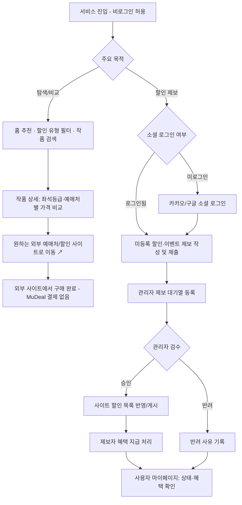
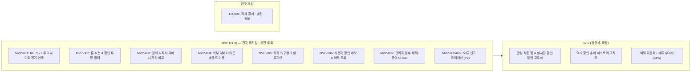
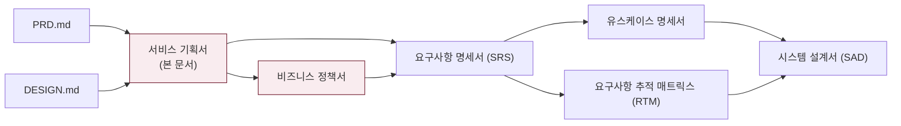

# 서비스 기획서 (Service Planning Document) — MuDeal

> 본 문서는 [PRD.md](../../PRD.md)와 [DESIGN.md](../../DESIGN.md)를 기반으로 작성한 **Phase 0(기획)** 공식 산출물입니다.
> 프로젝트에서 확정된 결정은 본문에 반영했으며, 아직 확정되지 않은 항목(제보자 혜택 형태·중복 제보 세부 규칙, 연동 대상 사이트 우선순위, 정량 KPI 목표치 등)은 임의로 가정하지 않고 `미결`로 표시하여 [7.3 가정·의존성·미결 결정](#73-가정의존성미결-결정)에서 추적합니다.

| 항목 | 내용 |
|------|------|
| **문서 ID** | SPD-MUDEAL-v0.1 |
| **프로젝트명** | MuDeal (가칭) |
| **문서 버전** | v0.1 |
| **작성일** | 2026-11-24 |
| **작성자** | 기획팀 / Gemini (Antigravity) |
| **승인자** | 프로젝트 오너 (미결 — G0 승인 대기) |
| **문서 상태** | 초안 |

---

## 변경 이력

| 버전 | 날짜 | 작성자 | 변경 내용 |
|------|------|--------|-----------|
| v0.1 | 2026-11-24 | Gemini (Antigravity) | PRD·DESIGN 기반 초안 작성 (전국 뮤지컬 대상, KOPIS+주요 사이트 정기 연동, 소셜 로그인 우선, MVP 완전 무료 반영) |
| v0.2 | 2026-11-24 | Gemini (Antigravity) | 실제 응답 검증 채널(KOPIS·NOL·엘티켓·YES24·티켓링크 + 4개 공연장), 공지 이미지 Vision/OCR 파이프라인, 싱어롱·커튼콜·특전 이벤트 범위 및 초안 검수 원칙 반영 |

---

## 목차

1. [서비스 개요](#1-서비스-개요)
2. [핵심 메커니즘](#2-핵심-메커니즘)
3. [콘텐츠/기능 전략](#3-콘텐츠기능-전략)
4. [수익화 전략](#4-수익화-전략)
5. [MVP 스코프 정의](#5-mvp-스코프-정의)
6. [KPI 가설 검증 프레임워크](#6-kpi-가설-검증-프레임워크)
7. [다음 단계](#7-다음-단계)
8. [관련 문서](#8-관련-문서)

---

## 1. 서비스 개요

### 1.1 서비스명 및 컨셉

| 항목 | 내용 |
|------|------|
| 서비스명 | MuDeal (가칭) |
| 한 줄 설명 | 전국 뮤지컬의 흩어져 있는 할인·로터리·싱어롱·커튼콜 데이·특전(굿즈) 이벤트를 한곳에 모아 비교하고, 원하는 예매처로 바로 이동해 구매하도록 돕는 뮤지컬 할인·이벤트 비교 플랫폼 |
| 서비스 유형 | 반응형 웹 플랫폼 (가격·이벤트 비교 어그리게이터, 아웃바운드 연결형) |
| 대상 플랫폼 | Web (PC `1100px` 셸 + 모바일 웹 반응형, [DESIGN.md](../../DESIGN.md) 기준) |
| 대상 범위 | 전국 뮤지컬 전체 (대극장·중소극장·대학로·지역 공연 포함) |

**서비스 컨셉 설명:**

한국 뮤지컬 시장은 정찰제를 기본으로 하지만, 실제로는 `NOL티켓(지금 할인중·로터리)`, `YES24티켓(YES24데이·엔젤티켓·싱어롱)`, `엘티켓(좌석별 최대할인가)`, `티켓링크(티켓오픈 공지·단독/할인)`, 그리고 공연장 공식 사이트(샤롯데·예술의전당·세종문화회관 등)에서 비정기 할인과 **싱어롱 데이·커튼콜 데이·포토카드/특전 증정 이벤트**가 분산 발생합니다. 특히 핵심 이벤트와 상세 할인표의 상당수가 텍스트가 아닌 **공지 이미지** 안에 담겨 있어 관객이 매번 여러 사이트를 뒤져야 하는 불편이 큽니다. MuDeal은 **KOPIS 오픈 API** 기준 DB 위에 1차 검증 예매처 4곳의 **저빈도 배치 수집 + 신규 공지 이미지 Vision/OCR 자동 해석 → 관리자 검수 초안 생성** 파이프라인과 **사용자 제보 → 관리자 검수·승인 → 제보자 혜택 지급** 구조를 결합해, 전국 뮤지컬의 할인과 이벤트를 한눈에 비교하고 원하는 예매처로 바로 이동하게 합니다. 단, **자체 결제는 제공하지 않으며** 비교와 아웃바운드 연결에만 집중합니다.

**배경 및 동기:**

- 정찰제 인식 때문에 할인 기회를 놓치거나, 반대로 할인 정보를 찾기 위해 다수의 플랫폼을 반복 탐색하는 시간 비용이 크다.
- 동일 작품이라도 `무조건 할인`과 `추첨(로터리)·카드·재관람 조건부 할인`이 혼재되어 있어 실질 최저가 판단이 어렵다.
- 비정기 특가와 소규모 할인 이벤트는 자동 연동만으로 100% 포착하기 어려워, 관객의 제보와 관리자의 검수 체계를 결합할 때 정보 커버리지와 신뢰도를 동시에 확보할 수 있다.

#### 사용자 문제와 근거

| 문제 ID | 사용자·상황·겪는 문제 | 현재 대안과 한계 | 관찰 근거 | 확인 상태·다음 검증 |
|---------|-----------------------|------------------|-----------|---------------------|
| OBJ-001 | 일반 관객이 뮤지컬 예매 전 최저가를 찾을 때 예매처·할인 사이트(Yes24, NOL, 타임티켓, 유니켓, L티켓 등)를 일일이 방문해 좌석별 가격을 비교해야 함 | 포털 검색, 각 예매처 앱 순회 방문 / 탐색 시간 과다 및 누락 발생 | 도메인 기획 관찰 (정량 표본 미수집) | 가정 (MVP 검색→비교 전환율 및 아웃바운드 CTR로 검증) |
| OBJ-002 | 관객이 `YES24데이`·`NOL 로터리` 같은 단기 특가뿐만 아니라 **싱어롱 데이·커튼콜 데이·포토카드/굿즈 특전 증정**처럼 공지 이미지 속에 숨은 이벤트를 놓치거나 무조건/조건부 할인을 구분하기 어려움 | 커뮤니티·예매처 상세 이미지 수동 확인 / 마감 경과 후 인지, 조건 오인 | 도메인 기획 관찰 + 실제 예매처 5곳 응답 검증 완료 | 확인·가정 (할인/이벤트 필터 사용률 및 OCR 초안 승인률로 검증) |
| OBJ-003 | 운영자·자동 연동만으로는 모든 비정기/지역 뮤지컬 특가를 즉시 파악하기 어려워 누락·품절 정보가 발생함 | 운영자 수동 조사 / 커버리지 한계, 정보 노후화 | 서비스 운영 구조 분석 | 확인 (사용자 제보 + 관리자 검수 워크플로로 보완 설계) |

### 1.2 핵심 가치 제안 (Value Proposition)

| 항목 | 내용 |
|------|------|
| 핵심 가치 | 여러 사이트를 헤매지 않고, 원하는 뮤지컬의 **실질 최저가와 할인 조건을 한 화면에서 비교해 바로 구매 사이트로 이동**한다 |
| 차별점 | 1) 전국 뮤지컬 특화 좌석등급·조건부 구분 비교 2) 자동 연동(KOPIS + 주요 사이트)과 **사용자 제보·관리자 검수**의 하이브리드 정보 확보 |
| 대안 대비 우위 | 단일 할인 판매처(타임티켓·유니켓 등)는 자사 판매분만 노출하지만, MuDeal은 여러 예매처·할인 사이트의 링크와 이벤트를 중립적으로 한데 모아 비교한다 |

**가치 제안 캔버스:**

| 구분 | 내용 |
|------|------|
| 사용자의 할 일 (Jobs) | 보고 싶은 뮤지컬을 가장 합리적인 가격/조건으로 찾고, 놓치기 쉬운 특가·로터리 기회를 제때 확인해 예매한다 |
| 사용자의 고통 (Pains) | 여러 예매처 반복 검색, 정가 대비 실질 할인율 계산 번거로움, 조건부/추첨 할인 혼동, 이미 마감된 할인 정보 |
| 사용자의 이득 (Gains) | 탐색 시간 단축, 티켓 비용 절감, 미등록 할인 제보 시 혜택 수령 |
| 고통 해결제 (Pain Relievers) | 좌석등급별 통합 가격 비교표, 무조건/조건부 배지 분리, 마감/품절 신고 및 자동 마감 전환 |
| 이득 생성제 (Gain Creators) | 홈 추천(마감임박·로터리 스포트라이트·할인율 상위), 제보 승인 리워드(형태 `DEC-001` 미결) |

### 1.3 타겟 사용자 정의

#### 1.3.1 주요 사용자 페르소나

**페르소나 1: 알뜰 뮤지컬 관객 (User — 탐색·비교형)**

| 항목 | 내용 |
|------|------|
| 역할 | 일반 사용자 (`USER`, 비로그인 탐색 가능) |
| 연령/특성 | 20~40대, 연 2~10회 이상 뮤지컬을 관람하는 전국 관객 |
| 기술 수준 | 중급 (모바일·PC 웹 예매처 이용에 익숙) |
| 핵심 목표 | 보고 싶은 작품의 좌석별 최저가와 현재 진행 중인 이벤트를 빠르게 확인하고 해당 사이트에서 바로 예매 |
| 핵심 불편 | 정가 외 할인 사이트나 로터리·데이 이벤트를 일일이 찾아보기 번거롭고 조건을 비교하기 어려움 |
| 사용 시나리오 | 주말 관람할 작품을 검색해 `R석` 기준 예매처별 가격과 수수료·조건을 비교한 뒤 최저가 사이트로 이동 |
| 성공 기준 | 1분 이내에 정가보다 저렴한 유효 링크를 찾아 외부 예매처로 이동했을 때 |

**페르소나 2: 뮤지컬 할인 제보자 (User — 참여·제보형)**

| 항목 | 내용 |
|------|------|
| 역할 | 로그인 일반 사용자 (`USER`, 소셜 로그인 필수) |
| 연령/특성 | 뮤지컬 커뮤니티 활동이 잦고 할인/이벤트 소식을 빠르게 접하는 고관여 관객 |
| 기술 수준 | 중상급 |
| 핵심 목표 | MuDeal에 아직 올라오지 않은 할인/이벤트를 제보해 공유하고, 승인 시 제공되는 혜택을 받음 |
| 핵심 불편 | 좋은 특가 정보를 알고 있어도 제보 절차가 복잡하거나 승인/혜택 진행 상황이 불투명하면 참여 동기가 떨어짐 |
| 사용 시나리오 | 소셜 로그인 후 미등록 할인 링크와 가격 정보를 제출하고, 마이페이지에서 검수 상태(`검수중`→`승인됨`)와 혜택을 확인 |
| 성공 기준 | 1분 내에 간편하게 제보를 마치고, 빠른 검수 후 사이트 반영과 혜택 지급 내역을 명확히 확인했을 때 |

**페르소나 3: 할인 큐레이터 / 운영 관리자 (Admin)**

| 항목 | 내용 |
|------|------|
| 역할 | 관리자 (`ADMIN`) |
| 핵심 목표 | 외부 연동 데이터 품질을 유지하고, 사용자 제보를 신속히 검수(승인/반려)해 신뢰도 높은 할인 목록을 운영 |
| 핵심 불편 | 중복 제보·허위 링크·종료된 이벤트를 수동 대조하고 혜택 지급 이력을 누락 없이 관리해야 함 |
| 사용 시나리오 | 어드민 검수 대기열에서 제보 링크와 기존 딜을 대조한 뒤 승인(사이트 게시 + 혜택 지급 처리) 또는 반려(사유 기록) 수행 |
| 성공 기준 | 제보 검수와 게시, 혜택 상태 기록을 한 화면에서 일관되게 처리할 수 있을 때 |

#### 1.3.2 사용자 세그먼트

| 세그먼트 | 설명 | 규모 추정 | 우선순위 | MVP 포함 |
|----------|------|-----------|----------|----------|
| 일반 탐색 관객 (비로그인 포함) | 홈 추천·검색·가격 비교 후 외부 예매처로 이동 | 미결 (출시 후 측정) | P1 | Y |
| 할인 제보 참여자 (로그인) | 미등록 할인·이벤트 제보 및 혜택 수령 | 미결 (출시 후 측정) | P1 | Y |
| 운영 관리자 (`ADMIN`) | 제보 검수, 혜택 지급, 공연/할인 CRUD 및 큐레이션 | 내부 운영진 (소수) | P1 | Y |

#### 1.3.3 비사용자 (Anti-Persona)

| 비사용자 | 이유 | 대안 |
|----------|------|------|
| MuDeal 안에서 직접 좌석 선택·결제·발권까지 끝내려는 사용자 | 본 서비스는 **자체 결제를 제공하지 않는(EX-001)** 비교·연결 플랫폼임 | 각 공식 예매처 및 할인 티켓 사이트 직접 이용 |
| 개인 간 티켓 양도·중고 거래를 원하는 사용자 | 암표·사기 분쟁 위험 및 서비스 핵심 목적과 무관 (EX-004) | 공식 예매처 취소표 / 외부 양도 커뮤니티 |
| 뮤지컬 외 콘서트·스포츠·영화 할인 탐색 사용자 | MVP는 전국 **뮤지컬** 도메인에 집중 (정찰제+특수 할인 구조 특화) | 종합 티켓·커머스 플랫폼 |

---

## 2. 핵심 메커니즘

### 2.1 서비스 작동 원리

**핵심 루프 1 — 탐색·비교·이동 루프 (Consumer Loop):**
1. **진입·탐색**: 사용자가 비로그인 상태로 홈 추천(마감임박·로터리·할인율 상위)을 보거나 원하는 뮤지컬을 검색한다.
2. **비교**: 시스템은 KOPIS 기준 정가와 연동·제보된 예매처별 할인 정보를 좌석등급·조건부 여부와 함께 비교표로 제시한다.
3. **이동**: 사용자가 원하는 가격/혜택의 `예매처 이동 ↗`을 클릭하면 외부 구매 사이트로 새 탭 이동하고, 시스템은 아웃바운드 클릭 이벤트를 기록한다.
4. **재방문**: 다음 관람 예정 작품이 생겼을 때 최저가 확인을 위해 재방문한다.

**핵심 루프 2 — 제보·검수·혜택 루프 (Supply & Curation Loop):**
1. **제보**: 로그인 사용자가 사이트에 없는 할인·이벤트 정보(작품, 사이트명, URL, 가격/할인율 등)를 제출한다.
2. **검수**: 관리자가 제보 대기열에서 실제 링크·가격·유효기간·중복 여부를 확인하고 **승인(게시)** 또는 **반려(사유 기록)**를 결정한다.
3. **반영 및 보상**: 승인된 제보는 즉시(또는 보정 후) 서비스 할인 목록에 게시되며, 제보자에게 혜택이 부여된다(구체적 혜택 형태·중복 규칙은 `DEC-001` 미결).
4. **신뢰 선순환**: 더 풍부한 할인 정보가 쌓여 탐색 사용자의 만족도와 재방문이 증가하고, 새로운 제보로 이어진다.

### 2.2 전체 서비스 플로우

### 2.3 핵심 사용자 여정 (Key User Journey)

#### 여정 1: 첫 방문 관객의 할인 검색 → 가격 비교 → 외부 이동

| 단계 | 사용자 행동 | 시스템 반응 | 감정 목표 | 핵심 지표 |
|------|------------|------------|-----------|-----------|
| 1. 진입 | 홈 접속 (비로그인) | 마감임박 레일, 로터리 스포트라이트, 추천 5:7 포스터 그리드 표시 | 기대감·고급스러움 | 방문자 수, 이탈률 |
| 2. 탐색/검색 | 작품명 검색 또는 할인 유형 칩 클릭 | 최저가·최대 할인율·비교 예매처 수가 요약된 검색 결과 표시 | 명료함 | 검색 실행률 |
| 3. 비교 | 작품 상세 진입, 좌석등급 탭(`R석` 등) 전환 | 정가 취소선, 예매처별 할인가·수수료·`무조건`/`조건부` 배지 비교표 제시 (`최저가` 골드 강조) | 신뢰·확신 | 검색→상세 전환율 |
| 4. 이동 | 원하는 행의 `예매처 이동 ↗` 클릭 | 새 탭으로 외부 사이트 연결 + 아웃바운드 클릭 로그 기록 + 외부 가격 변동 고지 | 만족 | 아웃바운드 CTR |

#### 여정 2: 로그인 사용자의 누락 할인 제보 → 검수 → 혜택 확인

| 단계 | 사용자 행동 | 시스템 반응 | 감정 목표 | 핵심 지표 |
|------|------------|------------|-----------|-----------|
| 1. 인지 | 특정 작품 비교표에 자신이 아는 할인이 없음을 발견 | "없는 할인 제보하기" CTA 노출 | 참여 동기 | 제보 진입률 |
| 2. 로그인 | 소셜 로그인(카카오/구글) 선택 | 간편 인증 후 제보 폼으로 자동 복귀 | 매끄러움 | 로그인 전환율 |
| 3. 제출 | 작품명·예매처·URL·가격/할인율 입력 후 제출 | URL 형식 검증 후 `검수대기` 저장 및 접수 안내 표시 | 간편함 | 제보 제출 완료율 |
| 4. 결과 확인 | 마이페이지에서 내 제보 현황 조회 | `승인됨`(게시 링크 + 혜택 내역) 또는 `반려됨`(사유) 표시 | 공정함·보람 | 제보 승인률, 재제보율 |

#### 여정 3: 관리자의 제보 검수 및 사이트 반영

| 단계 | 관리자 행동 | 시스템 반응 | 운영 목표 | 핵심 지표 |
|------|------------|------------|-----------|-----------|
| 1. 확인 | 어드민 제보 대기열(`검수대기`) 진입 | 제출 시각순 목록과 원본 링크 바로가기, 동일 작품 기존 등록 딜 대조 표시 | 빠른 파악 | 검수 대기 건수 |
| 2. 판단 | 외부 링크 접속해 가격·조건·기간 확인 후 승인/반려 선택 | 승인 시 정식 `Deal` 게시 폼 연동 및 혜택 지급 기록; 반려 시 사유 저장 | 정확성 | 제보 검수 리드타임 |

---

## 3. 콘텐츠/기능 전략

### 3.1 핵심 기능 방향

| 기능 영역 | 전략 방향 | 우선순위 | MVP 포함 | 비고 |
|-----------|-----------|----------|----------|------|
| 데이터 연동 파이프라인 | KOPIS API(전국 공연 메타·좌석 정가) + 주요 할인/예매처 정기 배치 연동으로 초기 데이터 자동 확보 | P1 | Y | 세부 연동 대상·주기 `DEC-002` |
| 홈 큐레이션 & 탐색 | TimeTicket형 고밀도 5:7 포스터 리듬 + 와인/버건디 다크 스포트라이트 밴드(Yes24데이·NOL 로터리 강조) | P1 | Y | `DESIGN.md` 준수 |
| 검색 & 다중 채널 가격 비교 | 좌석등급 탭 + 무조건/조건부 분리 + 최저가 1위 강조 + 아웃바운드 이동 | P1 | Y | 서비스 핵심 가치 |
| 사용자 제보 & 관리자 검수 | 소셜 로그인 기반 간편 제보 → 관리자 승인/반려 → 혜택 지급 이력 관리 | P1 | Y | 혜택 형태/중복 규칙 `DEC-001` |
| 품절/가격 오류 신고 | 변동이 빠른 티켓 특성상 사용자 신고로 노후 딜을 신속 마감 처리 | P2 | Y | 정보 신선도 보완 |
| 관심 작품 찜 & 할인 알림 | 찜 목록 및 신규 특가 알림으로 재방문(Retention) 유도 | P2 | 보류/선택 | P1 완료 후 일정 허용 시 포함 |

**기능 방향 의사결정 기록:**

| 항목 | A안 | B안 | 선택 | 근거 |
|------|-----|-----|------|------|
| 초기 데이터 확보 | 100% 수동 등록 + 제보 | KOPIS API + 주요 사이트 정기 배치 연동 + 제보 | **B안** | 전국 뮤지컬 대상 탐색 가치를 출시 첫날부터 제공 (사용자 확정) |
| 탐색 접근성 | 전체 로그인 필수 | 탐색·비교·이동 비로그인 허용, 제보·혜택만 로그인 | **B안** | 비교 서비스의 초기 이탈 최소화 (사용자 확정) |
| 로그인 수단 | 이메일+비밀번호 + 소셜 | 소셜 로그인(카카오/구글) 우선 | **B안** | 비밀번호 관리·인증 메일 복잡도 제거, MVP 단순화 (사용자 확정) |
| 결제 제공 여부 | 자체 결제/중개 | 자체 결제 미제공, 외부 예매처 이동 | **B안** | 비교·연결 본질 집중 및 결제/환불/발권 리스크 원천 차단 (사용자 확정) |

### 3.2 보상/혜택 체계 (제보자 리워드)

> **현재 상태: `미결 (DEC-001)`** — "승인된 제보자에게 혜택을 제공한다"는 방향과 관리자 지급 관리 흐름은 확정되었으나, **혜택의 구체적 형태(포인트·기프티콘·등급/배지 등)와 중복 제보 지급 규칙**은 아직 미정입니다.

| 요소 | MVP 기준 방향 | 확정 상태 |
|------|--------------|-----------|
| 지급 트리거 | 관리자가 사용자 제보를 `승인`하여 사이트에 반영했을 때 | 확정 |
| 혜택 유형 및 단가 | 포인트 적립 / 건당 기프티콘 / 등급·배지 등 후보 검토 중 | **미결 (`DEC-001`)** |
| 중복 제보 지급 규칙 | 최초 유효 제보자 1명 지급 등 세부 기준 확정 필요 | **미결 (`DEC-001`)** |
| 시스템 설계 방향 | 혜택 확정 전에도 확장 가능하도록 `Reward` 이력 엔티티(상태: `대기`/`지급완료`, 유형/메모)와 마이페이지·어드민 지급 기록 UI를 단순하게 준비 | 확정 |

### 3.3 콘텐츠 전략

| 항목 | 내용 |
|------|------|
| 콘텐츠 유형 | 전국 뮤지컬 기본 정보(포스터·공연장·기간·정가) + 예매처별 할인/이벤트 링크·조건 데이터 |
| 콘텐츠 생산 방식 | 혼합: ① KOPIS API 및 주요 할인/예매처 정기 배치 연동 ② 관리자 수동 큐레이션 ③ 사용자 제보(관리자 검수 후 게시) |
| 콘텐츠 큐레이션 | 자동 정렬(마감임박순·할인율순·최저가순) + 관리자 홈 스포트라이트/배너 큐레이션 |
| 콘텐츠 갱신 주기 | 정기 배치 연동(세부 주기 `DEC-002` 확정 필요) + 사용자 제보 수시 검수 + 마감 시각 도달 시 자동 마감 처리 |
| 품질 관리 | 관리자 검수 게이트(승인/반려) + 사용자 품절/가격 오류 신고 + KOPIS 기준 정가 대조 |

### 3.4 브랜드/톤앤매너 ([DESIGN.md](../../DESIGN.md) 연계)

| 항목 | 내용 |
|------|------|
| 브랜드 톤 | 극장 벨벳 커튼의 품격과 타임커머스의 명료한 정보 밀도 (에디토리얼 티켓팅) |
| 커뮤니케이션 스타일 | 친절하고 명확한 존댓말, 과장 없는 투명한 가격·조건 안내 |
| 시각적 아이덴티티 | 5-Tier 와인/버건디(`Velvet Burgundy #6E182B`, `Wine Accent #8A1E37`, `Curtain Noir #2B0D16`, `Mulberry #4A1525`, `Rosé Mist #F9ECEF`) + 희소성 전용 `Champagne Gold #B89352` + 웜 포슬린 뉴트럴(`#FFFFFF`/`#FCF8F7`/`#F6EFEF`) + `Pretendard Variable` (`tabular-nums`) |
| 캐릭터/마스코트 | 없음 |

---

## 4. 수익화 전략

### 4.1 수익 모델 선택

| 항목 | 내용 |
|------|------|
| 주요 수익 모델 (MVP) | **없음 (완전 무료, 무광고)** — 사용자 확보와 핵심 비교·제보 가치 검증 우선 |
| 무료/유료 경계 | MVP 전체 기능 무료 (비로그인 탐색·비교·이동 무료 / 로그인 제보 무료). 자체 결제 없음 |
| 향후 수익 모델 후보 (v2+) | 외부 예매처/할인 플랫폼 제휴 링크(Affiliate/CPA), 공연사·티켓사 스폰서드 배너 노출 (`미결 — DEC-004`) |

### 4.2 단계별 수익화 계획

| 단계 | 시점 / 조건 | 수익화 방식 | 목표 |
|------|------------|------------|------|
| Phase 0: MVP 검증 | 출시 ~ PMF 검증 구간 (정량 조건 `DEC-003` 미결) | 완전 무료 (수익화·광고 미적용) | 전국 뮤지컬 비교 유용성(CTR) 및 제보 선순환 검증 |
| Phase 1: 초기 수익화 | 월간 아웃바운드 클릭 규모 확보 후 (`DEC-004`) | 제휴 링크(CPA) 또는 네이티브 스폰서드 배너 검토 | 비교 중립성을 해치지 않는 선의 운영비·리워드 재원 확보 |

### 4.3 과금 정책 요약

- **해당 없음**: MuDeal은 자체 결제·구독·환불을 제공하지 않습니다. (`EX-001` 영구 제외)

---

## 5. MVP 스코프 정의

> **이 섹션은 본 문서의 핵심이다.**
> AI(Gemini / Antigravity 등)와 개발팀이 구현 시 "어디까지 만들 것인가"와 **"무엇을 만들지 않을 것인가"**를 명확히 구분해 범위 초과를 방지한다.

### 5.1 MVP 정의 기준

| 항목 | 내용 |
|------|------|
| MVP 목표 | 전국 뮤지컬 할인 정보를 KOPIS+주요 사이트 연동과 사용자 제보로 모아 제공했을 때, 관객이 가격을 비교해 외부 예매처로 이동하고 누락 할인을 자발적으로 제보하는지 검증한다 |
| MVP 기간 | 미결 (`DEC-005` — 기술 스택 및 투입 공수 확정 후 WBS 수립) |
| MVP 성공 기준 | 아웃바운드 클릭률(CTR), 검색→비교 전환율, 주간 유효 제보 수 및 검수 리드타임 달성 (구체 목표치 `DEC-003` 미결) |
| MVP 실패 시 대응 | CTR 저조 시 가격 비교 UI/데이터 커버리지 보강; 제보 저조 시 제보 입력 간소화 및 혜택(`DEC-001`) 재설계 |

### 5.2 포함 항목 (In-Scope)

> 우선순위 정의: **P1 (Must Have)** MVP 필수 / **P2 (Should Have)** MVP 권장 / **P3 (Nice to Have)** 일정 허용 시 포함

| ID | 기능/항목 | 설명 | 우선순위 | 관련 문제 ID | 비고 |
|----|-----------|------|----------|-------------|------|
| **MVP-001** | 전국 뮤지컬 데이터 연동 및 공지 이미지 OCR 초안 파이프라인 | ① KOPIS API(전국 공연 메타·좌석 정가 자동 반영) ② 1차 검증 4개 예매처(NOL·엘티켓·YES24·티켓링크) 저빈도 배치 수집 ③ 2차 공연장(샤롯데·예술의전당·세종·클립서비스) 보조 수집 ④ NOL/YES24/엘티켓 신규 공지 이미지 **Vision/OCR 자동 해석**(싱어롱·커튼콜·특전·할인표 추출) → 관리자 검수 초안 생성 | P1 | OBJ-001, OBJ-002, OBJ-003 | 타임티켓·LG/충무아트센터(CSR)는 조건부 후속 확장 |
| **MVP-002** | 홈 할인·이벤트 뮤지컬 추천 및 필터 | 마감임박 레일, 로터리/스페셜 데이 스포트라이트 밴드, 할인율 상위·신규 그리드, **`싱어롱·커튼콜` / `굿즈·특전`** 포함 유형 칩 필터 (`DESIGN.md` 적용) | P1 | OBJ-001, OBJ-002 | 비로그인 허용 |
| **MVP-003** | 작품 검색 · 가격 비교 · 이벤트/특전 안내 | 작품/공연장/지역/이벤트(`싱어롱`, `커튼콜`, `포토카드` 등) 검색, 상세 화면 좌석등급 탭(`VIP/R/S/A/전석`) 가격 비교 + **싱어롱·커튼콜·특전 조건 섹션** | P1 | OBJ-001, OBJ-002 | 비로그인 허용 |
| **MVP-004** | 외부 예매처 아웃바운드 이동 및 클릭 집계 | 각 가격 행에서 외부 구매/할인 사이트로 새 탭 이동, 클릭 로그 기록, 가격 변동 면책 고지 | P1 | OBJ-001 | 자체 결제 없음 |
| **MVP-005** | 소셜 로그인(카카오/구글) 및 역할 권한 | 비로그인 탐색 유지, 제보·혜택 조회 시 소셜 로그인 요구, `USER`/`ADMIN` 권한 분리 | P1 | OBJ-003 | 이메일 가입은 MVP 제외 |
| **MVP-006** | 사용자 할인·이벤트 제보 및 마이페이지 | 미등록 할인 제보 폼(작품·예매처·URL·가격/할인율 등), 내 제보 상태(`검수대기/승인/반려+사유`) 및 혜택 지급 내역 조회 | P1 | OBJ-003 | 혜택 세부 형태 `DEC-001` |
| **MVP-007** | 관리자 콘솔 (제보·OCR 초안 검수 · 혜택 · 운영 CRUD) | **통합 검수 대기열**(사용자 제보 + 자동 수집/OCR 초안) 확인·승인(게시)·반려(사유), 제보자 혜택 지급 상태 관리, 공연/할인/이벤트 수동 CRUD 및 마감 처리 | P1 | OBJ-002, OBJ-003 | KOPIS 외 수집본은 검수 후 게시 원칙 |
| **MVP-008** | 품절/가격 오류 신고 및 관리자 처리 | 사용자가 만료·품절·가격 불일치 딜 신고 → 관리자 확인 후 수정/마감 처리 | P2 | OBJ-003 | 정보 신뢰도 유지 |
| **MVP-009** | 홈 배너/스포트라이트 큐레이션 관리 | 관리자가 홈 히어로 배너·다크 스포트라이트 밴드 노출 항목/기간 설정 | P2 | OBJ-002 | 초기엔 단순 플래그 가능 |
| **MVP-010** | 관심 작품 찜 및 신규 할인 알림 | 로그인 사용자가 관심 뮤지컬 찜, 신규 할인 등록 시 인앱/이메일 알림 | P3 | OBJ-002 | 일정 허용 시 포함 (미포함 시 v2) |

### 5.3 제외 항목 (Out-of-Scope) + 제외 근거

| ID | 제외 항목 | 제외 근거 | 대안 (MVP에서는 대신 무엇을 하는가) | v2 진입 조건 |
|----|-----------|-----------|--------------------------------------|-------------|
| **EX-001** | **자체 결제·예매·발권·환불 기능** | 서비스 핵심 가치가 비교·연결이며 PG·티켓 발권·정산·환불 리스크가 과다함 | 외부 예매처/할인 사이트 아웃바운드 링크 연결 (`MVP-004`) | **영구 제외** (서비스 경계) |
| **EX-002** | **초단위 실시간 잔여좌석 동기화** | 외부 예매처별 좌석 API 미공개 및 차단·트래픽 비용 리스크가 큼 | 정기 배치 연동(`MVP-001`) + 최종 확인 시각 표기 + 사용자 품절 신고(`MVP-008`) | 외부 티켓사 공식 제휴 API 확보 시 |
| **EX-003** | **이메일/비밀번호 자체 회원가입** | 비밀번호 정책·인증 메일·계정 찾기 구현 비용 대비 MVP 검증 효용이 낮음 | 카카오/구글 소셜 로그인(`MVP-005`) | 소셜 미사용 사용자 가입 요청 누적 시 |
| **EX-004** | **커뮤니티(자유게시판·관람 후기·양도 거래)** | 암표·사기 분쟁 및 스팸 관리 비용이 크고 핵심 비교 경험이 분산됨 | 작품/할인 정보 탐색과 제보 기능에 집중 | 핵심 비교 리텐션 확보 후 후기 연동 별도 검토 |
| **EX-005** | **포인트 현금 환급·자체 리워드 스토어** | 혜택 형태 자체가 미정(`DEC-001`)이며 전자금융·정산 복잡도가 높음 | 혜택 확정 전까지 관리자 지급 기록 관리 중심의 단순 구조 | 혜택 정책 확정 및 월간 지급 건수 증가 시 |
| **EX-006** | **광고 배너 및 유료 구독 모델** | MVP는 완전 무료로 핵심 가치(비교·제보)를 우선 검증하기로 결정 | 무료 제공, 수익화 미적용 | PMF 검증 및 월간 아웃바운드 트래픽 확보 후 |
| **EX-007** | **네이티브 모바일 앱 (iOS/Android)** | 웹 검색 유입과 외부 사이트 링크 이동 특성상 반응형 웹이 검증 효율이 높음 | 반응형 웹 (`DESIGN.md` 모바일 하단 탭바·바텀시트 적용) | 재방문율 및 모바일 푸시 알림 수요 입증 시 |

### 5.4 MVP 기능 범위 다이어그램

### 5.5 기술적 MVP 결정사항

> 구체 기술 스택은 Phase 2(SAD)에서 확정합니다 (`DEC-005` 미결).

| 결정 항목 | MVP 방향 | 근거 | v2에서 전환 가능 |
|-----------|----------|------|------------------|
| 데이터 수집 | KOPIS API + 주요 할인/예매처 정기 배치 스케줄러 | 전국 공연 메타 일관성 확보 + 할인 정보 자동 보강 | Y (공식 제휴 API 전환) |
| 프론트엔드 | 반응형 웹 (`DESIGN.md` 표준 CSS 브레이크포인트) | PC·모바일 단일 코드베이스 대응, 검색 유입 최적화 | Y |
| 인증 | OAuth 2.0 소셜 로그인 (카카오/구글) | MVP 가입 마찰 최소화 및 보안 부담 경감 | Y |

---

## 6. KPI 가설 검증 프레임워크

> 구체적 목표 수치와 판정 기간은 출시 전 `DEC-003`에서 확정합니다. 아래는 검증 구조와 산식 정의입니다.

### 6.1 검증할 가설 목록

| ID | 가설 | 검증 방법 | 성공 기준 | 실패 시 대응 | 우선순위 |
|----|------|-----------|-----------|-------------|----------|
| **H-001** | 전국 뮤지컬의 예매처별 가격과 조건을 한 화면에 비교해 주면, 작품 상세 조회 사용자 중 상당 비율이 외부 예매처로 실제 이동할 것이다 | 상세 페이지 조회 대비 `예매처 이동 ↗` 클릭 이벤트(아웃바운드 CTR) 측정 | `미결 (DEC-003)` | 비교표 정보 밀도/신뢰 요소(수수료·조건·최종 확인 시각) 개선 | P1 |
| **H-002** | 비로그인 검색·비교를 허용하면 첫 방문 사용자의 핵심 기능(가격 비교) 도달률이 높아질 것이다 | 전체 방문 세션 대비 검색 또는 작품 상세(비교표) 진입 비율 측정 | `미결 (DEC-003)` | 홈 추천 카드 및 검색 진입 UX 개선 | P1 |
| **H-003** | 소셜 로그인 기반 간편 제보와 승인 시 혜택 구조를 제공하면, 누락 할인 제보가 지속적으로 유입되고 높은 비율로 승인될 것이다 | 주간 제보 제출 건수, 승인률, 최초 제보 대비 재제보율 측정 | `미결 (DEC-003)` | 제보 입력 항목 축소 및 혜택(`DEC-001`) 매력도 재설계 | P1 |
| **H-004** | 관리자가 제보를 빠르게 검수해 마감 전에 게시하면, 제보 기반 할인 링크의 아웃바운드 클릭이 자동 연동 링크와 대등 이상으로 발생할 것이다 | 제보 검수 리드타임 및 제보 출처 딜의 아웃바운드 CTR 비교 | `미결 (DEC-003)` | 어드민 검수 대기열 UX 및 알림 개선 | P2 |

### 6.2 핵심 지표 (Key Metrics)

| 구분 | 지표명 | 정의 | 목표값 | 측정 방법 | 측정 주기 |
|------|--------|------|--------|-----------|-----------|
| **North Star** | 주간 유효 아웃바운드 클릭 수 | 가격 비교 화면에서 외부 예매처로 이동한 고유 클릭 건수 | `미결 (DEC-003)` | 클릭 이벤트 로그 | 주간 |
| 획득 (Acquisition) | 주간 순방문자 수 (WAU) | 7일 내 1회 이상 접속한 고유 방문자 | `미결 (DEC-003)` | 웹 애널리틱스 | 주간 |
| 활성화 (Activation) | 비교표 도달률 | 전체 방문 중 작품 가격 비교 화면 진입 비율 | `미결 (DEC-003)` | 페이지뷰 이벤트 | 주간 |
| 전환 (Conversion) | 아웃바운드 CTR | 가격 비교 화면 조회 대비 외부 예매처 클릭 비율 | `미결 (DEC-003)` | 클릭/조회 비율 | 주간 |
| 공급 (Supply) | 주간 승인 제보 건수 & 검수 리드타임 | 주간 승인된 사용자 제보 수 및 제출→처리 평균 시간 | `미결 (DEC-003)` | DB 제보 로그 | 주간 |
| 유지 (Retention) | D7 / D30 재방문율 | 첫 방문 후 7일/30일 내 재방문 비율 | `미결 (DEC-003)` | 애널리틱스 코호트 | 주간/월간 |

### 6.3 가설 검증 매트릭스

| 가설 ID | 결과 시나리오 | 판단 | 다음 액션 |
|---------|--------------|------|-----------|
| H-001~H-004 | 목표 달성 (성공 기준 충족) | 가설 검증 완료 | v2 기능(알림·히스토리·수익화) 검토 착수 |
| H-001~H-004 | 목표 미달이나 상승 추세 | 추가 관찰 필요 | 2주 추가 관찰 + 데이터 커버리지/UI 미세 개선 |
| H-001~H-004 | 목표 크게 미달 | 가설 기각 | 원인 분석(데이터 부족 vs UX 마찰 vs 혜택 매력도) 후 피벗/재설계 |
| H-001~H-004 | 표본 부족 또는 수집 오류 | 판단 보류 | 이벤트 로깅 점검 및 초기 유입 확보 후 재판정 |

### 6.4 데이터 수집 계획

| 데이터 항목 | 수집 이벤트 | 수집 도구 | 용도 | MVP 필수 |
|------------|------------|-----------|------|----------|
| 페이지 방문 / 검색 | `page_view`, `search_submit` | 자체 로그 + 웹 애널리틱스(`미결`) | 활성화·검색 전환 측정 | Y |
| 가격 비교 조회 | `deal_compare_view` (작품 ID, 좌석등급) | 자체 로그 | H-001/H-002 분모 | Y |
| 외부 예매처 이동 | `outbound_click` (작품 ID, 딜 ID, 예매처, 출처) | 서버 리다이렉트/이벤트 로그 | North Star, H-001/H-004 검증 | Y |
| 제보·검수 이력 | `report_submit`, `report_approve`, `report_reject` | 서비스 DB | H-003/H-004 및 혜택 산정 | Y |

---

## 7. 다음 단계

### 7.1 기획 완료 체크리스트 (G0 게이트용)

- [x] 서비스 컨셉이 한 문장으로 명확히 정의되었는가
- [x] 타겟 사용자가 구체적으로 정의되었는가 (비사용자 포함)
- [x] 핵심 가치 제안이 경쟁 대비 차별화되었는가
- [x] 핵심 메커니즘(탐색·비교·이동 + 제보·검수·혜택)이 명확한가
- [x] 수익 모델 방향(MVP 완전 무료, 자체 결제 제외)과 근거가 기록되었는가
- [x] MVP 포함/제외 항목과 제외 근거·대안이 모두 정의되었는가
- [x] 비즈니스 동작 규칙이 [비즈니스정책서.md](비즈니스정책서.md)에 독립적으로 정의되었는가
- [ ] 미결 결정 사항(`DEC-001`~`DEC-005`)의 담당자·기한 확정 및 G0 이해관계자 리뷰 완료

### 7.2 v2+ 로드맵

| 버전 | 진입 조건 | 주요 기능 | 목표 |
|------|-----------|-----------|------|
| **v1.0 (MVP)** | G0~G5 게이트 통과 | 전국 뮤지컬 연동·추천·검색·가격비교·외부이동·제보·어드민 검수 | 핵심 비교 CTR 및 제보 선순환 검증 |
| **v1.1 안정화** | MVP 출시 후 운영 피드백 수집 | 연동 파서 보정, 오류 신고 개선, 검색·필터 UX 개선 | 데이터 정확도 및 안정성 확보 |
| **v2.0 성장** | 핵심 가설(H-001, H-003) 검증 완료 | 관심 작품 할인 알림 고도화, 역대 할인 히스토리, 혜택 자동화, 제휴 수익화(`DEC-004`) | 재방문(Retention) 극대화 및 지속 가능성 확보 |

### 7.3 가정·의존성·미결 결정

| ID | 확인할 내용·근거 | 범위·일정 영향 | 담당자·결정 기한 | 상태·결정 기록 |
|----|------------------|----------------|------------------|----------------|
| **DEC-001** | **제보자 혜택(리워드)의 구체적 형태·지급 단가 및 중복 제보 지급 규칙** (후보: 포인트, 기프티콘, 등급/배지 등 / 최초 제보자 1명 원칙 여부) | MVP-006, MVP-007, `BP-REPORT-004` / 지연 시 어드민 수동 지급 기록 상태로 임시 출시 | 프로젝트 오너 / `미결` | **미결** (사용자 지정: 혜택 미정) |
| **DEC-002** | **외부 채널 연동 및 Vision/OCR 세부 튜닝** — 1차 검증 채널(KOPIS·NOL·엘티켓·YES24·티켓링크) + 2차 공연장(샤롯데·예술의전당·세종·클립서비스) + 신규 공지 이미지 Vision/OCR 초안 검수 방식 확정. 저빈도 수집 주기·Vision 모델 비용 한도·CSR 채널(타임티켓·LG/충무아트센터) 확장 시점 결정 | MVP-001, `BP-SYNC` / 봇 차단·약관 이슈 발생 채널은 즉시 배치 비활성화 후 수동·제보 전환 | 프로젝트 오너·개발 / Phase 4 전 | **1차 채널·OCR 확정** (수집 주기·비용 한도만 튜닝) |
| **DEC-003** | **MVP 성공 판정 정량 KPI 목표값 및 최소 측정 기간·표본 수** (CTR, 주간 승인 제보 수 등) | 6장 KPI 프레임워크, v2 진입 판정 | 프로젝트 오너 / `미결` | **미결** |
| **DEC-004** | **v2 수익화 모델 선정** (외부 제휴 링크 CPA vs 스폰서드 배너) | v2 로드맵 (MVP 범위 외) | 프로젝트 오너 / v1.1 이후 | **미결** (MVP는 완전 무료 확정) |
| **DEC-005** | **MVP 기술 스택 및 개발 일정(WBS)** | Phase 2(SAD), MVP 기간 | 개발 리드 / 확정 완료 | **스택 확정**: 반응형 웹(Next.js `vinext` + Tailwind CSS) · Cloudflare Workers + D1(Drizzle) + R2 + Cron Triggers / WBS 일정 미결 |

> G0 검토 결과와 승인된 기획 버전은 [단계별 검토 체크리스트](../08-검토/단계별검토-체크리스트.md)에 연결합니다.

---

## 8. 관련 문서

### 8.1 문서 간 관계

### 8.2 참조 문서 목록

| 문서명 | 위치 | 관계 |
|--------|------|------|
| 제품 요구사항 요약 (PRD) | [PRD.md](../../PRD.md) | 제품 목적·역할·핵심 경계 요약 |
| 디자인 시스템 | [DESIGN.md](../../DESIGN.md) | 와인/버건디 컬러·타이포·5:7 카드·비교표·반응형 기준 |
| 비즈니스 정책서 | [비즈니스정책서.md](비즈니스정책서.md) | 본 문서에서 도출된 비즈니스 동작 규칙(`BP-*`) 상세 정의 |
| 요구사항 명세서 (SRS) | [요구사항명세서-SRS.md](../01-요구사항분석/요구사항명세서-SRS.md) | 본 문서의 `MVP-xxx`를 시스템 요구사항으로 구체화 (다음 단계) |
| 요구사항 추적 매트릭스 (RTM) | [요구사항추적매트릭스-RTM.md](../01-요구사항분석/요구사항추적매트릭스-RTM.md) | 기획→정책→요구사항→테스트 추적 |

---

## 부록

### A. 용어 정의

| 용어 | 정의 |
|------|------|
| **KOPIS** | 공연예술통합전산망. 전국 공연의 공식 기본 정보(작품명, 공연장, 기간, 정가 등)를 제공하는 공공 오픈 API |
| **아웃바운드 이동** | MuDeal에서 자체 결제를 진행하지 않고, 사용자가 선택한 외부 예매처·할인 사이트의 구매 페이지로 링크 연결하는 동작 |
| **무조건 할인** | 별도 추첨·카드 실적·재관람 증빙 없이 일반 관객 누구나 해당 링크에서 적용받을 수 있는 할인 |
| **조건부 / 로터리 할인** | 추첨 당첨(NOL 로터리 등), 특정 제휴 카드, 재관람·학생 증빙 등 조건 충족 시에만 적용되는 할인 |
| **제보 (Deal Report)** | 로그인 사용자가 MuDeal에 아직 등록되지 않은 할인·이벤트 정보를 관리자에게 제출하는 행위 |
| **정기 배치 연동** | 외부 사이트/API의 공연·할인 데이터를 일정 주기로 자동 수집·갱신하는 방식 |

### B. 승인

| 역할 | 이름 | 서명 | 날짜 |
|------|------|------|------|
| 기획 책임자 / 프로젝트 오너 | 미결 | | 미결 |
| 개발 리드 | 미결 | | 미결 |
