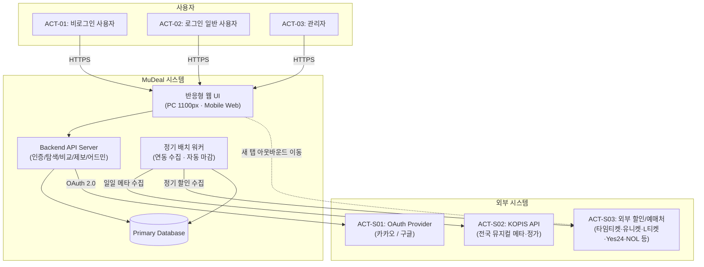
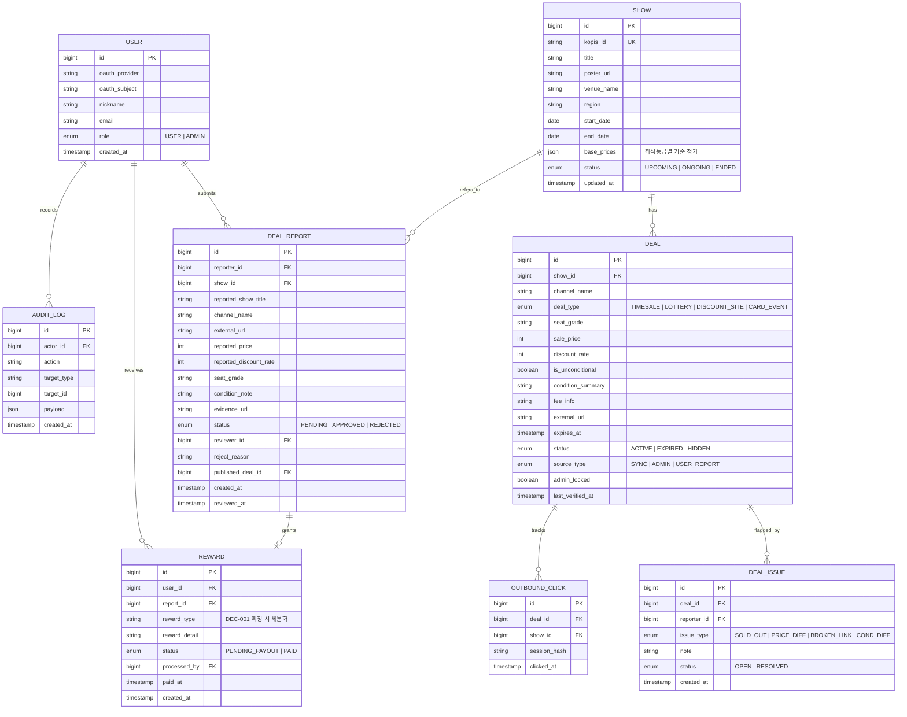

# 소프트웨어 요구사항 명세서 (SRS) — MuDeal

> Software Requirements Specification
> 본 문서는 [서비스기획서.md](../00-기획/서비스기획서.md), [비즈니스정책서.md](../00-기획/비즈니스정책서.md), [PRD.md](../../PRD.md), [DESIGN.md](../../DESIGN.md)를 기반으로 작성한 **Phase 1(요구사항 분석)** 산출물입니다.
> 모든 기능·비기능 요구사항은 출처(`MVP-*`, `BP-*`, `EX-*`)와 관찰 가능한 수용 기준(AC)을 함께 정의하며, 확정되지 않은 결정(`DEC-001`~`DEC-005`)은 `미결`로 명시합니다.

---

## 문서 정보

| 항목 | 내용 |
|------|------|
| 프로젝트명 | MuDeal (가칭) |
| 문서 번호 | SRS-MUDEAL-v0.1 |
| 버전 | v0.1 |
| 작성일 | 2026-11-24 |
| 작성자 | 기획/분석팀 · Gemini (Antigravity) |
| 보안 등급 | 대외비 (내부 프로젝트) |

---

## 변경 이력

| 버전 | 날짜 | 변경 내용 | 작성자 | 승인자 |
|------|------|-----------|--------|--------|
| 0.1 | 2026-11-24 | Phase 0 기획·정책 기반 MuDeal SRS 초안 작성 (`FR-001`~`FR-013`, `NFR-001`~`NFR-007`) | Gemini (Antigravity) | 미결 (G1 승인 대기) |
| 0.2 | 2026-11-24 | 1차 검증 5개 채널(KOPIS·NOL·엘티켓·YES24·티켓링크) + 2차 공연장 4곳 + Vision/OCR 공지 이미지 해석 + 검수 초안(DRAFT) 원칙 및 싱어롱·커튼콜·특전 이벤트 반영 | Gemini (Antigravity) | 미결 (G1 승인 대기) |

---

## 목차

1. [문서 개요](#1-문서-개요)
2. [전체 시스템 설명](#2-전체-시스템-설명)
3. [기능 요구사항](#3-기능-요구사항)
4. [비기능 요구사항](#4-비기능-요구사항)
5. [외부 인터페이스 요구사항](#5-외부-인터페이스-요구사항)
6. [데이터 요구사항](#6-데이터-요구사항)
7. [제약 조건](#7-제약-조건)
8. [승인 내역 및 미결정 사항](#8-승인-내역-및-미결정-사항)

---

## 1. 문서 개요

### 1.1 목적

본 문서는 전국 뮤지컬 티켓 할인·이벤트 가격 비교 서비스 **MuDeal**의 소프트웨어 요구사항을 정의한다. 개발·디자인·QA·운영 이해관계자가 구현 범위와 검증 기준에 대해 동일한 이해를 가지며, [요구사항추적매트릭스-RTM.md](요구사항추적매트릭스-RTM.md)의 기준선으로 활용하는 것을 목적으로 한다.

### 1.2 범위

- **포함 범위 (MVP v1.0)**:
  - 전국 뮤지컬 기본정보(KOPIS API) 및 주요 할인/예매처 정기 배치 연동 (`MVP-001`)
  - 비로그인 허용 홈 할인 추천·할인 유형 필터, 작품/공연장/이벤트 검색, 좌석등급·예매처별 가격 비교 (`MVP-002`, `MVP-003`)
  - 외부 예매처/할인 사이트 아웃바운드 이동 및 클릭 집계 (`MVP-004`)
  - 카카오/구글 소셜 로그인 및 `USER`/`ADMIN` 역할 기반 접근 제어 (`MVP-005`)
  - 로그인 사용자의 미등록 할인 제보 및 마이페이지(검수 상태·혜택 내역) 조회 (`MVP-006`)
  - 관리자 제보 검수(승인·게시 / 반려·사유), 제보자 혜택 지급 관리, 공연·할인·이벤트 CRUD (`MVP-007`)
  - (P2) 품절/가격 오류 신고 및 관리자 처리(`MVP-008`), 홈 배너·스포트라이트 큐레이션(`MVP-009`)
  - (P3 선택) 관심 작품 찜 및 신규 할인 알림(`MVP-010`)
- **제외 범위 (Out-of-Scope)**:
  - **자체 결제·예매·발권·환불 기능 (`EX-001` — 영구 제외)**
  - 초단위 실시간 잔여좌석 동기화 (`EX-002`)
  - 이메일/비밀번호 자체 회원가입 (`EX-003`)
  - 자유 커뮤니티·관람 후기·티켓 양도 거래 (`EX-004`)
  - 포인트 현금 환급·자체 리워드 스토어 (`EX-005`)
  - 광고 배너·유료 구독 모델 (`EX-006`)
  - 네이티브 모바일 앱 (`EX-007`)

### 1.3 용어 정의

| 용어 | 정의 |
|------|------|
| **KOPIS** | 공연예술통합전산망 공공 API. 전국 뮤지컬 공식 기본 정보 및 기준 정가 제공 소스 |
| **Deal (할인 딜)** | 특정 뮤지컬 작품과 연결된 외부 예매처/할인 사이트의 가격·할인율·조건·URL 단위 정보 |
| **무조건 할인** | 별도 추첨·카드 실적·증빙 조건 없이 일반 관객 누구나 적용받을 수 있는 할인 |
| **추첨/조건부 할인** | NOL 로터리 추첨, 특정 카드, 재관람·학생 증빙 등 조건 충족 시 적용되는 할인 |
| **아웃바운드 이동** | 자체 결제 없이 사용자가 선택한 외부 예매처/할인 사이트로 새 탭 이동하는 동작 |
| **DealReport (할인 제보)** | 로그인 사용자가 미등록 할인/이벤트를 관리자에게 제출한 검수 대상 건 |
| **RBAC** | Role-Based Access Control (`GUEST` / `USER` / `ADMIN` 권한 분리) |

### 1.4 참고 문서

| 문서명 | 버전 | 비고 |
|--------|------|------|
| [PRD.md](../../PRD.md) | v0.2 | 제품 핵심 목적·경계·결정 현황 |
| [DESIGN.md](../../DESIGN.md) | v1.0 | 와인/버건디 디자인 시스템, 5:7 카드·비교표·반응형 규격 |
| [서비스 기획서](../00-기획/서비스기획서.md) | v0.1 | `OBJ-*`, `MVP-*`, `EX-*`, `DEC-*` |
| [비즈니스 정책서](../00-기획/비즈니스정책서.md) | v0.1 | `BP-AUTH`, `BP-DEAL`, `BP-SYNC`, `BP-REPORT`, `BP-NOTI`, `BP-RESET`, `BP-ERROR`, `BP-STAT` |
| [유스케이스 명세서](유스케이스명세서.md) | v0.1 | `UC-001` ~ `UC-011` 상세 시나리오 |
| [요구사항 추적 매트릭스 (RTM)](요구사항추적매트릭스-RTM.md) | v0.1 | 기획·정책·요구사항·설계·테스트 추적 |

### 1.5 우선순위 정의

| 등급 | 라벨 | 정의 |
|------|------|------|
| P1 | 필수 (Must) | MVP 출시에 반드시 필요한 핵심 기능 |
| P2 | 권장 (Should) | MVP 포함 권장 기능 (일정에 따라 순서 조정 가능) |
| P3 | 선택 (Could) | 일정 허용 시 포함, 미포함 시 v2 이관 |
| P4 | 제외 (Won't) | 현재 범위에서 명시적 제외 (`EX-*` 참조) |

---

## 2. 전체 시스템 설명

### 2.1 시스템 관점도

### 2.2 사용자 유형 및 특성

| Actor ID | 사용자 유형 | 설명 | 권한 수준 | 인증 여부 |
|----------|-------------|------|-----------|-----------|
| ACT-01 | 비로그인 사용자 (`GUEST`) | 홈 추천 탐색, 검색, 가격 비교, 외부 예매처 이동 | Level 0 (조회·이동) | 미인증 |
| ACT-02 | 로그인 일반 사용자 (`USER`) | `ACT-01` 권한 + 할인 제보, 내 제보/혜택 조회, 오류 신고, (P3) 찜 | Level 1 (회원 참여) | 소셜 로그인 |
| ACT-03 | 관리자 (`ADMIN`) | 제보 검수(승인/반려), 혜택 지급 관리, 공연·할인·큐레이션 CRUD, 오류 처리 | Level 2 (운영 관리) | 인증 + ADMIN 역할 |
| ACT-S01 | OAuth Provider | 카카오·구글 소셜 인증 제공 | 외부 연동 | OAuth 2.0 |
| ACT-S02 | KOPIS API | 전국 뮤지컬 기본정보 및 기준 정가 제공 | 외부 연동 | API Key |
| ACT-S03 | 외부 할인/예매처 | 할인·이벤트 데이터 수집 대상 및 최종 구매 이동 사이트 | 외부 연동 | 배치 / URL |

### 2.3 운영 및 클라이언트 환경

- **클라이언트 환경**: 반응형 웹 (Desktop Chrome/Safari/Edge/Firefox 최신 2버전, iOS Safari 15+, Android Chrome 12+). [DESIGN.md](../../DESIGN.md)의 표준 CSS 브레이크포인트(`<640px`, `640–1023px`, `1024–1199px`, `1200px+`) 준수. 네이티브 앱 미지원(`EX-007`).
- **서버/인프라 환경**: 구체 기술 스택(프레임워크, DB, 배치 스케줄러, 호스팅)은 **`DEC-005` 미결** — Phase 2([시스템아키텍처설계서-SAD.md](../02-시스템설계/시스템아키텍처설계서-SAD.md))에서 확정.

### 2.4 가정 및 전제 조건

1. 모든 날짜·시각 연산과 마감 판정은 `KST (UTC+9)`를 단일 기준으로 사용한다 (`BP-RESET-001-1`).
2. MuDeal은 결제·발권을 수행하지 않으며, 모든 실제 거래는 아웃바운드 이동한 외부 사이트에서 이루어진다 (`EX-001`).
3. 외부 할인 사이트 배치 연동은 각 대상 사이트의 이용약관 및 `robots.txt` 검토(`DEC-002`)를 통과한 범위 내에서만 수행한다.

---

## 3. 기능 요구사항

### 3.1 기능 요구사항 요약 목록

| FR-ID | 기능명 | 출처 (기획·정책) | 우선순위 | 관련 UC | 상태 |
|-------|--------|------------------|----------|---------|------|
| **FR-001** | 전국 뮤지컬 및 할인 데이터 정기 배치 연동 | `MVP-001`, `BP-SYNC-001~003`, `BP-RESET-001` | P1 필수 | UC-011 | 초안 |
| **FR-002** | 홈 할인 뮤지컬 추천 및 할인 유형 필터 | `MVP-002`, `BP-DEAL-001~002` | P1 필수 | UC-001 | 초안 |
| **FR-003** | 작품·공연장·이벤트 통합 검색 및 필터링 | `MVP-003`, `BP-DEAL-001` | P1 필수 | UC-002 | 초안 |
| **FR-004** | 작품 상세 및 좌석등급·예매처별 가격 비교 | `MVP-003`, `BP-DEAL-001~002`, `BP-STAT-001-2` | P1 필수 | UC-003 | 초안 |
| **FR-005** | 외부 예매처 아웃바운드 이동 및 클릭 집계 | `MVP-004`, `EX-001`, `BP-DEAL-003`, `BP-STAT-001-1` | P1 필수 | UC-004 | 초안 |
| **FR-006** | 소셜 로그인(카카오/구글)·로그아웃 및 RBAC | `MVP-005`, `EX-003`, `BP-AUTH-001~003` | P1 필수 | UC-005 | 초안 |
| **FR-007** | 사용자 미등록 할인·이벤트 제보 제출 | `MVP-006`, `BP-REPORT-001`, `BP-ERROR-002-1` | P1 필수 | UC-006 | 초안 |
| **FR-008** | 마이페이지 제보 상태 및 혜택 내역 조회 | `MVP-006`, `BP-REPORT-002`, `BP-REPORT-004`, `BP-NOTI-001` | P1 필수 | UC-007 | 초안 |
| **FR-009** | 관리자 제보 검수(승인/반려) 및 혜택 지급 관리 | `MVP-007`, `BP-REPORT-002`, `BP-REPORT-004`, `BP-AUTH-002-3` | P1 필수 | UC-008 | 초안 |
| **FR-010** | 관리자 공연·할인·이벤트 CRUD 및 잠금 관리 | `MVP-007`, `BP-SYNC-002-2`, `BP-DEAL-001~003` | P1 필수 | UC-009 | 초안 |
| **FR-011** | 품절/가격 오류 신고 및 관리자 처리 | `MVP-008`, `BP-REPORT-003`, `BP-ERROR-002-2` | P2 권장 | UC-010 | 초안 |
| **FR-012** | 관리자 홈 배너·스포트라이트 큐레이션 관리 | `MVP-009`, `DESIGN.md` | P2 권장 | UC-009 | 초안 |
| **FR-013** | 관심 작품 찜 및 신규 할인 알림 | `MVP-010`, `BP-NOTI-001-3`, `BP-STAT-001-3` | P3 선택 | 미결(P3) | 보류 |
| **FR-EX-001** | 자체 결제·예매·발권·환불 (제외 명시) | `EX-001`, `BP-DEAL-003-1` | P4 제외 | 해당 없음 | 제외 |

---

### 3.2 FR-001: 전국 뮤지컬 연동 및 공지 이미지 Vision/OCR 초안 수집

| 항목 | 내용 |
|------|------|
| **FR-ID** | FR-001 |
| **설명** | 시스템은 KOPIS 오픈 API에서 전국 뮤지컬 기본정보·좌석별 공식 정가를 매일 자동 Upsert하고, 실제 응답이 검증된 1차 예매처 4곳(NOL티켓·엘티켓·YES24티켓·티켓링크) 및 2차 공연장 4곳(샤롯데·예술의전당·세종문화회관·클립서비스)을 저빈도 배치로 수집한다. 또한 NOL·YES24·엘티켓의 신규 공지·할인 이미지 URL을 감지해 Vision AI/OCR로 싱어롱·커튼콜·특전·상세 할인표를 구조화 추출하며, KOPIS 외 수집·OCR 결과는 모두 `DRAFT(검수 대기 초안)`으로 생성한다. |
| **우선순위** | P1 필수 |
| **출처** | `MVP-001`, `BP-SYNC-001~003`, `BP-RESET-001-3` |
| **관련 UC / 의존성** | UC-011 / `DEC-002` (1차 채널·OCR 확정, 배치 주기·비용 한도 튜닝) |

**처리 로직:**
1. KOPIS 일일 배치(`kopis.or.kr/openApi/restful/pblprfr`)로 전국 뮤지컬 메타 및 `pcseguidance` 기준 정가를 자동 Upsert한다(`BP-SYNC-001-1`).
2. 1차 검증 예매처 4곳(NOL `__next_f` SSR JSON·오픈예정, 엘티켓 상품목록/상세, YES24 장르목록·티켓오픈 공지·상세, 티켓링크 랭킹·공지 JSON) 및 2차 공연장 4곳을 저빈도 배치로 조회해 신규 할인·공지(YES24데이·로터리·싱어롱·커튼콜 등)를 감지한다(`BP-SYNC-001-2`).
3. NOL·YES24·엘티켓에서 신규 공지 이미지 URL이 발견되면 기존 `image_url`/`image_hash` 중복 여부를 확인하고, 미처리 이미지만 Vision AI/OCR 파이프라인으로 전달해 싱어롱 회차, 커튼콜 날짜, 특전/굿즈 조건, 상세 할인표를 JSON으로 추출한다(`BP-SYNC-002-1~2`).
4. KOPIS 외 채널 수집 데이터와 Vision/OCR 추출 결과는 직접 게시하지 않고 `DRAFT(검수 대기 초안)`으로 적재하며(`BP-SYNC-001-3`), 기존 `admin_locked=true` 딜은 덮어쓰지 않는다(`BP-SYNC-002-3`).
5. KST 기준 공연 종료일 경과 작품은 `종료`, 마감 시각 도래(`>=`) 딜은 `마감`으로 전환하며, 동일 소스 3회 연속 실패 시 기존 정상 딜을 보존하고 관리자 경고를 기록한다(`BP-SYNC-003-1~3`).

**수용 기준:**

| 기준 ID | 사전 조건 | 사건/행동 | 관찰 가능한 기대 결과 |
|---------|-----------|-----------|----------------------|
| FR-001-AC1 | KOPIS 및 1차 검증 4개 채널 정상 응답 | 정기 배치 실행 | KOPIS 공연 메타는 자동 Upsert되고, 외부 4개 채널 할인/공지는 `DRAFT(검수 대기 초안)`으로 적재되어 바로 사용자 화면에 미승인 노출되지 않는다 |
| FR-001-AC2 | NOL/YES24/엘티켓 신규 공지 이미지 URL 감지 | Vision/OCR 작업 실행 | 싱어롱·커튼콜·특전·상세 할인표가 구조화 JSON + `DRAFT` 초안으로 생성되며, 동일 이미지 URL/해시는 재호출되지 않는다 |
| FR-001-AC3 | `admin_locked=true`로 수동 마감된 딜 존재 | 후속 정기 배치 실행 | 해당 딜의 상태와 가격이 덮어쓰기되지 않고 `마감` 상태로 유지된다 |
| FR-001-AC4 | 특정 외부 소스 타임아웃·차단·파싱 실패 | 배치 1~3회 실행 | 기존 정상 딜이 유지되며, 3회 연속 실패 시 실패 로그와 관리자 경고가 기록된다 |
| FR-001-AC5 | 딜 마감 시각이 `2026-12-01 18:00:00 KST` | 시각이 `18:00:00 KST` 도달 | 해당 딜이 즉시 `마감` 상태로 전환되어 활성 최저가 계산에서 제외된다 |

---

### 3.3 FR-002: 홈 할인 뮤지컬 추천 및 할인 유형 필터

| 항목 | 내용 |
|------|------|
| **FR-ID** | FR-002 |
| **설명** | 비로그인 포함 모든 사용자에게 홈 화면에서 마감임박 레일, 로터리·스페셜 특가 스포트라이트 밴드, 할인율 상위/신규 등록 뮤지컬을 제공하고, 할인 유형 칩 필터로 즉시 탐색할 수 있게 한다. |
| **우선순위** | P1 필수 |
| **출처** | `MVP-002`, `BP-AUTH-003`, `BP-DEAL-001~002`, `DESIGN.md` |
| **관련 UC** | UC-001 |

**입력 (필터/조회):** `dealType` (`ALL` / `TIMESALE` / `LOTTERY` / `DISCOUNT_SITE` / `SPECIAL_DAY` / `SINGALONG` / `CURTAIN_CALL` / `PERK_GOODS` / `CLOSING_TODAY`), `region` (선택, 전국/시도)

**출력:** 히어로 배너, 마감임박 레일, 스포트라이트 밴드, 추천 작품 카드 목록(작품 ID, 포스터, 지역·공연장, 비교 예매처 수, 최대 할인율%, 최저가, 핵심 배지, D-Day)

**수용 기준:**

| 기준 ID | 사전 조건 | 사용자 행동 | 관찰 가능한 기대 결과 |
|---------|-----------|------------|----------------------|
| FR-002-AC1 | 비로그인 상태, 활성 딜 존재 | 홈(`/`) 접속 | 로그인 요구 없이 추천 섹션과 5:7 포스터 카드가 노출되며, 각 카드에 `[할인율%] [최저가~]`가 `tabular-nums`로 표시된다 |
| FR-002-AC2 | 홈 화면 진입 | `로터리` 또는 `오늘 마감` 칩 선택 | 해당 유형의 활성(`게시중`) 딜이 존재하는 작품만 필터링되어 표시되며, 마감된 딜은 제외된다 |
| FR-002-AC3 | 특정 필터 조건에 해당하는 활성 딜 0건 | 해당 칩 선택 | 빈 상태 안내 메시지와 전체 보기 복귀 버튼이 표시된다 |

---

### 3.4 FR-003: 작품·공연장·이벤트 통합 검색 및 필터링

| 항목 | 내용 |
|------|------|
| **FR-ID** | FR-003 |
| **설명** | 사용자가 작품명, 공연장명, 지역, 할인 이벤트 키워드(예: `Yes24데이`, `로터리`)로 검색하고, 지역·좌석등급·할인유형 필터 및 정렬(`최저가순`, `할인율순`, `마감임박순`, `인기순`)을 적용해 결과를 조회한다. |
| **우선순위** | P1 필수 |
| **출처** | `MVP-003`, `BP-AUTH-003`, `BP-DEAL-001` |
| **관련 UC** | UC-002 |

**입력:** `q`(검색어, 1~100자, 앞뒤 공백 트림), `region`(선택), `seatGrade`(선택), `dealType`(선택), `unconditionalOnly`(Boolean, 선택), `sort`(`LOWEST_PRICE` / `HIGHEST_DISCOUNT` / `CLOSING_SOON` / `POPULAR`), `page`/`limit`(기본 20)

**수용 기준:**

| 기준 ID | 사전 조건 | 사용자 행동 | 관찰 가능한 기대 결과 |
|---------|-----------|------------|----------------------|
| FR-003-AC1 | 작품/할인 데이터 존재 | 검색창에 작품명·공연장·이벤트명 입력 후 검색 | 일치하는 작품 카드 목록과 총 건수, 각 작품의 최저가·최대 할인율·비교 예매처 수가 반환된다 |
| FR-003-AC2 | 검색 결과 표시 중 | `할인율순` 정렬 및 `무조건 할인만` 필터 적용 | 조건에 맞는 작품이 할인율 내림차순으로 재정렬된다 |
| FR-003-AC3 | 일치하는 작품 없음 | 임의 키워드 검색 | `200 OK`와 빈 결과 안내 + "없는 할인 제보하기" 이동 링크가 표시된다 |

---

### 3.5 FR-004: 작품 상세 — 좌석·예매처별 가격 비교 및 이벤트·특전 안내

| 항목 | 내용 |
|------|------|
| **FR-ID** | FR-004 |
| **설명** | 특정 뮤지컬의 기본 정보(포스터, 공연장, 기간, 기준 정가)와 함께 좌석등급(`VIP/R/S/A/전석`) 탭별 예매처 가격 비교표와 **현장 이벤트·특전 안내(싱어롱 데이 회차, 커튼콜 데이 날짜, 포토카드·스페셜 티켓·굿즈 증정 조건)**를 구분해 제공한다. |
| **우선순위** | P1 필수 |
| **출처** | `MVP-003`, `BP-DEAL-001~002`, `BP-STAT-001-2` |
| **관련 UC** | UC-003 |

**처리 로직:**
1. 작품 존재 여부 확인(미존재 시 `404`).
2. 활성(`ACTIVE`) 가격 할인 딜을 좌석등급별로 그룹화하고 할인율(`floor((정가-할인가)/정가*100)`)을 계산한다(`BP-DEAL-001-1`).
3. 최저가 요약에 `일반(무조건) 최저가`와 `추첨/조건부 최저가`를 분리 산출한다(`BP-DEAL-002-2`).
4. 활성 현장 이벤트·특전(`SINGALONG`, `CURTAIN_CALL`, `PERK_GOODS`)을 회차/날짜·증정 조건·원문 예매처 링크와 함께 별도 이벤트 섹션으로 구성한다(`BP-DEAL-002-1~2`, 원본 공지 이미지 무단 재배포 금지).
5. 가격 비교표 행은 `할인가 오름차순 → 무조건 할인 우선 → 마감일 여유순 → 최근 확인 시각 최신순`으로 정렬한다(`BP-DEAL-002-3~4`).
6. 동일 세션 30분 중복 제거 규칙에 따라 작품 조회수를 집계한다(`BP-STAT-001-2`).

**수용 기준:**

| 기준 ID | 사전 조건 | 사용자 행동 | 관찰 가능한 기대 결과 |
|---------|-----------|------------|----------------------|
| FR-004-AC1 | 작품 A에 R석 기준 정가 110,000원, 무조건 77,000원, 로터리 30,000원 딜 존재 | 작품 상세 진입 및 `R석` 탭 선택 | 요약에 일반 최저가 `77,000원 (30%)`과 조건부 최저가 `30,000원 (72%)`가 분리 표시되고, 정가 취소선과 면책 고지·최종 확인 시각이 노출된다 |
| FR-004-AC2 | 동일 할인가(50,000원)의 무조건 딜과 카드 조건부 딜 존재 | 비교표 조회 | `무조건` 딜이 `조건부` 딜보다 상단에 정렬된다 (`BP-DEAL-002-3`) |
| FR-004-AC3 | 존재하지 않는 작품 ID 요청 | `/shows/999999` 접속 | `404 Not Found` 안내 화면과 홈/검색 이동 링크를 표시한다 |

---

### 3.6 FR-005: 외부 예매처 아웃바운드 이동 및 클릭 집계

| 항목 | 내용 |
|------|------|
| **FR-ID** | FR-005 |
| **설명** | 사용자가 비교표에서 원하는 예매처의 `예매처 이동 ↗`을 클릭하면 안전한 외부 URL을 새 탭으로 열어주고, 아웃바운드 클릭 이벤트를 기록한다. 자체 결제 화면은 존재하지 않는다. |
| **우선순위** | P1 필수 |
| **출처** | `MVP-004`, `EX-001`, `BP-DEAL-003`, `BP-STAT-001-1` |
| **관련 UC** | UC-004 |

**수용 기준:**

| 기준 ID | 사전 조건 | 사용자 행동 | 관찰 가능한 기대 결과 |
|---------|-----------|------------|----------------------|
| FR-005-AC1 | 활성 딜(유효 `https://` URL) 표시 중 | `예매처 이동 ↗` 클릭 | 새 탭(`rel="noopener noreferrer"`)으로 외부 예매처 페이지가 열리고 `outbound_click` 로그 1건이 저장된다 |
| FR-005-AC2 | 동일 세션에서 방금 클릭 완료 | 10초 이내 동일 딜 버튼 재클릭 | 외부 페이지는 정상 열리되 클릭 지표는 1건으로 중복 제거 집계된다 (`BP-STAT-001-1`) |
| FR-005-AC3 | 비안전 스킴(`javascript:` 등) URL | 저장 또는 이동 요청 | 서버가 `400 Bad Request`로 차단하며 렌더링·리다이렉트하지 않는다 (`BP-DEAL-003-2`) |

---

### 3.7 FR-006: 소셜 로그인(카카오/구글)·로그아웃 및 RBAC

| 항목 | 내용 |
|------|------|
| **FR-ID** | FR-006 |
| **설명** | 카카오·구글 OAuth 2.0 소셜 로그인으로 간편 가입·인증·로그아웃을 처리하고, 서버 측에서 `GUEST` / `USER` / `ADMIN` 역할별 접근을 통제한다. |
| **우선순위** | P1 필수 |
| **출처** | `MVP-005`, `EX-003`, `BP-AUTH-001~003` |
| **관련 UC** | UC-005 |

**수용 기준:**

| 기준 ID | 사전 조건 | 사용자 행동 | 관찰 가능한 기대 결과 |
|---------|-----------|------------|----------------------|
| FR-006-AC1 | 비로그인 신규 사용자 | 카카오 또는 구글 로그인 선택 → 약관 필수 동의 | `USER` 역할 계정이 생성되고 인증 토큰/세션 발급 후 원래 요청 URL로 복귀한다 (`BP-AUTH-001~002`) |
| FR-006-AC2 | 기존 소셜 연동 사용자 | 동일 소셜 계정으로 재로그인 | 중복 계정 없이 기존 계정에 로그인된다 (`BP-AUTH-001-3`) |
| FR-006-AC3 | `USER` 역할 로그인 상태 | `/admin/*` API 호출 | 서버가 `403 Forbidden`을 반환한다 (`BP-AUTH-002-3`) |
| FR-006-AC4 | 로그인 상태 | 로그아웃 클릭 | 서버 측 세션/Refresh Token이 무효화되고 비로그인 상태로 전환된다 |

---

### 3.8 FR-007: 사용자 미등록 할인·이벤트 제보 제출

| 항목 | 내용 |
|------|------|
| **FR-ID** | FR-007 |
| **설명** | 로그인 사용자가 MuDeal에 없는 뮤지컬 할인·이벤트 정보를 입력·제출해 관리자 검수 대기열에 등록한다. |
| **우선순위** | P1 필수 |
| **출처** | `MVP-006`, `BP-REPORT-001`, `BP-DEAL-003-2`, `BP-ERROR-002-1` |
| **관련 UC** | UC-006 |

**입력:**

| 필드명 | 타입 | 필수 | 유효성 규칙 |
|--------|------|------|-------------|
| 작품 선택 / 미등록 작품명 | ID 또는 String | 필수 | 기존 `showId` 선택 또는 1~120자 작품명 입력 |
| 예매처/할인 사이트명 | String | 필수 | 1~60자 |
| 할인/이벤트 URL | String (URL) | 필수 | `https://`(또는 허용 `http://`) 유효 URL 형식 (`BP-DEAL-003-2`) |
| 할인가 또는 할인율 | Integer | 둘 중 하나 필수 | 할인가 >= 0원 또는 할인율 1~99% |
| 좌석등급 | Enum/String | 선택 | `VIP` / `R` / `S` / `A` / `ALL` / 기타 |
| 할인 조건 유형 | Enum | 선택 | `UNCONDITIONAL` / `CONDITIONAL` (조건 설명 최대 300자) |
| 마감일시 | DateTime (KST) | 선택 | 유효 날짜 |
| 메모 / 증빙 이미지 | String / Image | 선택 | 이미지 JPG/PNG/WebP 최대 5MB |

**수용 기준:**

| 기준 ID | 사전 조건 | 사용자 행동 | 관찰 가능한 기대 결과 |
|---------|-----------|------------|----------------------|
| FR-007-AC1 | `USER` 로그인 상태, 당일 제보 10건 미만 | 필수 항목 입력 후 제출 | `201 Created`, 상태 `PENDING(검수대기)`으로 저장되며 마이페이지에 즉시 표시된다 |
| FR-007-AC2 | 비로그인 상태 | 제보 페이지 접근 또는 제출 API 호출 | 화면은 로그인으로 유도(복귀 URL 유지), API는 `401 Unauthorized` 반환 |
| FR-007-AC3 | 당일 KST 기준 이미 10건 제보 완료 | 11번째 제보 제출 | `429 Too Many Requests`와 일일 한도 초과 안내 반환 (`BP-REPORT-001-3`) |
| FR-007-AC4 | 제보 작성 중 세션 만료 또는 네트워크 오류 | 제출 실패 | 작성 중인 텍스트 필드가 브라우저 로컬에 임시 보존되어 재시도/재로그인 후 복원된다 (`BP-ERROR-002-1`) |

---

### 3.9 FR-008: 마이페이지 제보 상태 및 혜택 내역 조회

| 항목 | 내용 |
|------|------|
| **FR-ID** | FR-008 |
| **설명** | 로그인 사용자가 본인이 제출한 할인 제보 목록과 검수 상태(`검수대기`, `승인됨`, `반려됨` + 반려 사유), 그리고 승인 건에 연결된 혜택 지급 상태(`지급대기` / `지급완료`)를 조회한다. |
| **우선순위** | P1 필수 |
| **출처** | `MVP-006`, `BP-REPORT-002`, `BP-REPORT-004`, `BP-NOTI-001` |
| **관련 UC** | UC-007 |

**수용 기준:**

| 기준 ID | 사전 조건 | 사용자 행동 | 관찰 가능한 기대 결과 |
|---------|-----------|------------|----------------------|
| FR-008-AC1 | 본인 제보 중 대기·승인·반려 건 존재 | 마이페이지 진입 | 본인 제보만 최신순으로 노출되며, 승인 건은 게시 링크·혜택 상태, 반려 건은 관리자 반려 사유가 표시된다 |
| FR-008-AC2 | 타 사용자의 제보 ID | 상세 조회 API 직접 호출 | `403 Forbidden` 또는 `404 Not Found`로 타인 데이터 접근을 차단한다 |

---

### 3.10 FR-009: 관리자 통합 검수(사용자 제보 · 자동 수집/OCR 초안) 및 혜택 지급 관리

| 항목 | 내용 |
|------|------|
| **FR-ID** | FR-009 |
| **설명** | 관리자가 ① 사용자 제보 대기열과 ② 외부 배치·Vision/OCR 추출 초안(`DRAFT`) 대기열을 각각 검수해 승인(보정 후 정식 게시) 또는 반려(사유 기록/폐기) 처리하고, **사용자 제보 승인 건에 한해** 제보자 혜택 지급 상태를 관리한다. |
| **우선순위** | P1 필수 |
| **출처** | `MVP-007`, `BP-SYNC-001-3`, `BP-REPORT-002`, `BP-REPORT-004`, `BP-AUTH-002-3` |
| **관련 UC / 의존성** | UC-008 / 세부 혜택 유형·중복 제보 지급 규칙 `DEC-001` 미결 |

**처리 로직:**
1. `ADMIN` 권한 검증.
2. 검수 대기열을 `사용자 제보` 탭과 `자동 수집·OCR 초안` 탭으로 분리 제공하고, 원본 공지 링크·OCR 추출 구조화 데이터·동일 작품 기존 활성 딜을 대조 표시한다.
3. **사용자 제보 승인**: `PENDING` 상태 트랜잭션 검증(중복 시 `409`) → `Deal`(`source_type=USER_REPORT`) 게시 → 제보 `APPROVED` → 연결 `Reward` 1건 생성 → 감사 로그 기록.
4. **자동 수집/OCR 초안 승인**: 관리자가 추출 값(가격·싱어롱/커튼콜 회차·특전 조건·원문 링크)을 보정해 `DRAFT → ACTIVE` 게시 (`source_type=SYNC_APPROVED` 또는 `OCR_APPROVED`, **`Reward` 미생성**).
5. **반려/폐기**: 사용자 제보 반려는 사유 필수 검증(`400`) 후 `REJECTED` 저장; 자동 초안은 `DISCARDED` 처리.
6. **혜택 지급 업데이트**: 관리자가 `Reward` 건의 지급 유형·메모와 상태(`PAID`)를 갱신한다.

**수용 기준:**

| 기준 ID | 사전 조건 | 관리자 행동 | 관찰 가능한 기대 결과 |
|---------|-----------|------------|----------------------|
| FR-009-AC1 | `PENDING` 상태 사용자 제보 존재 | 정보 확인/보정 후 `승인` 실행 | 딜/이벤트가 게시되고 제보=`APPROVED` 및 연결 `Reward` 1건이 생성된다 |
| FR-009-AC2 | `DRAFT` 상태 자동 수집/OCR 초안 존재 | 추출 내용 보정 후 `승인 및 게시` 실행 | 딜/이벤트가 게시되고 `Reward`는 생성되지 않으며 원문 예매처 링크가 연결된다 |
| FR-009-AC3 | `PENDING` 사용자 제보 존재 | 반려 사유 없이 `반려` 시도 | `400 Bad Request`로 차단되고 사유 입력 요구 메시지 표시 (`BP-REPORT-002-4`) |
| FR-009-AC4 | 이미 `APPROVED` 처리된 제보 | 중복 `승인` 요청 | `409 Conflict` 반환, 중복 `Deal` 및 중복 `Reward`가 생성되지 않는다 |
| FR-009-AC5 | `지급대기` 상태의 `Reward` 존재 | 지급 완료 처리(메모 포함) | 상태가 `지급완료`로 변경되고 사용자 마이페이지에 반영되며 감사 로그가 남는다 |

---

### 3.11 FR-010: 관리자 공연·할인·이벤트 CRUD 및 잠금 관리

| 항목 | 내용 |
|------|------|
| **FR-ID** | FR-010 |
| **설명** | 관리자가 뮤지컬 작품과 예매처별 할인/이벤트를 직접 등록·수정·마감·숨김 처리하고, 배치 덮어쓰기를 방지하는 잠금(`admin_locked`)을 제어한다. |
| **우선순위** | P1 필수 |
| **출처** | `MVP-007`, `BP-SYNC-002-2`, `BP-DEAL-001~003` |
| **관련 UC** | UC-009 |

**수용 기준:**

| 기준 ID | 사전 조건 | 관리자 행동 | 관찰 가능한 기대 결과 |
|---------|-----------|------------|----------------------|
| FR-010-AC1 | `ADMIN` 로그인 | 신규 할인 딜 등록(유효 URL·가격·조건 입력) | `source_type=ADMIN`으로 저장되어 홈/검색/비교표에 즉시 노출된다 |
| FR-010-AC2 | 기존 연동 딜 존재 | 수동 `마감` 또는 가격 수정 + 잠금 활성화 | `admin_locked=true`가 설정되어 이후 배치 실행 시에도 변경값이 유지된다 |

---

### 3.12 FR-011: 품절/가격 오류 신고 및 관리자 처리

| 항목 | 내용 |
|------|------|
| **FR-ID** | FR-011 |
| **설명** | 사용자가 매진·가격 불일치·링크 오류 딜을 신고하고, 관리자가 신고 목록을 확인해 대상 딜을 수정하거나 마감 처리한다. |
| **우선순위** | P2 권장 |
| **출처** | `MVP-008`, `BP-REPORT-003`, `BP-ERROR-002-2` |
| **관련 UC** | UC-010 |

**수용 기준:**

| 기준 ID | 사전 조건 | 행동 | 관찰 가능한 기대 결과 |
|---------|-----------|------|----------------------|
| FR-011-AC1 | 게시 중인 딜 존재 | 사용자가 `매진/종료` 유형으로 오류 신고 | 신고가 접수되되 딜은 즉시 자동 삭제되지 않는다 (`BP-REPORT-003-2`) |
| FR-011-AC2 | 접수된 오류 신고 존재 | 관리자가 확인 후 딜 `마감` 및 신고 `처리완료` | 해당 딜이 비교표 활성 목록에서 제외되고 신고 상태가 완료로 갱신된다 |

---

### 3.13 FR-012: 관리자 홈 배너·스포트라이트 큐레이션 관리

| 항목 | 내용 |
|------|------|
| **FR-ID** | FR-012 |
| **설명** | 관리자가 홈 상단 히어로 배너와 Curtain Noir(`#2B0D16`) 스포트라이트 밴드(Yes24데이·NOL 로터리 등)의 노출 항목·순서·게시 기간을 설정한다. |
| **우선순위** | P2 권장 |
| **출처** | `MVP-009`, `DESIGN.md` |
| **관련 UC** | UC-009 |

**수용 기준:**

| 기준 ID | 사전 조건 | 관리자 행동 | 관찰 가능한 기대 결과 |
|---------|-----------|------------|----------------------|
| FR-012-AC1 | `ADMIN` 로그인 | 스포트라이트 항목·노출 기간 설정 후 저장 | 게시 기간 내 홈 화면 스포트라이트 영역에 지정된 순서대로 노출된다 |

---

### 3.14 FR-013 (P3 선택) 및 FR-EX-001 (P4 제외)

- **FR-013 (P3 선택 — 관심 작품 찜 및 신규 할인 알림)**: 출처 `MVP-010`, `BP-NOTI-001-3`, `BP-STAT-001-3`. MVP P1/P2 완료 후 일정 허용 시 상세화하며, 미포함 시 v2로 이관한다.
- **FR-EX-001 (P4 제외 — 자체 결제·예매·발권·환불)**: 출처 `EX-001`. 시스템에 결제 모듈·PG 연동·장바구니·주문 기능을 일절 포함하지 않는다.

---

## 4. 비기능 요구사항

| NFR-ID · 출처 | 분류 | 측정 대상 · 조건 | 합격 기준 | 검증 방법 · 담당 |
|---------------|------|------------------|----------|------------------|
| **NFR-001** (`MVP-002~003`) | 성능 | 홈·상세 가격 비교·검색 API 및 초기 웹 로드 (MVP 기준 정상 부하, 세부 동시접속 조건 Phase 2 확정) | 조회/비교 API p95 `< 500ms`, 검색 API p95 `< 1,000ms`, 초기 로드 LCP `< 2.5s` | API 부하/응답 측정 & Lighthouse / 개발·QA |
| **NFR-002** (`BP-AUTH`, `BP-DEAL-003`) | 보안 | OAuth 2.0 인증, `/admin/*` 서버 RBAC, 외부 URL 스킴, 전송 암호화, 관리자 감사 로그 | 미인가 `/admin/*` 100% `403`, 비안전 URL 저장/실행 0건, 전 구간 HTTPS(TLS 1.2+), 승인·반려·지급 감사 로그 100% 기록 | 보안 테스트 케이스 & 코드 리뷰 / 개발·QA |
| **NFR-003** (`BP-RESET`, `BP-SYNC`, `BP-REPORT`) | 정합성 | KST 마감 경계, 제보 승인 중복 요청, 외부 배치 실패 | 마감 시각 도달 시 활성 제외 100%, 중복 승인 시 중복 `Deal`/`Reward` 0건, 배치 실패 시 기존 정상 딜 보존 100% | 통합/경계값 테스트 / 개발·QA |
| **NFR-004** (`DESIGN.md`) | 호환성·접근성 | Chrome·Safari·Edge·Firefox 최신 2버전, 모바일(390px)·태블릿(768px)·데스크톱(1280px+) 뷰포트 | 전 브레이크포인트 가로 스크롤 `0px`, 본문·CTA 명도비 WCAG 2.1 AA(`4.5:1` 이상), `tabular-nums` 적용 | 크로스브라우저/뷰포트 시각 점검 / 프론트·QA |
| **NFR-005** (`BP-SYNC`, `BP-ERROR`, `BP-STAT`) | 신뢰성 | 배치 연속 실패 감지, 제보 입력 보존, 클릭 중복 제거 | 동일 소스 3회 연속 실패 시 관리자 알림 발송, 401/네트워크 오류 시 제보 텍스트 복원, 10초 내 중복 클릭 1건 집계 | 장애 시뮬레이션 테스트 / 개발·QA |
| **NFR-006** (`DEC-002`, `BP-DEAL-003-4`) | 법규·약관 | 개인정보 최소 수집(소셜 로그인 동의), 외부 사이트 약관/robots.txt 준수, 가격 면책 고지 | 필수 약관 미동의 시 가입 불가, 비교표 면책 문구·최종 확인 시각 상시 노출, 연동 대상별 약관 검토 완료 | 체크리스트 검토 / 기획·개발 |
| **NFR-007** (공통 품질) | 유지보수성 | API 스펙 문서화, 정적 분석, 정책·요구사항 추적성 | OpenAPI 문서 최신 유지, CI 린트/핵심 단위·통합 테스트 통과, 모든 P1 FR에 TC 매핑 | CI 파이프라인 & RTM 점검 / 개발·QA |

---

## 5. 외부 인터페이스 요구사항

### 5.1 사용자 인터페이스 (UI)

- **디자인 시스템**: [DESIGN.md](../../DESIGN.md) 전면 적용 (와인/버건디 5-Tier + 샴페인 골드 희소성 규칙, `Pretendard Variable`, `5:7` 포스터, `1100px` 데스크톱 셸, 모바일 하단 탭바·바텀시트, 라이트 모드 전용).
- **지원 언어**: 한국어 단일 언어(MVP).

#### 주요 화면 목록

| 화면 ID | 화면명 | 대상 역할 | 설명 | 관련 FR |
|---------|--------|-----------|------|---------|
| **SCR-01** | 홈 | 전체 | 히어로 배너, 마감임박 레일, 로터리 다크 밴드, 할인 유형 필터 그리드 | FR-002 |
| **SCR-02** | 검색 결과 | 전체 | 키워드 검색 결과(4열 카드 / 모바일 리스트), 필터 모달·바텀시트, 정렬 | FR-003 |
| **SCR-03** | 작품 상세 / 가격 비교 | 전체 | 블러 포스터 헤더, 좌석등급 탭, 최저가 요약, 예매처별 비교표, `예매처 이동 ↗`, 오류 신고 | FR-004, FR-005, FR-011 |
| **SCR-04** | 소셜 로그인 | 비로그인 | 카카오/구글 로그인 버튼, 최초 가입 시 필수 약관 동의 | FR-006 |
| **SCR-05** | 할인 제보 작성 | USER | 미등록 할인·이벤트 제보 폼 (로컬 임시 보존 포함) | FR-007 |
| **SCR-06** | 마이페이지 | USER | 내 제보 상태(`검수중/승인됨/반려됨+사유`), 혜택 지급 이력 | FR-008 |
| **SCR-07** | 어드민 제보 검수 | ADMIN | 제보 대기열, 기존 딜 대조, 승인(게시 보정)/반려(사유) 처리 | FR-009 |
| **SCR-08** | 어드민 혜택 관리 | ADMIN | 승인 제보자 혜택 목록 및 지급 상태(`지급대기→지급완료`) 관리 | FR-009 |
| **SCR-09** | 어드민 공연·할인·큐레이션 | ADMIN | 작품/딜 CRUD, `admin_locked` 제어, 홈 배너·스포트라이트 관리 | FR-010, FR-012 |
| **SCR-10** | 어드민 오류 신고 처리 | ADMIN | 품절/가격 오류 신고 목록 확인 및 대상 딜 수정/마감 | FR-011 |

### 5.2 API 인터페이스 개요 (상세 계약은 Phase 2 `API설계서.md`에서 확정)

| 구분 | Method & Endpoint (초안) | 설명 | 인증/역할 | 관련 FR |
|------|--------------------------|------|-----------|---------|
| 탐색 | `GET /api/v1/home` | 홈 추천·배너·스포트라이트 조회 | 선택 (GUEST 허용) | FR-002 |
| 탐색 | `GET /api/v1/shows` | 작품 검색·필터·정렬 목록 조회 | 선택 | FR-003 |
| 비교 | `GET /api/v1/shows/{showId}` | 작품 상세 및 좌석·예매처별 가격 비교표 | 선택 | FR-004 |
| 이동 | `POST /api/v1/deals/{dealId}/clicks` | 아웃바운드 이동 클릭 기록 (중복 제거) | 선택 | FR-005 |
| 인증 | `POST /api/v1/auth/oauth/{provider}` / `logout` / `refresh` | 카카오/구글 로그인·로그아웃·갱신 | 공개 / 인증 | FR-006 |
| 제보 | `POST /api/v1/reports` | 미등록 할인·이벤트 제보 제출 | USER | FR-007 |
| 마이 | `GET /api/v1/me/reports`, `GET /api/v1/me/rewards` | 내 제보 상태 및 혜택 이력 조회 | USER | FR-008 |
| 신고 | `POST /api/v1/deals/{dealId}/issues` | 품절/가격 오류 신고 | USER (확정) | FR-011 |
| 어드민 | `GET/POST /api/v1/admin/reports/{id}/approve\|reject` | 제보 대기열 조회 및 승인/반려 | ADMIN | FR-009 |
| 어드민 | `GET/PATCH /api/v1/admin/rewards/{id}` | 제보자 혜택 지급 상태 관리 | ADMIN | FR-009 |
| 어드민 | `CRUD /api/v1/admin/shows`, `/deals`, `/curations`, `/issues` | 공연·딜·큐레이션·오류신고 운영 관리 | ADMIN | FR-010~012 |

### 5.3 외부 시스템 연동

| 연동 ID | 외부 시스템 | 연동 목적 | 프로토콜 | 인증 방식 | 비고 |
|---------|-------------|-----------|----------|-----------|------|
| EXT-01 | 카카오 / 구글 OAuth | 소셜 로그인 인증 | OAuth 2.0 (HTTPS) | Client ID / Secret | 필수 |
| EXT-02 | KOPIS 오픈 API (`kopis.or.kr`) | 전국 뮤지컬 메타·좌석 공식 정가 일일 자동 수집 | REST HTTPS (XML) | API Key | 기준 DB |
| EXT-03 | 1차 검증 예매처 4곳 (NOL·엘티켓·YES24·티켓링크) | 저빈도 배치 할인·티켓오픈 공지·이미지 URL 수집 → 검수 초안 생성 | HTTPS GET/JSON | 공개 저빈도 배치 | 봇 방어 고려 저빈도 호출 필수 |
| EXT-04 | 2차 공연장 공식 SSR 4곳 (샤롯데·예술의전당·세종·클립서비스) | 자체 기획작·선예매·회원 할인 공지 보조 수집 | HTTPS GET | 공개 저빈도 배치 | 보조 채널 |
| EXT-05 | Vision LLM / OCR API (Gemini Vision API 또는 Cloudflare Workers AI) | NOL·YES24·엘티켓 신규 공지 이미지에서 싱어롱·커튼콜·특전·할인표 구조화 추출 | REST HTTPS / Binding | API Key / Binding | 이미지 해시 중복 방지, 원본 이미지 미재배포 |

---

## 6. 데이터 요구사항

### 6.1 논리 데이터 모델 개요

### 6.2 데이터 보존 및 백업

- **사용자 계정**: 탈퇴 요청 시 지체 없이 파기 또는 법령 근거 항목 분리 보관(세부 보존 기간은 개인정보 처리방침 수립 시 확정).
- **관리자 감사 로그(`AUDIT_LOG`) 및 혜택 지급 이력(`REWARD`)**: 운영 분쟁 방지 목적 보관 (구체 기간 Phase 2/운영 가이드에서 확정).
- **백업**: 일일 DB 백업 필수(상세 RPO/RTO 및 인프라 구성은 `DEC-005` 기술 스택 확정 후 Phase 2 SAD에서 정의).

---

## 7. 제약 조건

| 제약 ID | 분류 | 내용 | 대응 방안 |
|---------|------|------|-----------|
| **CON-01** | 서비스 경계 | 자체 결제·예매·발권·환불 영구 미제공 (`EX-001`) | 아웃바운드 이동 링크 및 외부 기준 면책 고지 상시 유지 |
| **CON-02** | 외부 연동 | 외부 할인/예매처의 HTML/API 구조 변경 및 약관·robots.txt 제약 (`DEC-002`) | 채널별 어댑터 분리, 실패 시 기존 데이터 보존, 약관 불가 채널은 관리자 등록·사용자 제보로 운영 |
| **CON-03** | 정책 미결 | 제보자 혜택 형태 및 중복 제보 지급 규칙 미확정 (`DEC-001`) | `REWARD` 엔티티를 유형/상세 유연 구조로 설계해 확정 시 스키마 파괴 없이 반영 |
| **CON-04** | 법규 | 개인정보보호법 준수 (소셜 로그인 최소 수집·동의·파기) | 필수 동의 절차 및 최소 필드(식별자·닉네임·이메일)만 저장 |

---

## 8. 승인 내역 및 미결정 사항

### 8.1 미결정 사항 (Phase 0 연계)

| 이슈 ID | 내용 | 참조 결정 ID | 담당자 | 상태 |
|---------|------|-------------|--------|------|
| ISSUE-01 | 제보자 혜택의 구체적 형태·단가 및 중복 제보 지급 규칙 확정 | `DEC-001` | 프로젝트 오너 | 미결 |
| ISSUE-02 | 1차 검증 채널 배치 주기·Vision/OCR 모델 비용 한도·CSR 채널(타임티켓·LG/충무아트센터) 확장 시점 | `DEC-002` | 프로젝트 오너·개발 | 1차 채널·OCR 확정 / 세부 튜닝 |
| ISSUE-03 | 품절/가격 오류 신고(`FR-011`)의 비로그인 허용 여부 | `BP-AUTH-003` | 프로젝트 오너 | 확정 (`USER` 전용) |
| ISSUE-04 | 기술 스택·인프라 확정 및 KPI 정량 목표값 확정 | `DEC-003`, `DEC-005` | 프로젝트 오너·개발 | 스택 확정 (Cloudflare Workers·Next.js `vinext`·D1·R2) / KPI 미결 |

### 8.2 승인 (G1 게이트)

| 역할 | 이름 | 승인일 | 상태 |
|------|------|--------|------|
| 프로젝트 오너 | 미결 | 미결 | 대기 |
| 개발 리드 | 미결 | 미결 | 대기 |
