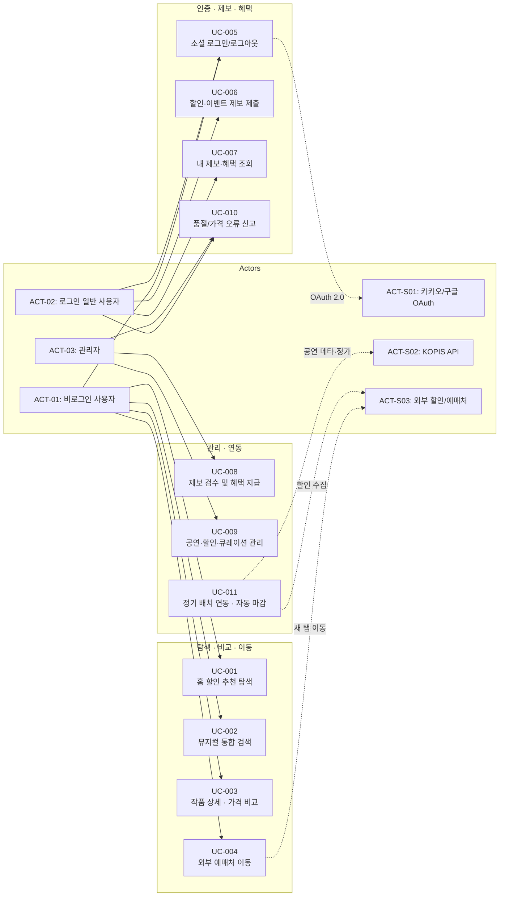

# 유스케이스 명세서 — MuDeal

> Use Case Specification
> 본 문서는 [요구사항명세서-SRS.md](요구사항명세서-SRS.md)와 [비즈니스정책서.md](../00-기획/비즈니스정책서.md)의 규칙(`BP-*`)에 따라 **MuDeal**의 핵심 액터별 시나리오(`UC-001`~`UC-011`)를 정의합니다.

---

## 문서 정보

| 항목 | 내용 |
|------|------|
| 프로젝트명 | MuDeal (가칭) |
| 문서 번호 | UCS-MUDEAL-v0.1 |
| 버전 | v0.1 |
| 작성일 | 2026-11-24 |
| 작성자 | 기획/분석팀 · Gemini (Antigravity) |

---

## 변경 이력

| 버전 | 날짜 | 변경 내용 | 작성자 | 승인자 |
|------|------|-----------|--------|--------|
| 0.1 | 2026-11-24 | MuDeal 핵심 유스케이스(`UC-001`~`UC-011`) 초안 작성 | Gemini (Antigravity) | 미결 (G1 승인 대기) |

---

## 1. 유스케이스 다이어그램

---

## 2. 액터 정의

| Actor ID | 이름 | 설명 | 권한 수준 | 인증 여부 |
|----------|------|------|-----------|-----------|
| ACT-01 | 비로그인 사용자 (`GUEST`) | 로그인 없이 전국 뮤지컬 추천·검색·가격 비교·외부 예매처 이동 수행 | Level 0 | 미인증 |
| ACT-02 | 로그인 일반 사용자 (`USER`) | `ACT-01`의 모든 권한 + 미등록 할인 제보, 내 제보/혜택 조회, 오류 신고 | Level 1 | 소셜 로그인 |
| ACT-03 | 관리자 (`ADMIN`) | 제보 검수(승인/반려), 혜택 지급 관리, 공연·할인·큐레이션 CRUD, 오류 신고 처리 | Level 2 | 인증 + ADMIN |
| ACT-S01 | OAuth Provider | 카카오·구글 소셜 인증 제공 (보조 액터) | 외부 연동 | OAuth 2.0 |
| ACT-S02 | KOPIS API | 전국 뮤지컬 기본정보·좌석별 기준 정가 제공 (보조 액터) | 외부 연동 | API Key |
| ACT-S03 | 외부 할인/예매처 | 할인 수집 대상이자 사용자가 최종 구매를 진행하는 외부 사이트 (보조 액터) | 외부 연동 | 배치 / URL |

---

## 3. 유스케이스 목록

| UC-ID | 유스케이스명 | 주요 액터 | 우선순위 | 상태 | 관련 FR |
|-------|-------------|-----------|----------|------|---------|
| **UC-001** | 홈 할인 뮤지컬 탐색 및 필터링 | GUEST, USER | P1 필수 | 초안 | FR-002 |
| **UC-002** | 뮤지컬 통합 검색 및 정렬 | GUEST, USER | P1 필수 | 초안 | FR-003 |
| **UC-003** | 작품 상세 및 좌석·예매처별 가격 비교 | GUEST, USER | P1 필수 | 초안 | FR-004 |
| **UC-004** | 외부 예매처 아웃바운드 이동 | GUEST, USER | P1 필수 | 초안 | FR-005 |
| **UC-005** | 소셜 로그인 및 로그아웃 | GUEST, USER | P1 필수 | 초안 | FR-006 |
| **UC-006** | 미등록 할인·이벤트 제보 제출 | USER | P1 필수 | 초안 | FR-007 |
| **UC-007** | 내 제보 상태 및 혜택 내역 조회 | USER | P1 필수 | 초안 | FR-008 |
| **UC-008** | 관리자 제보 검수 및 혜택 지급 관리 | ADMIN | P1 필수 | 초안 | FR-009 |
| **UC-009** | 관리자 공연·할인·큐레이션 운영 관리 | ADMIN | P1 필수 | 초안 | FR-010, FR-012 |
| **UC-010** | 품절/가격 오류 신고 및 관리자 처리 | USER, ADMIN | P2 권장 | 초안 | FR-011 |
| **UC-011** | 외부 사이트 정기 배치 연동 및 자동 마감 | 시스템(배치), KOPIS, 외부사이트 | P1 필수 | 초안 | FR-001 |

---

## 4. 유스케이스 상세 명세

---

### 4.1 UC-001: 홈 할인 뮤지컬 탐색 및 필터링

| 항목 | 내용 |
|------|------|
| **UC-ID** | UC-001 |
| **액터** | 비로그인 사용자 (`GUEST`), 로그인 사용자 (`USER`) |
| **우선순위 / 관련 FR** | P1 필수 / FR-002 |
| **트리거** | 사용자가 MuDeal 홈(`/`)에 접속한다 |

- **사전 조건**: 활성(`게시중`) 상태의 공연 및 할인 데이터가 1건 이상 존재한다.
- **기본 흐름**:
  1. 사용자가 홈(`/`)에 접속한다.
  2. 시스템은 히어로 배너, 마감임박 레일, 스포트라이트 밴드(Yes24데이·NOL 로터리 등), 할인 유형 칩 필터, 추천 5:7 포스터 그리드를 표시한다.
  3. 사용자가 할인 유형 칩(예: `로터리`, `타임세일`, `오늘 마감`)을 선택한다.
  4. 시스템은 선택한 조건에 부합하는 활성 딜이 있는 작품 목록만 즉시 필터링하여 노출한다.
  5. 사용자가 원하는 작품 카드를 클릭하면 `UC-003`(작품 상세/가격 비교)으로 이동한다.
- **대안 흐름**: `AF-001-01` 지역 필터 추가 선택 시 해당 지역 공연장 작품으로 추가 필터링한다.
- **예외 흐름**: `EF-001-01` 선택한 필터 조건에 활성 딜이 0건인 경우 빈 상태 안내와 `전체 보기` 버튼을 표시한다. `EF-001-02` API 오류 시 최대 2회 읽기 재시도 후 수동 재시도 안내를 표시한다(`BP-ERROR-001-1`).
- **사후 조건**: 사용자가 관심 뮤지컬의 상세 비교 화면으로 진입하거나 최신 할인 현황을 파악했다.
- **비즈니스 규칙**: `BP-AUTH-003`, `BP-DEAL-001-3~4`, `BP-RESET-001-4` · **UI 참조**: `SCR-01`

---

### 4.2 UC-002: 뮤지컬 통합 검색 및 정렬

| 항목 | 내용 |
|------|------|
| **UC-ID** | UC-002 |
| **액터** | `GUEST`, `USER` |
| **우선순위 / 관련 FR** | P1 필수 / FR-003 |
| **트리거** | 사용자가 상단 검색창에 키워드를 입력하고 검색을 실행한다 |

- **사전 조건**: 없음 (비로그인 허용).
- **기본 흐름**:
  1. 사용자가 작품명, 공연장명, 지역 또는 이벤트 키워드를 입력하고 검색한다.
  2. 시스템은 앞뒤 공백을 제거하고 매칭되는 전국 뮤지컬 목록과 각 작품의 최저가·최대 할인율·비교 예매처 수를 표시한다.
  3. 사용자가 필터(`지역`, `좌석등급`, `할인유형`, `무조건 할인만`) 또는 정렬(`최저가순`, `할인율순`, `마감임박순`, `인기순`)을 선택한다.
  4. 시스템은 조건에 맞게 검색 결과를 재조회하여 표시한다.
- **대안 흐름**: `AF-002-01` 검색어 입력 중 자동완성 추천 작품 선택 시 `UC-003`으로 바로 이동한다.
- **예외 흐름**: `EF-002-01` 검색 결과가 0건인 경우 빈 결과 안내와 함께 "찾는 할인이 없나요? 할인 제보하기" CTA(`UC-006`)를 노출한다. `EF-002-02` 공백만 입력 시 검색어 입력 안내를 표시한다.
- **사후 조건**: 사용자가 원하는 작품을 찾아 비교 화면으로 이동할 수 있다.
- **비즈니스 규칙**: `BP-AUTH-003`, `BP-DEAL-001-1~4` · **UI 참조**: `SCR-02`

---

### 4.3 UC-003: 작품 상세 및 좌석·예매처별 가격 비교

| 항목 | 내용 |
|------|------|
| **UC-ID** | UC-003 |
| **액터** | `GUEST`, `USER` |
| **우선순위 / 관련 FR** | P1 필수 / FR-004 |
| **트리거** | 사용자가 홈 또는 검색 결과에서 특정 뮤지컬 카드를 클릭한다 |

- **사전 조건**: 요청한 `showId`가 시스템에 존재한다.
- **기본 흐름**:
  1. 시스템은 작품 기본 정보(포스터, 공연장, 지역, 공연 기간, KOPIS 기준 좌석별 정가), 활성(`ACTIVE`) 가격 할인 목록, 그리고 **현장 이벤트·특전(`싱어롱 데이`, `커튼콜 데이`, `굿즈·포토카드 특전`)** 목록을 조회한다.
  2. 시스템은 좌석등급 탭(`VIP/R/S/A/전석`), `일반(무조건) 최저가` vs `추첨/조건부 최저가` 요약, 예매처별 가격 비교표(정가 취소선, 할인가, 할인율, 수수료, 조건 배지, 최종 확인 시각, 면책 고지), 그리고 **이벤트·특전 안내 섹션(회차/날짜, 증정 조건, 원문 예매처 링크)**을 표시한다.
  3. 사용자가 다른 좌석등급 탭이나 `무조건 할인만` 토글을 조작하면 해당 기준의 비교표와 최저가 요약을 즉시 갱신한다.
  4. 시스템은 30분 세션 중복 제거 규칙에 따라 작품 조회수를 1 증가시킨다(`BP-STAT-001-2`).
- **대안 흐름**: `AF-003-01` 활성 할인이 없는 작품인 경우 KOPIS 기준 정가 정보와 함께 "진행 중인 할인이 없어요 · 할인 제보하기" CTA를 표시한다.
- **예외 흐름**: `EF-003-01` 존재하지 않는 작품 ID 요청 시 `404` 안내 화면과 홈 이동 링크를 표시한다. `EF-003-02` 공연 종료 작품의 경우 종료 배지를 표시하고 활성 구매 이동 버튼을 비활성화한다(`BP-SYNC-003-3`).
- **사후 조건**: 사용자가 좌석·예매처별 가격과 조건을 파악해 이동 대상을 결정했다.
- **비즈니스 규칙**: `BP-DEAL-001~002`, `BP-DEAL-003-4`, `BP-STAT-001-2` · **UI 참조**: `SCR-03`

---

### 4.4 UC-004: 외부 예매처 아웃바운드 이동

| 항목 | 내용 |
|------|------|
| **UC-ID** | UC-004 |
| **액터** | `GUEST`, `USER`, 외부 할인/예매처 (`ACT-S03`) |
| **우선순위 / 관련 FR** | P1 필수 / FR-005 |
| **트리거** | 사용자가 가격 비교표에서 특정 예매처의 `예매처 이동 ↗` 버튼을 클릭한다 |

- **사전 조건**: 해당 딜이 활성 상태이며 유효한 외부 URL(`https://`)을 보유하고 있다.
- **기본 흐름**:
  1. 사용자가 원하는 가격 행의 `예매처 이동 ↗` 버튼을 클릭한다.
  2. 시스템은 URL 스킴 안전성을 확인하고, 동일 세션 10초 중복 제거 규칙에 따라 `outbound_click` 이벤트를 기록한다.
  3. 브라우저는 새 탭(`target="_blank" rel="noopener noreferrer"`)으로 해당 외부 예매처/할인 사이트 페이지를 연다.
  4. 사용자는 외부 사이트에서 실제 좌석 선택 및 결제를 진행한다(MuDeal은 결제에 관여하지 않음).
- **대안 흐름**: `AF-004-01` 이동 후 외부 사이트에서 이미 매진되었거나 가격이 다른 경우 사용자는 MuDeal 탭으로 돌아와 `UC-010`(오류 신고)을 수행할 수 있다.
- **예외 흐름**: `EF-004-01` 클릭 시점에 해당 딜이 마감(`>= expires_at`)된 경우 마감 안내를 표시하고 비교표를 갱신한다. `EF-004-02` 클릭 로그 API가 일시 실패하더라도 사용자의 외부 사이트 이동 자체는 차단하지 않는다.
- **사후 조건**: 사용자가 외부 예매처 페이지에 도달하고 유효 클릭이 집계되었다.
- **비즈니스 규칙**: `BP-DEAL-003-1~4`, `BP-STAT-001-1`, `BP-RESET-001-3` · **UI 참조**: `SCR-03`

---

### 4.5 UC-005: 소셜 로그인 및 로그아웃

| 항목 | 내용 |
|------|------|
| **UC-ID** | UC-005 |
| **액터** | `GUEST`, `USER`, OAuth Provider (`ACT-S01`) |
| **우선순위 / 관련 FR** | P1 필수 / FR-006 |
| **트리거** | 사용자가 `로그인` 버튼을 클릭하거나 비로그인 상태에서 로그인 필수 기능(`UC-006`, `UC-007`)에 접근한다 |

- **사전 조건**: OAuth Provider(카카오/구글) 서비스가 정상 동작 중이다.
- **기본 흐름 (로그인)**:
  1. 시스템은 소셜 로그인 화면(`SCR-04`)을 표시하고 복귀할 원래 경로(`redirectUrl`)를 보관한다.
  2. 사용자가 카카오 또는 구글 로그인을 선택해 OAuth 인증을 완료한다.
  3. 시스템은 OAuth 콜백으로 전달된 고유 식별자(`provider + subject`)를 검증한다.
  4. 기존 계정이면 바로 인증 세션을 발급하고, 신규 사용자이면 필수 약관 동의 확인 후 `USER` 역할 계정을 생성한다.
  5. 시스템은 보관해 둔 `redirectUrl`(없으면 홈)로 리다이렉트한다.
- **대안 흐름**: `AF-005-01` 로그아웃: 로그인 사용자가 `로그아웃`을 클릭하면 서버의 세션/Refresh Token을 무효화하고 클라이언트 상태를 초기화한다.
- **예외 흐름**: `EF-005-01` 사용자가 OAuth 권한 승인 또는 필수 약관 동의를 취소한 경우 계정을 생성하지 않고 로그인 화면으로 복귀한다. `EF-005-02` OAuth Provider 장애 시 "소셜 로그인 중 오류가 발생했습니다. 잠시 후 다시 시도해주세요" 메시지를 표시한다.
- **사후 조건**: 유효한 세션이 발급(로그인) 또는 무효화(로그아웃)되었다.
- **비즈니스 규칙**: `BP-AUTH-001-1~3`, `BP-AUTH-002-1~2` · **UI 참조**: `SCR-04`

---

### 4.6 UC-006: 미등록 할인·이벤트 제보 제출

| 항목 | 내용 |
|------|------|
| **UC-ID** | UC-006 |
| **액터** | `USER` |
| **우선순위 / 관련 FR** | P1 필수 / FR-007 |
| **트리거** | 사용자가 헤더 또는 작품 상세에서 `할인 제보하기` 버튼을 클릭한다 |

- **사전 조건**: 사용자가 소셜 로그인(`USER`)된 상태이다(미로그인 시 `UC-005` 선행).
- **기본 흐름**:
  1. 시스템은 할인 제보 폼(`SCR-05`)을 표시한다(작품 상세에서 진입한 경우 해당 작품이 자동 선택된다).
  2. 사용자가 작품(기존 선택 또는 미등록 작품명 입력), 예매처/사이트명, 할인 URL, 할인가 또는 할인율(및 선택 정보: 좌석등급·조건·마감일·증빙 이미지)을 입력하고 제출한다.
  3. 시스템은 일일 제보 한도(KST 기준 10건)와 입력값(URL `https://` 스킴 포함)을 검증한다.
  4. 시스템은 `DEAL_REPORT`를 `PENDING(검수대기)` 상태로 저장하고 임시 저장 데이터를 삭제한다.
  5. 시스템은 접수 완료 안내와 함께 마이페이지(`UC-007`) 이동 링크를 표시한다.
- **대안 흐름**: `AF-006-01` 기존 작품 검색 목록에 없는 뮤지컬인 경우 작품명 텍스트를 직접 입력해 제출한다.
- **예외 흐름**: `EF-006-01` 필수 항목 누락 또는 비안전 URL 입력 시 필드별 오류를 표시하고 저장을 거부한다. `EF-006-02` 당일 10건 초과 시 `429` 한도 초과 안내를 표시한다(`BP-REPORT-001-3`). `EF-006-03` 제출 중 네트워크 오류 또는 세션 만료(`401`) 발생 시 입력 텍스트를 브라우저 로컬에 임시 보존한다(`BP-ERROR-002-1`).
- **사후 조건**: `PENDING` 상태의 제보가 관리자 대기열에 등록되었다.
- **비즈니스 규칙**: `BP-REPORT-001-1~3`, `BP-DEAL-003-2`, `BP-ERROR-002-1` · **UI 참조**: `SCR-05`

---

### 4.7 UC-007: 내 제보 상태 및 혜택 내역 조회

| 항목 | 내용 |
|------|------|
| **UC-ID** | UC-007 |
| **액터** | `USER` |
| **우선순위 / 관련 FR** | P1 필수 / FR-008 |
| **트리거** | 로그인 사용자가 `마이페이지`에 진입한다 |

- **사전 조건**: 사용자가 로그인(`USER`)된 상태이다.
- **기본 흐름**:
  1. 시스템은 본인 계정에 귀속된 제보 목록(`DEAL_REPORT`)과 혜택 내역(`REWARD`)을 최신순으로 조회해 표시한다.
  2. 사용자는 각 제보의 상태(`검수중`, `승인됨`, `반려됨`)와 상세 내역을 확인한다.
  3. 승인 건은 실제 게시된 작품/딜 링크 및 연결된 혜택 상태(`지급대기` / `지급완료`)를, 반려 건은 관리자가 기록한 반려 사유를 확인한다.
- **대안 흐름**: `AF-007-01` 상태별 필터(`전체`, `검수중`, `승인됨`, `반려됨`)로 목록을 좁혀 조회한다.
- **예외 흐름**: `EF-007-01` 제보 이력이 0건인 경우 빈 상태 안내와 `첫 할인 제보하기` CTA를 표시한다.
- **사후 조건**: 사용자가 본인의 제보 결과와 혜택 현황을 투명하게 확인했다.
- **비즈니스 규칙**: `BP-AUTH-003`, `BP-REPORT-002-4`, `BP-REPORT-004-1`, `BP-NOTI-001-1~2` · **UI 참조**: `SCR-06`

---

### 4.8 UC-008: 관리자 제보 검수 및 혜택 지급 관리

| 항목 | 내용 |
|------|------|
| **UC-ID** | UC-008 |
| **액터** | `ADMIN` |
| **우선순위 / 관련 FR** | P1 필수 / FR-009 |
| **트리거** | 관리자가 어드민 제보 검수 대기열(`SCR-07`)에 진입한다 |

- **사전 조건**: 관리자가 `ADMIN` 역할로 인증된 상태이다.
- **기본 흐름 (승인 및 혜택 지급)**:
  1. 시스템은 `PENDING(검수대기)` 상태 제보 목록을 제출 시각순으로 표시한다.
  2. 관리자가 특정 제보를 선택하면 시스템은 제보 상세, 원본 링크 바로가기, 그리고 동일 작품의 기존 등록 딜 목록을 함께 표시한다.
  3. 관리자는 외부 링크에 접속해 가격·조건·진행 여부를 확인하고, 필요 시 작품 매핑·좌석등급·조건 라벨을 보정한 뒤 `승인 및 게시`를 클릭한다.
  4. 시스템은 트랜잭션 내에서 제보 상태(`PENDING` 확인) → 정식 `DEAL`(`source_type=USER_REPORT`) 게시 → 제보 상태 `APPROVED` 전환 → `REWARD` 레코드 생성 → 감사 로그 기록을 수행한다.
  5. 이후 관리자는 혜택 관리 화면(`SCR-08`)에서 지급 완료 시 상태를 `PAID(지급완료)`로 갱신하고 지급 메모를 기록한다.
- **대안 흐름**:
  - `AF-008-01` **자동 수집·OCR 초안(`DRAFT`) 검수**: 관리자가 `자동 수집·OCR 초안` 탭에서 NOL/YES24/엘티켓/티켓링크 배치 및 Vision/OCR 추출 초안을 확인한다. 원문 공지 링크와 OCR 추출 JSON(싱어롱 회차, 커튼콜 날짜, 특전 조건, 할인가)을 대조·보정한 뒤 `승인 및 게시`를 클릭하면 `ACTIVE`로 게시되며 혜택(`Reward`)은 생성되지 않는다. 부적합/중복 초안은 `폐기(DISCARDED)`한다.
  - `AF-008-02` **사용자 제보 반려**: 중복 제보·종료 이벤트·확인 불가 링크 등 부적합 판정 시 관리자가 반려 사유를 선택/입력하고 `반려`를 클릭한다. 제보는 `REJECTED`로 전환되며 사유가 사용자 마이페이지에 노출된다.
- **예외 흐름**: `EF-008-01` 반려 사유 미입력 시 저장을 차단한다(`BP-REPORT-002-4`). `EF-008-02` 이미 처리된 제보에 중복 승인 요청 시 `409 Conflict`로 중복 게시·중복 혜택을 방지한다. `EF-008-03` 비관리자 접근 시 `403 Forbidden`을 반환한다.
- **사후 조건**: 제보가 사이트에 반영(또는 사유와 함께 반려)되고 혜택·감사 이력이 정확히 기록되었다.
- **비즈니스 규칙**: `BP-AUTH-002-3`, `BP-REPORT-002-1~4`, `BP-REPORT-004-1~3` (`DEC-001` 연계) · **UI 참조**: `SCR-07`, `SCR-08`

---

### 4.9 UC-009: 관리자 공연·할인·큐레이션 운영 관리

| 항목 | 내용 |
|------|------|
| **UC-ID** | UC-009 |
| **액터** | `ADMIN` |
| **우선순위 / 관련 FR** | P1 필수 (`FR-010`) / P2 권장 (`FR-012`) |
| **트리거** | 관리자가 어드민 운영 관리 화면(`SCR-09`)에서 공연·딜·홈 큐레이션을 등록하거나 수정한다 |

- **사전 조건**: 관리자가 `ADMIN` 역할로 인증된 상태이다.
- **기본 흐름**:
  1. 관리자가 공연 또는 할인 딜 등록/수정 화면을 열고 정보를 입력한다(URL 스킴 및 가격 검증 적용).
  2. 필요 시 자동 배치 덮어쓰기를 막기 위해 `admin_locked` 옵션을 설정하거나, 즉시 `마감`/`숨김` 상태로 전환한다.
  3. (P2) 관리자가 홈 히어로 배너 또는 스포트라이트 밴드의 노출 항목·순서·기간을 저장한다.
  4. 시스템은 변경 사항을 저장하고 감사 로그를 기록하며, 사용자 화면에 반영한다.
- **대안 흐름**: `AF-009-01` 자동 연동된 딜의 오타나 조건을 수동 보정하면 `admin_locked=true`로 자동 설정해 배치 덮어쓰기를 방지한다.
- **예외 흐름**: `EF-009-01` 비안전 URL 또는 음수 가격 입력 시 `400 Bad Request`를 반환한다.
- **사후 조건**: 운영 변경 사항이 서비스에 반영되고 감사 로그가 남았다.
- **비즈니스 규칙**: `BP-AUTH-002-3`, `BP-DEAL-001~003`, `BP-SYNC-002-2` · **UI 참조**: `SCR-09`

---

### 4.10 UC-010: 품절/가격 오류 신고 및 관리자 처리

| 항목 | 내용 |
|------|------|
| **UC-ID** | UC-010 |
| **액터** | `USER` (신고), `ADMIN` (처리) |
| **우선순위 / 관련 FR** | P2 권장 / FR-011 |
| **트리거** | 사용자가 작품 상세 비교표에서 특정 딜의 `오류/품절 신고` 버튼을 클릭한다 |

- **사전 조건**: 게시 중인 딜이 존재한다.
- **기본 흐름**:
  1. 사용자가 오류 유형(`매진/종료`, `가격 다름`, `링크 오류`, `조건 다름`)과 선택 메모를 입력해 제출한다.
  2. 시스템은 `DEAL_ISSUE`를 `OPEN` 상태로 저장한다(대상 딜은 자동 삭제하지 않음).
  3. 관리자가 어드민 오류 신고 화면(`SCR-10`)에서 접수 건을 확인하고, 사실일 경우 대상 딜을 수정 또는 `마감`(`admin_locked=true`) 처리한 뒤 신고를 `RESOLVED`로 완료한다.
- **대안 흐름**: `AF-010-01` 확인 결과 정상 딜이면 딜을 유지하고 신고만 `RESOLVED`(조치 없음)로 종료한다.
- **예외 흐름**: `EF-010-01` 이미 마감된 딜에 대한 신고 시도 시 이미 마감된 할인임을 안내한다.
- **사후 조건**: 노후·오류 딜이 관리자 확인을 거쳐 정리되었다.
- **비즈니스 규칙**: `BP-REPORT-003-1~2`, `BP-ERROR-002-2` · **UI 참조**: `SCR-03`, `SCR-10`

---

### 4.11 UC-011: 외부 사이트 저빈도 배치 연동 · 공지 이미지 OCR · 자동 마감

| 항목 | 내용 |
|------|------|
| **UC-ID** | UC-011 |
| **액터** | 시스템 배치(Cron/Workflows), KOPIS API (`ACT-S02`), 1차/2차 외부 사이트 (`ACT-S03`), Vision AI/OCR (`EXT-05`) |
| **우선순위 / 관련 FR** | P1 필수 / FR-001 |
| **트리거** | 예약된 배치 주기 도래 (KOPIS 일 1회, 1차/2차 채널 저빈도 배치, 마감 체크 15분 주기) |

- **사전 조건**: KOPIS API 키, 채널별 저빈도 어댑터, Vision AI/OCR 키 설정이 유효하다.
- **기본 흐름**:
  1. KOPIS 일일 배치가 전국 뮤지컬 목록·상세·좌석 공식 정가를 `shows`에 자동 Upsert한다.
  2. 1차 검증 4개 채널(NOL티켓·엘티켓·YES24티켓·티켓링크) 및 2차 공연장 4곳을 저빈도 배치로 조회해 할인 정보, 티켓오픈 공지 키워드(`YES24데이`, `싱어롱`, `커튼콜`, `로터리`), 그리고 신규 공지 이미지 URL을 수집한다.
  3. 신규 공지 이미지 URL은 기존 `image_url`/`image_hash`와 대조해 미처리 건만 Vision AI/OCR 작업 큐에 등록한다.
  4. Vision AI/OCR이 이미지에서 싱어롱 회차, 커튼콜 날짜, 특전/굿즈 조건, 상세 할인표를 구조화 JSON으로 추출하고, 모든 외부 수집·OCR 결과를 `DRAFT(검수 대기 초안)` 상태로 적재한다(`BP-SYNC-001-3`).
  5. 마감 배치가 KST 기준 공연 종료일 경과 작품과 `expires_at <= 현재 KST` 딜을 `ENDED`/`EXPIRED`로 자동 전환한다.
  6. 배치 및 OCR 실행 결과를 `sync_runs`·`ocr_image_jobs`에 기록한다.
- **대안 흐름**: `AF-011-01` 관리자가 어드민에서 특정 채널 수동 재수집 또는 실패한 OCR 작업 재시도를 트리거한다.
- **예외 흐름**: `EF-011-01` 특정 외부 사이트 차단·타임아웃·파싱 실패 시 기존 정상 딜을 보존하고 실패 로그를 기록하며, 3회 연속 실패 시 관리자 경고를 발송한다(`BP-SYNC-003-1~2`). `EF-011-02` Vision/OCR 호출 실패 또는 저신뢰도 추출 시 `FAILED`/`NEEDS_REVIEW` 상태로 기록해 관리자가 원문 링크에서 직접 확인할 수 있게 한다.
- **사후 조건**: KOPIS 기준 DB가 동기화되고, 신규 할인·싱어롱·커튼콜·특전 초안이 관리자 검수 대기열에 적재되었다.
- **비즈니스 규칙**: `BP-SYNC-001~003`, `BP-RESET-001-1~3`

---

## 부록: 유스케이스 간 관계 요약

| 유스케이스 | 관계 유형 | 대상 유스케이스 | 설명 |
|-----------|-----------|---------------|------|
| `UC-001` 홈 탐색 / `UC-002` 검색 | leads to | `UC-003` 작품 상세·비교 | 카드 선택 시 가격 비교 화면으로 이동 |
| `UC-003` 작품 상세·비교 | extends | `UC-004` 외부 예매처 이동 | 원하는 가격 행 선택 시 새 탭 이동 |
| `UC-003` 작품 상세·비교 | extends | `UC-010` 오류/품절 신고 | 매진/불일치 발견 시 신고 |
| `UC-006` 제보 제출 / `UC-007` 마이페이지 | includes | `UC-005` 소셜 로그인 | 비로그인 시 로그인 선행 후 원 경로 복귀 |
| `UC-008` 관리자 제보 검수 | triggers | `UC-007` 내 제보·혜택 조회 | 승인/반려 및 지급 결과가 사용자 마이페이지에 반영 |
