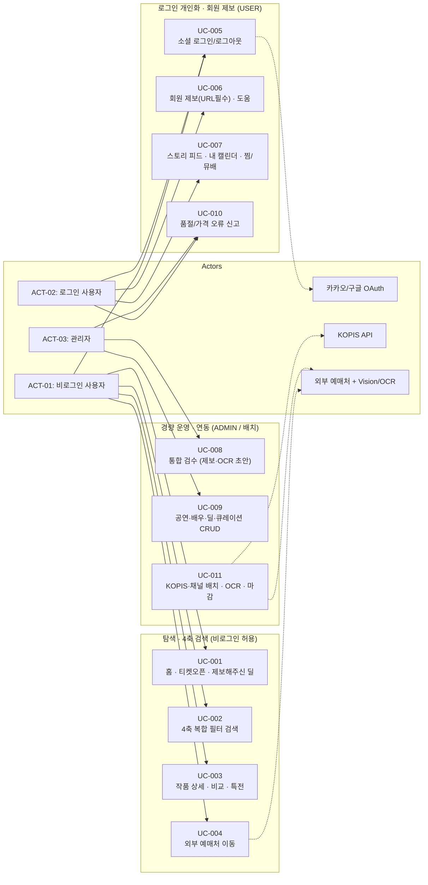

# 유스케이스 명세서 — MuDeal

> Use Case Specification (`UCS-MUDEAL-v1.0`)
> [요구사항명세서-SRS.md](요구사항명세서-SRS.md) (`v1.0`)와 [비즈니스정책서.md](../00-기획/비즈니스정책서.md) (`v1.0`) 기준의 액터별 핵심 유스케이스(`UC-001`~`UC-011`)를 정의합니다.

---

## 1. 유스케이스 다이어그램

---

## 2. 유스케이스 목록 및 상세 흐름

| UC-ID | 유스케이스명 | 주요 액터 | 관련 FR | 화면 ID |
|---|---|---|---|---|
| **UC-001** | 홈 추천 및 `제보해주신 딜` 탐색 | GUEST, USER | FR-002 | SCR-01 |
| **UC-002** | 4축 복합 필터 검색 (날짜·이름/배우·가격대·지역) | GUEST, USER | FR-003 | SCR-02 |
| **UC-003** | 작품 상세 · 가격 비교 · 싱어롱/특전 · 출연 배우 | GUEST, USER | FR-004 | SCR-03, SCR-04 |
| **UC-004** | 외부 예매처 아웃바운드 이동 및 확인 수 집계 | GUEST, USER | FR-005 | SCR-03 |
| **UC-005** | 카카오/구글 소셜 로그인 및 로그아웃 | GUEST, USER | FR-007 | SCR-05 |
| **UC-006** | 비회원/회원 할인·이벤트 제보 및 `도움이 됐어요` | GUEST, USER | FR-006 | SCR-06, SCR-01, SCR-03 |
| **UC-007** | 작품 찜 · 뮤배 팔로우(`내 뮤배 극`) · 인앱 소식 피드 · 내 기여 | USER | FR-008 | SCR-04, SCR-07 |
| **UC-008** | 관리자 통합 검수 (사용자 제보 + 자동 수집/OCR 초안) | ADMIN | FR-009 | SCR-08 |
| **UC-009** | 관리자 공연·배우 매핑·딜·큐레이션 운영 관리 | ADMIN | FR-010, FR-012 | SCR-09 |
| **UC-010** | 품절/가격 오류 신고 및 관리자 처리 | USER, ADMIN | FR-011 | SCR-03, SCR-10 |
| **UC-011** | KOPIS·1차/2차 채널 배치 · 공지 이미지 OCR · 자동 마감 | 시스템(Cron/Queue) | FR-001 | - |

---

### UC-001: 홈 추천 및 `제보해주신 딜` 탐색 (`FR-002`)
- **기본 흐름**: 홈(`/`) 진입 → 히어로 배너, 마감임박 레일, Curtain Noir 스포트라이트 밴드, **`제보해주신 딜` 전용 섹션**(제보자 닉네임·`N명 확인`·`도움이 됐어요`), 유형 칩 필터 그리드 표시 → 칩 선택 시 즉시 필터링, 카드 클릭 시 `UC-003` 이동.
- **예외**: 필터 결과 0건 시 빈 상태 + `전체 보기`, API 실패 시 2회 재시도 후 수동 재시도.

### UC-002: 4축 복합 필터 검색 · URL 공유 · 조건부 세부 칩 (`FR-003`)
- **기본 흐름**:
  1. 사용자가 검색 화면(`/search`) 또는 헤더 검색바에서 **① 날짜/기간**(`오늘`/`이번 주말`/`이번 달`/직접 선택) **② 작품·공연장·배우·이벤트명** **③ 가격대**(`3/5/7/10만원 이하`/직접 입력) **④ 지역**(`서울-대학로` 별도 분리 + 전국) 중 1개 이상 조건을 조합해 검색한다.
  2. 필요 시 유형 칩(`무조건 할인만`, `싱어롱·커튼콜`, `굿즈·특전`) 및 **조건부 세부 칩(`마티네`, `재관람`, `청년/학생`, `직장인`, `카드/제휴`)**을 추가 선택한다.
  3. 시스템은 모든 조건을 URL 쿼리에 동기화해 링크 1개로 공유할 수 있게 하고, 로그인 사용자는 자주 쓰는 조합을 프리셋(최대 5개)으로 저장·호출할 수 있다.
- **예외**: 결과 0건 시 필터 초기화 버튼과 `없는 할인 제보하기`(`UC-006`) CTA 표시.

### UC-003: 작품 상세 · 가격 비교 · 싱어롱/특전 · 출연 배우 (`FR-004`)
- **기본 흐름**:
  1. 시스템은 작품 메타·KOPIS 기준 정가·좌석등급별 가격 비교표(`일반 최저가` vs `조건부 최저가` 분리, 면책 고지·최종 확인 시각)·**`현장 이벤트·특전 안내`**(싱어롱·커튼콜·굿즈)·**`출연 배우`** 칩 목록을 표시한다.
  2. 사용자가 출연 배우를 클릭하면 배우 상세/출연작 모아보기(`SCR-04`)로 이동하거나 바로 팔로우 토글(`UC-007`)할 수 있다.
  3. 제보 출처 딜에는 제보자 크레딧(`○○님 제보`)과 `도움이 됐어요` 버튼이 함께 표시된다.
- **예외**: 미존재 `showId` 시 `404` 안내, 종료 공연 시 활성 이동 버튼 비활성화.

### UC-004: 외부 예매처 아웃바운드 이동 (`FR-005`)
- **기본 흐름**: `예매처 이동 ↗` 클릭 → URL 스킴 검증 + `outbound_clicks` 기록(10초 중복 제거) + 제보 딜일 경우 `deals.click_count` 증가 → 새 탭(`rel="noopener noreferrer"`) 오픈. 자체 결제 없음.
- **예외**: 클릭 시점 만료 딜은 `410` 안내 후 비교표 갱신; 로그 API 일시 실패 시에도 외부 이동은 차단하지 않음.

### UC-005: 카카오/구글 소셜 로그인 및 로그아웃 (`FR-007`)
- **기본 흐름**: 개인화 기능(`찜`, `뮤배 팔로우`, `마이페이지`, `오류 신고`) 클릭 시 `redirectUrl` 보관 → 카카오/구글 OAuth 인증 → 신규 사용자는 필수 약관 동의 후 `USER` 생성 → 쿠키 세션 발급 후 원 경로 복귀. 로그아웃 시 세션/Refresh Token 무효화.
- **예외**: 동의 취소·OAuth 장애 시 로그인 화면 복귀 및 오류 안내.

### UC-006: 로그인 회원 전용 할인·이벤트 제보 및 `도움이 됐어요` (`FR-006`)
- **기본 흐름 (제보)**:
  1. 로그인 사용자(`USER`)가 `/reports/new`에 진입한다(미로그인 시 `UC-005` 선행).
  2. 작품(기존 선택/직접 입력), 예매처, 원문 URL(`https://` 필수), 할인가·할인율 또는 이벤트 내용, 표시 닉네임(기본 프로필 닉네임), 증빙 이미지(선택 5MB)를 입력해 제출한다.
  3. 시스템은 URL 스킴 검증 및 계정 KST 일 10건 한도를 확인 후 `PENDING`으로 저장한다.
- **대안 흐름 (`도움이 됐어요`)**: 비회원/회원 누구나 `제보해주신 딜` 카드나 상세 비교표에서 `도움이 됐어요`를 누르면 카운트가 증가한다(회원 토글 / 비회원 세션당 1회).
- **예외**: 비안전 URL `400`, 일 10건 초과 `429`, 네트워크 오류 시 폼 텍스트 로컬 임시 저장(`BP-ERROR-002-1`).

### UC-007: 스토리 바 자동읽음/저장 피드 · 내 뮤지컬 캘린더 · 찜/뮤배 팔로우 (`FR-008`)
- **기본 흐름**:
  1. 로그인 사용자가 작품 `찜` 및 배우 `팔로우`를 토글한다.
  2. 마이페이지(`/my`) 상단 **스토리 바**에서 미확인 새 소식 링이 표시된 배우(모노그램/최근 포스터) 또는 작품 썸네일을 클릭하면, 아래에 **해당 대상의 미확인 새 소식만 X/인스타 피드 카드 형식으로 스크롤 표시되며 열람 시 자동 읽음 처리(링 해제)**된다.
  3. 각 배우/작품 프로필의 **`최근 소식 다시 보기`(30일)** 버튼으로 이미 읽은 소식을 재확인하고, 카드별 **`🔖 저장하기`** 버튼으로 영구 보관함에 저장할 수 있다.
  4. **내 캘린더** 탭에서 찜/팔로우 작품의 **티켓오픈 일시**·로터리 마감·싱어롱/커튼콜 회차를 자동 조회하고, 소식을 담거나 개인 일정을 직접 CRUD한다.
  5. `내 뮤배 극`·`찜한 뮤지컬`(할인 없어도 KOPIS 기본정보 상시 표시), `저장한 소식`, `내 제보 기여`, `검색 프리셋`을 조회한다.
- **예외**: 미로그인 접근 시 `UC-005`로 유도 후 복귀; 직접 일정 200건 초과 시 안내.

### UC-008: 관리자 통합 검수 (사용자 제보 + 배치/OCR 초안) (`FR-009`)
- **기본 흐름**:
  1. 관리자가 `/admin/reports`에서 **`사용자 제보` 탭** 또는 **`자동 수집·OCR 초안` 탭**을 선택해 대기열을 확인한다.
  2. 원문 링크(또는 OCR 추출 JSON·신뢰도)와 동일 작품 기존 활성 딜을 대조한 뒤 보정 후 `승인 및 게시`를 실행한다.
  3. 시스템은 멱등성 검증(`PENDING`/`DRAFT` 확인) 후 `ACTIVE` 게시(사용자 제보인 경우 `제보해주신 딜` 판 포함) + 해당 작품 찜/출연 배우 팔로우 사용자 인앱 새 소식 생성 + (로그인 제보자일 경우 승인 알림 생성) + 감사 로그 기록을 수행한다. **금전 혜택은 생성하지 않는다.**
- **대안 흐름**: 사용자 제보 `반려`(사유 필수, `400` 검증) 또는 자동 초안 `폐기(DISCARDED)`.
- **예외**: 중복 승인 `409`, 비관리자 접근 `403`.

### UC-009: 관리자 공연·배우 매핑·딜·큐레이션 운영 관리 (`FR-010`, `FR-012`)
- **기본 흐름**: 공연/딜 수동 CRUD, `admin_locked` 토글, KOPIS 자동 파싱 배우의 동명이인/오표기 보정·병합, 홈 히어로/스포트라이트 큐레이션 편집 + 감사 로그 기록.

### UC-010: 품절/가격 오류 신고 및 관리자 처리 (`FR-011`)
- **기본 흐름**: 로그인 사용자(`USER`)가 오류 신고 제출 → 딜 자동 삭제 없이 `OPEN` 접수 → 관리자가 `/admin/issues`에서 확인 후 대상 딜 수정/마감(`admin_locked=true`) 및 신고 완료.

### UC-011: KOPIS·1차/2차 채널 배치 · 공지 이미지 OCR · 자동 마감 (`FR-001`)
- **기본 흐름**:
  1. KOPIS 일 1회 배치: 전국 공연 메타·정가·`대학로` 지역 분류·출연진 `prfcast` → `actors`/`show_actors` 자동 Upsert (팔로우 배우 신규 공연 시 인앱 소식 생성).
  2. 1차 4개 예매처·2차 공연장 4곳 저빈도 배치 → `DRAFT` 초안 적재 + 신규 공지 이미지 URL(`image_url`/`image_hash` 미처리분) Vision/OCR 큐 적재 → 싱어롱·커튼콜·특전·할인표 JSON 추출 후 `DRAFT` 생성.
  3. 15분 주기 KST 자동 마감 배치 실행 및 3회 연속 실패 시 관리자 경고 기록.
