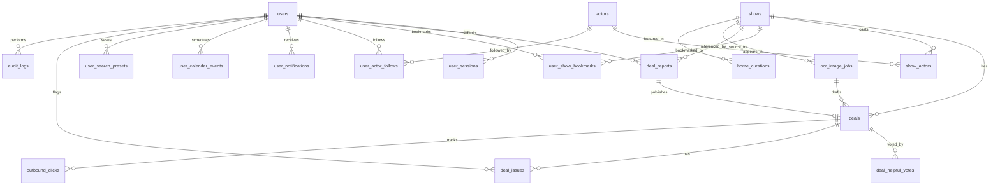

# 데이터베이스 설계서 — MuDeal

> 본 문서는 [시스템아키텍처설계서-SAD.md](시스템아키텍처설계서-SAD.md) (`v1.0`)와 [요구사항명세서-SRS.md](../01-요구사항분석/요구사항명세서-SRS.md) (`v1.1`)를 기반으로 **Cloudflare D1 (SQLite) + Drizzle ORM** 물리 스키마(19개 테이블)를 정의합니다.
> 금전 보상(`rewards`) 테이블을 제거하고, **4축 검색(`sub_region` 대학로 분리·조건부 세부 태그·검색 프리셋)**, **회원 전용 제보 + `제보해주신 딜`(확인/도움 수)**, **`TICKET_OPEN` 티켓오픈 임박**, **작품 찜 · 뮤배 팔로우 · 스토리 바 피드(저장 포함) · 마이페이지 내장 캘린더** 테이블을 반영했습니다.

| 항목 | 내용 |
|------|------|
| **문서 ID** | DBS-MUDEAL-v1.0 |
| **프로젝트명** | MuDeal (가칭) |
| **문서 버전** | v1.0 (기획 확정 기준선) |
| **작성일** | 2026-11-25 |
| **DBMS / ORM** | Cloudflare D1 (SQLite 3) + Drizzle ORM (`PRAGMA foreign_keys = ON`) |
| **타임존 전략** | 저장: ISO-8601 UTC (`TEXT`) / 날짜·기간·마감·리셋 판정: `KST (UTC+9)` |

---

## 1. ER 다이어그램

---

## 2. 테이블 상세 명세 (19개 테이블)

### 2.1 `users` & `user_sessions` (소셜 로그인 · 개인화 · RBAC)
- **`users`**: `id` (PK), `oauth_provider` (`KAKAO|GOOGLE`), `oauth_subject`, `nickname`, `email` (NULL), `role` (`USER|ADMIN`), `status` (`ACTIVE|SUSPENDED|WITHDRAWN`), `terms_agreed_at`, `created_at`, `updated_at` · `UNIQUE(oauth_provider, oauth_subject)`
- **`user_sessions`**: `id` (PK), `user_id` (FK), `refresh_token_hash` (`UNIQUE`), `expires_at`, `revoked_at`, `created_at`

### 2.2 `shows` — 전국 뮤지컬 작품 (4축 검색 · 대학로 분리 지원)

| 컬럼명 | 타입 | Nullable | 설명 |
|--------|------|----------|------|
| `id` | `INTEGER` | NOT NULL | PK AUTOINCREMENT |
| `kopis_id` | `TEXT` | NULL | KOPIS 공연 고유 ID (`UNIQUE`) |
| `title` / `normalized_title` | `TEXT` | NOT NULL | 공연명 / 검색·매핑용 정규화 제목 |
| `poster_url` | `TEXT` | NULL | 5:7 포스터 URL |
| `venue_name` / `venue_address` | `TEXT` | NOT NULL / NULL | 공연장명 / 주소 |
| `region` | `TEXT` | NOT NULL | 광역 시/도 (`서울`, `경기`, `인천`, `부산`, `대구` 등) |
| `sub_region` | `TEXT` | NOT NULL | 4축 검색용 지역 코드 (`DAEHAKRO`, `SEOUL_OTHER`, `GYEONGGI_INCHEON`, `BUSAN`, `DAEGU`, `DAEJEON_CHUNGCHEONG`, `GWANGJU_JEOLLA`, `GANGWON_JEJU`) (`BP-SEARCH-004`) |
| `start_date` / `end_date` | `TEXT` | NOT NULL | 공연 시작일·종료일 (`YYYY-MM-DD`, KST — 날짜/기간 겹침 필터 기준 `BP-SEARCH-001`) |
| `base_prices_json` | `TEXT` | NULL | 좌석등급별 KOPIS 공식 정가 JSON (`{"VIP":170000,"R":140000,...}`) |
| `min_active_price` | `INTEGER` | NULL | 활성 딜 최저가 캐시 컬럼 (가격대 4축 필터·정렬 고속화용, 딜 변경 시 갱신) |
| `max_discount_rate` | `INTEGER` | NULL | 활성 딜 최대 할인율 캐시 컬럼 |
| `status` | `TEXT` | NOT NULL | `UPCOMING` / `ONGOING` / `ENDED` |
| `view_count` | `INTEGER` | NOT NULL | 누적 상세 조회수 (기본 `0`) |
| `created_at` / `updated_at` | `TEXT` | NOT NULL | UTC ISO-8601 |

- **인덱스**: `uk_shows_kopis_id (kopis_id)`, `idx_shows_4axis (status, sub_region, start_date, end_date, min_active_price)`, `idx_shows_norm_title (normalized_title)`

### 2.3 `deals` — 예매처별 할인 · 이벤트 · 특전 (`DRAFT` 초안 + `제보해주신 딜` 통합)

| 컬럼명 | 타입 | Nullable | 기본값 | 설명 |
|--------|------|----------|--------|------|
| `id` | `INTEGER` | NOT NULL | AUTOINCREMENT | PK |
| `show_id` | `INTEGER` | NOT NULL | - | FK → `shows(id)` ON DELETE CASCADE |
| `channel_name` | `TEXT` | NOT NULL | - | `NOL티켓`, `엘티켓`, `YES24티켓`, `티켓링크`, `유니켓`, `타임티켓`, `샤롯데씨어터` 등 |
| `deal_type` | `TEXT` | NOT NULL | - | 가격 할인(`TIMESALE` / `LOTTERY` / `DISCOUNT_SITE` / `CARD_EVENT` / `SPECIAL_DAY`), **티켓오픈 예정(`TICKET_OPEN`)**, 현장 이벤트·특전(`SINGALONG` / `CURTAIN_CALL` / `PERK_GOODS`) |
| `seat_grade` | `TEXT` | NOT NULL | `'ALL'` | `VIP` / `R` / `S` / `A` / `ALL` |
| `base_price` / `sale_price` | `INTEGER` | NULL / NULL | NULL | 기준 정가 / 할인가 (`sale_price >= 0`; `TICKET_OPEN` 및 순수 싱어롱·커튼콜·특전은 `NULL` 허용) |
| `discount_rate` | `INTEGER` | NULL | NULL | `floor((base_price-sale_price)/base_price*100)` |
| `is_unconditional` | `INTEGER` | NOT NULL | `1` | `1`=무조건 할인, `0`=추첨/조건부 |
| `condition_tags_json` | `TEXT` | NULL | NULL | 조건부 할인 세부 태그 JSON 배열 (`["MATINEE","REWATCH","YOUTH_STUDENT","OFFICE_WORKER","CARD_PARTNER"]`) — NOL `benefitBadges`·티켓링크 `청년패스` 연동 |
| `condition_summary` | `TEXT` | NULL | NULL | 할인/참여 조건 요약 |
| `opens_at` | `TEXT` | NULL | NULL | **`TICKET_OPEN` 오픈 예정 일시** (UTC ISO-8601 — 홈 `티켓오픈 임박` 및 캘린더 자동 표시용) |
| `event_dates_json` | `TEXT` | NULL | NULL | 싱어롱·커튼콜 회차/날짜 JSON 배열 |
| `perk_summary` | `TEXT` | NULL | NULL | 포토카드·스페셜 티켓·굿즈 증정 조건 |
| `fee_info` | `TEXT` | NULL | NULL | 예매 수수료 안내 |
| `external_url` | `TEXT` | NOT NULL | - | 외부 원문/예매 URL (`https://`) |
| `external_key` | `TEXT` | NULL | NULL | 배치 중복 감지 키 (`UNIQUE`) |
| `expires_at` | `TEXT` | NULL | NULL | 마감 시각 (UTC ISO-8601) |
| `status` | `TEXT` | NOT NULL | `'DRAFT'` | `DRAFT` / `ACTIVE` / `EXPIRED` / `HIDDEN` / `DISCARDED` |
| `source_type` | `TEXT` | NOT NULL | - | `SYNC_APPROVED` / `OCR_APPROVED` / `ADMIN` / `USER_REPORT` |
| `source_report_id` | `INTEGER` | NULL | NULL | FK → `deal_reports(id)` (**`UNIQUE`** — 제보 중복 게시 방지) |
| `source_ocr_job_id` | `INTEGER` | NULL | NULL | FK → `ocr_image_jobs(id)` |
| `reporter_nickname` | `TEXT` | NULL | NULL | `USER_REPORT` 출처 시 `제보해주신 딜` 판에 표시할 크레딧 (예: `뮤덕A`, `익명의 관객`) |
| `click_count` | `INTEGER` | NOT NULL | `0` | 누적 확인(외부 이동) 수 (`N명 확인` 표기용) |
| `helpful_count` | `INTEGER` | NOT NULL | `0` | 누적 `도움이 됐어요` 수 |
| `admin_locked` | `INTEGER` | NOT NULL | `0` | `1`이면 자동 배치 덮어쓰기 금지 |
| `last_verified_at` / `created_at` / `updated_at` | `TEXT` | NOT NULL | UTC NOW | 확인·생성·수정 시각 |

- **인덱스**:
  - `idx_deals_compare (show_id, status, seat_grade, sale_price ASC, is_unconditional DESC)`
  - `idx_deals_community (source_type, status, created_at DESC)` — 홈 **`제보해주신 딜`** 판 전용 인덱스
  - `idx_deals_price_filter (status, sale_price, is_unconditional)` — 가격대 4축 검색
  - `idx_deals_drafts (status, created_at ASC)` — 어드민 초안 검수 대기열
  - `idx_deals_expiry (status, expires_at)` — 자동 마감 배치

### 2.4 `deal_reports` — 회원 전용 할인·이벤트 제보 (악성 링크 방지, 금전 보상 없음)

| 컬럼명 | 타입 | Nullable | 설명 |
|--------|------|----------|------|
| `id` | `INTEGER` | NOT NULL | PK |
| `reporter_id` | `INTEGER` | **NOT NULL** | 로그인 회원 FK → `users(id)` (**회원 전용 제보 확정**) |
| `reporter_nickname` | `TEXT` | NOT NULL | 표시 닉네임 (기본 회원 닉네임, 검수 시 관리자 마스킹 가능) |
| `show_id` / `reported_show_title` | `INTEGER` / `TEXT` | NULL / NOT NULL | 기존 작품 FK 또는 미등록 작품명 |
| `channel_name` / `external_url` | `TEXT` | NOT NULL | 예매처명 / 외부 URL (`https://` 필수) |
| `deal_type` / `seat_grade` | `TEXT` | NOT NULL | 할인·이벤트 유형 / 좌석등급 |
| `reported_price` / `reported_discount_rate` | `INTEGER` | NULL | 제보 할인가 / 할인율 |
| `is_unconditional` / `condition_note` / `expires_at` | `INTEGER` / `TEXT` | NOT NULL / NULL | 조건·마감 메모 |
| `evidence_r2_key` | `TEXT` | NULL | R2 업로드 증빙 이미지 키 (5MB) |
| `status` | `TEXT` | NOT NULL | `PENDING` / `APPROVED` / `REJECTED` |
| `reviewer_id` / `reject_reason_code` / `reject_reason_note` / `reviewed_at` | `INTEGER` / `TEXT` | NULL | 관리자 검수 정보 |
| `created_at` / `updated_at` | `TEXT` | NOT NULL | UTC ISO-8601 |

- **인덱스**: `idx_reports_status (status, created_at ASC)`, `idx_reports_reporter (reporter_id, created_at DESC)` (마이페이지 및 KST 일 10건 한도 체크)

### 2.5 `actors` & `show_actors` — 뮤지컬 배우 및 출연작 매핑 (KOPIS `prfcast` 기반)
- **`actors`**: `id` (PK), `name` (NOT NULL), `normalized_name` (NOT NULL), `disambiguation_note` (NULL, 동명이인 구분용), `follower_count` (INTEGER DEFAULT 0), `created_at`, `updated_at` · `idx_actors_norm_name (normalized_name)`
- **`show_actors`**: `id` (PK), `show_id` (FK → `shows.id` CASCADE), `actor_id` (FK → `actors.id` CASCADE), `role_name` (NULL, 배역명 선택), `source_type` (`KOPIS|ADMIN`), `created_at` · `UNIQUE(show_id, actor_id)`, `idx_show_actors_actor (actor_id, show_id)`

### 2.6 개인화 5종 테이블 (`user_show_bookmarks`, `user_actor_follows`, `user_notifications`, `user_calendar_events`, `user_search_presets`)
- **`user_show_bookmarks`** (작품 찜): `id` (PK), `user_id` (FK), `show_id` (FK), `created_at` · `UNIQUE(user_id, show_id)`
- **`user_actor_follows`** (뮤배 팔로우): `id` (PK), `user_id` (FK), `actor_id` (FK), `created_at` · `UNIQUE(user_id, actor_id)`
- **`user_notifications`** (스토리 바 자동 읽음 · 최근 30일 다시 보기 · 소식 저장):
  - `id` (PK), `user_id` (FK), `noti_type` (`BOOKMARKED_SHOW_DEAL` | `FOLLOWED_ACTOR_DEAL` | `FOLLOWED_ACTOR_NEW_SHOW` | `REPORT_APPROVED` | `REPORT_REJECTED`), `show_id` (NULL), `deal_id` (NULL), `actor_id` (NULL), `report_id` (NULL), `title` (TEXT), `body` (TEXT), `is_read` (`0|1`), **`is_saved` (`0|1`, 기본 `0` — 저장된 소식은 30일 경과 후에도 보관)**, `dedup_key` (`TEXT UNIQUE`), `created_at`
  - 인덱스: `idx_noti_user_unread (user_id, is_read, created_at DESC)`, `idx_noti_story_target (user_id, is_read, actor_id, show_id)`, `idx_noti_user_saved (user_id, is_saved, created_at DESC)`
- **`user_calendar_events`** (마이페이지 내장 캘린더 — 담은 일정 + 직접 입력 일정, 1인 최대 200건):
  - `id` (PK), `user_id` (FK → `users.id` CASCADE), `event_date` (`YYYY-MM-DD` KST), `event_time` (`HH:mm` NULL 허용), `category` (`WATCH` 관극 | `TICKETING` 티켓팅 | `EVENT` 담은 소식 | `CUSTOM` 직접 입력), `title` (TEXT NOT NULL), `memo` (TEXT NULL), `source_show_id` (FK NULL), `source_deal_id` (FK NULL), `created_at`, `updated_at`
  - 인덱스: `idx_cal_user_date (user_id, event_date ASC)`
  - *참고*: 찜·팔로우 작품의 자동 표시 일정(티켓오픈·로터리 마감·싱어롱 회차)은 별도 복제 저장 없이 조회 시점에 `deals`·`shows`와 조합하여 반환한다.
- **`user_search_presets`** (저장된 4축 검색 프리셋, 1인 최대 5개):
  - `id` (PK), `user_id` (FK → `users.id` CASCADE), `name` (TEXT, 예: `대학로 5만원 이하`), `query_params_json` (TEXT JSON), `created_at`
  - 인덱스: `idx_presets_user (user_id, created_at DESC)`

### 2.7 운영 · OCR · 집계 보조 테이블 (7개)
| 테이블 | 핵심 컬럼 / 목적 | 주요 인덱스 / 제약 |
|---|---|---|
| **`ocr_image_jobs`** | `show_id`, `source_channel`, `source_page_url`, `image_url (UK)`, `image_hash`, `ocr_status`, `extracted_json`, `confidence`, `error_message` | `uk_ocr_image_url`, `idx_ocr_hash`, `idx_ocr_status` |
| **`deal_helpful_votes`** | `deal_id`, `user_id (NULL)`, `session_hash (NULL)`, `created_at` (`도움이 됐어요` 중복 방지) | `uk_helpful_user (deal_id, user_id)`, `uk_helpful_sess (deal_id, session_hash)` |
| **`deal_issues`** | `deal_id`, `reporter_id (USER)`, `issue_type`, `note`, `status`, `resolved_by` | `idx_issues_status` |
| **`home_curations`** | `slot_type (HERO|SPOTLIGHT)`, `show_id`, `eyebrow`, `title`, `subtitle`, `image_url`, `link_url`, `sort_order`, `starts_at`, `ends_at`, `is_active` | `idx_curations_active` |
| **`outbound_clicks`** | `deal_id`, `show_id`, `channel_name`, `source_type`, `session_hash`, `clicked_at` | `idx_clicks_dedup (session_hash, deal_id, clicked_at DESC)` |
| **`sync_runs`** & **`audit_logs`** | 배치 실행·3회 연속 실패 감지 / 관리자 전수 감사 로그 | `idx_sync_runs_source`, `idx_audit_target` |

---

## 3. 핵심 정합성 및 마이그레이션
- **제보 승인 멱등성**: `UPDATE deal_reports SET status='APPROVED' WHERE id=? AND status='PENDING'`(`changes === 1`) + `UNIQUE(deals.source_report_id)`. 승인 트랜잭션 완료 후 찜/팔로우 대상자에게 `INSERT OR IGNORE INTO user_notifications ...` (`dedup_key UNIQUE`)로 중복 없이 인앱 소식을 생성한다.
- **최저가 캐시 동기화**: `deals` 게시/수정/마감 시 `shows.min_active_price` 및 `shows.max_discount_rate`를 함께 갱신해 4축 가격대 필터가 단일 테이블 인덱스로 빠르게 동작하게 한다.
- **백업/마이그레이션**: Drizzle Kit 순차 SQL 마이그레이션 + Cloudflare D1 Time Travel(시점 복구).
