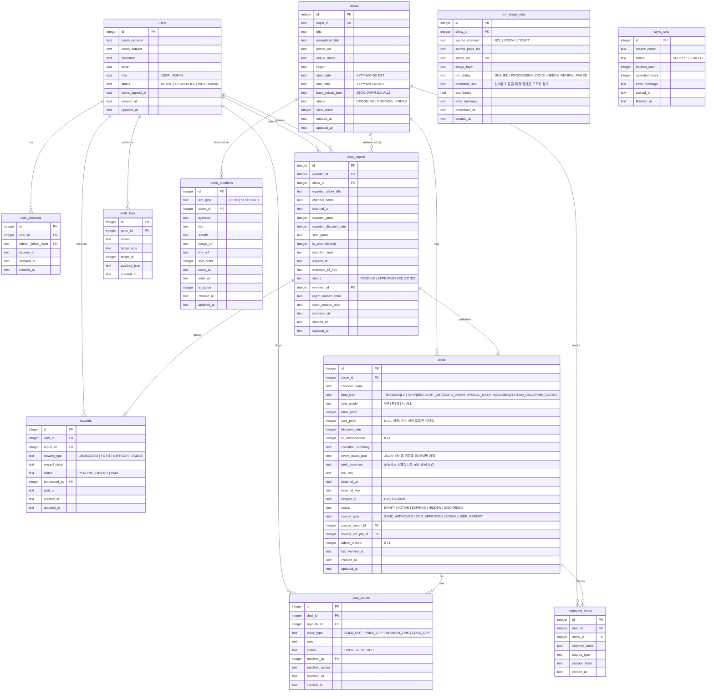

# 데이터베이스 설계서 — MuDeal

> 본 문서는 [시스템아키텍처설계서-SAD.md](시스템아키텍처설계서-SAD.md)와 [요구사항명세서-SRS.md](../01-요구사항분석/요구사항명세서-SRS.md)를 기반으로 **Cloudflare D1 (SQLite) + Drizzle ORM** 물리 스키마, 제약조건, 인덱스 및 마이그레이션 전략을 정의한 **Phase 2** 산출물입니다.

| 항목 | 내용 |
|------|------|
| **문서 ID** | DBS-MUDEAL-v0.1 |
| **프로젝트명** | MuDeal (가칭) |
| **문서 버전** | v0.1 |
| **작성일** | 2026-11-24 |
| **작성자** | 백엔드/데이터팀 · Gemini (Antigravity) |
| **승인자** | 프로젝트 오너 (미결 — G2 승인 대기) |
| **문서 상태** | 초안 |

---

## 1. 개요 및 DBMS 선정

| 항목 | 내용 |
|------|------|
| **DBMS** | Cloudflare D1 (Managed SQLite 3) |
| **ORM / 마이그레이션** | Drizzle ORM + Drizzle Kit (`migrations/*.sql`) |
| **인코딩 / 타임존** | UTF-8 / **저장: ISO-8601 UTC (`TEXT`, 예: `2026-11-24T11:30:00Z`)**, **비즈니스 판정: KST (UTC+9)** (`BP-RESET-001-1`) |
| **기본키 전략** | `INTEGER PRIMARY KEY AUTOINCREMENT` (D1/SQLite 인덱스 크기·조회 효율 최적화) |
| **외래키 / 불리언** | D1 `PRAGMA foreign_keys = ON` 적용 / 불리언은 `INTEGER` (`0` = false, `1` = true) |
| **명명 규칙** | `snake_case`, 복수형 테이블명 |

---

## 2. ER 다이어그램

---

## 3. 테이블 상세 명세 (12개 테이블)

### 3.1 `users` — 사용자 (소셜 로그인 전용)

| 컬럼명 | SQLite 타입 | Nullable | 기본값 | 설명 |
|--------|-------------|----------|--------|------|
| `id` | `INTEGER` | NOT NULL | AUTOINCREMENT | PK |
| `oauth_provider` | `TEXT` | NOT NULL | - | `KAKAO` / `GOOGLE` (`BP-AUTH-001-1`) |
| `oauth_subject` | `TEXT` | NOT NULL | - | 소셜 제공자 고유 사용자 ID |
| `nickname` | `TEXT` | NOT NULL | - | 표시 닉네임 |
| `email` | `TEXT` | NULL | NULL | 소셜 제공 이메일(선택 제공 대응) |
| `role` | `TEXT` | NOT NULL | `'USER'` | `USER` / `ADMIN` (`BP-AUTH-003`) |
| `status` | `TEXT` | NOT NULL | `'ACTIVE'` | `ACTIVE` / `SUSPENDED` / `WITHDRAWN` |
| `terms_agreed_at` | `TEXT` | NOT NULL | - | 필수 약관 동의 시각 (UTC) |
| `created_at` / `updated_at` | `TEXT` | NOT NULL | UTC NOW | 생성/수정 시각 |

- **제약조건**: `UNIQUE(oauth_provider, oauth_subject)` (`BP-AUTH-001-3`), `CHECK(role IN ('USER','ADMIN'))`
- **인덱스**: `uk_users_oauth (oauth_provider, oauth_subject)`, `idx_users_role (role)`

### 3.2 `user_sessions` — Refresh Token 세션

| 컬럼명 | SQLite 타입 | Nullable | 설명 |
|--------|-------------|----------|------|
| `id` | `INTEGER` | NOT NULL | PK |
| `user_id` | `INTEGER` | NOT NULL | FK → `users(id)` ON DELETE CASCADE |
| `refresh_token_hash` | `TEXT` | NOT NULL | SHA-256 해시 (`UNIQUE`) |
| `expires_at` | `TEXT` | NOT NULL | 만료 시각 (14일) |
| `revoked_at` | `TEXT` | NULL | 로그아웃/로테이션 무효화 시각 |
| `created_at` | `TEXT` | NOT NULL | 발급 시각 |

- **인덱스**: `idx_user_sessions_user (user_id)`, `uk_user_sessions_hash (refresh_token_hash)`

### 3.3 `shows` — 뮤지컬 작품

| 컬럼명 | SQLite 타입 | Nullable | 기본값 | 설명 |
|--------|-------------|----------|--------|------|
| `id` | `INTEGER` | NOT NULL | AUTOINCREMENT | PK |
| `kopis_id` | `TEXT` | NULL | NULL | KOPIS 공연 고유 ID (`UNIQUE`, 수동 등록 작품은 NULL 허용) |
| `title` | `TEXT` | NOT NULL | - | 공연명 |
| `normalized_title` | `TEXT` | NOT NULL | - | 공백/특수문자 제거 정규화 제목 (검색·배치 매핑용) |
| `poster_url` | `TEXT` | NULL | NULL | 5:7 포스터 이미지 URL |
| `venue_name` | `TEXT` | NOT NULL | - | 공연장명 |
| `region` | `TEXT` | NOT NULL | - | 시/도 지역 (`서울`, `경기`, `부산`, `대구` 등 전국 단위) |
| `start_date` / `end_date` | `TEXT` | NOT NULL | - | 공연 시작일/종료일 (`YYYY-MM-DD`, KST 기준) |
| `base_prices_json` | `TEXT` | NULL | NULL | 좌석등급별 기준 정가 JSON (예: `{"VIP":170000,"R":140000,"S":110000,"A":80000}`) |
| `status` | `TEXT` | NOT NULL | `'ONGOING'` | `UPCOMING` / `ONGOING` / `ENDED` |
| `view_count` | `INTEGER` | NOT NULL | `0` | 누적 상세 조회수 (`BP-STAT-001-2`) |
| `created_at` / `updated_at` | `TEXT` | NOT NULL | UTC NOW | 생성/수정 시각 |

- **인덱스**: `uk_shows_kopis_id (kopis_id)`, `idx_shows_status_region (status, region)`, `idx_shows_end_date (end_date)`, `idx_shows_norm_title (normalized_title)`

### 3.4 `deals` — 예매처별 할인·이벤트·특전 딜 (핵심 비교 및 초안 테이블)

| 컬럼명 | SQLite 타입 | Nullable | 기본값 | 설명 |
|--------|-------------|----------|--------|------|
| `id` | `INTEGER` | NOT NULL | AUTOINCREMENT | PK |
| `show_id` | `INTEGER` | NOT NULL | - | FK → `shows(id)` ON DELETE CASCADE |
| `channel_name` | `TEXT` | NOT NULL | - | 예매처/사이트명 (`NOL티켓`, `엘티켓`, `YES24티켓`, `티켓링크`, `유니켓`, `타임티켓`, `샤롯데씨어터` 등) |
| `deal_type` | `TEXT` | NOT NULL | - | 가격 할인(`TIMESALE` / `LOTTERY` / `DISCOUNT_SITE` / `CARD_EVENT` / `SPECIAL_DAY`) 또는 현장 이벤트·특전(`SINGALONG` / `CURTAIN_CALL` / `PERK_GOODS`) |
| `seat_grade` | `TEXT` | NOT NULL | `'ALL'` | `VIP` / `R` / `S` / `A` / `ALL` |
| `base_price` | `INTEGER` | NULL | NULL | 적용 기준 정가(원) |
| `sale_price` | `INTEGER` | NULL | NULL | 할인가(원, `>= 0`). 순수 `SINGALONG`/`CURTAIN_CALL`/`PERK_GOODS` 이벤트는 `NULL` 허용 |
| `discount_rate` | `INTEGER` | NULL | NULL | `floor((base_price-sale_price)/base_price*100)` (`BP-DEAL-001-1`) |
| `is_unconditional` | `INTEGER` | NOT NULL | `1` | `1`=무조건 할인, `0`=추첨/조건부 (`BP-DEAL-002-1`) |
| `condition_summary` | `TEXT` | NULL | NULL | 할인/참여 조건 요약 (예: `NOL 앱 추첨`, `재관람 티켓 지참`) |
| `event_dates_json` | `TEXT` | NULL | NULL | 싱어롱·커튼콜 데이 등 특정 회차/날짜 JSON 배열 (예: `["2026-12-05 19:30","2026-12-12 19:30"]`) |
| `perk_summary` | `TEXT` | NULL | NULL | 포토카드·스페셜 티켓·굿즈 증정 조건 요약 |
| `fee_info` | `TEXT` | NULL | NULL | 예매 수수료 안내 (예: `예매 수수료 2,000원`) |
| `external_url` | `TEXT` | NOT NULL | - | 외부 원문/예매 이동 URL (`https://` 검증, `BP-DEAL-003-2`) |
| `external_key` | `TEXT` | NULL | NULL | 배치 중복 감지 키 (`channel:externalId:dealType:seatGrade`) |
| `expires_at` | `TEXT` | NULL | NULL | 마감 시각 (UTC ISO-8601, `NULL`이면 공연 종료일까지) |
| `status` | `TEXT` | NOT NULL | `'DRAFT'` | `DRAFT`(배치·OCR 검수 대기 초안) / `ACTIVE`(게시중) / `EXPIRED` / `HIDDEN` / `DISCARDED`(초안 폐기) |
| `source_type` | `TEXT` | NOT NULL | - | `SYNC_APPROVED` / `OCR_APPROVED` / `ADMIN` / `USER_REPORT` (`BP-SYNC-002-4`) |
| `source_report_id` | `INTEGER` | NULL | NULL | 사용자 제보 승인 출처 FK → `deal_reports(id)` (**`UNIQUE`** — 중복 게시 DB 차단) |
| `source_ocr_job_id` | `INTEGER` | NULL | NULL | 공지 이미지 OCR 출처 FK → `ocr_image_jobs(id)` |
| `admin_locked` | `INTEGER` | NOT NULL | `0` | `1`이면 자동 배치가 덮어쓰지 않음 (`BP-SYNC-002-3`) |
| `last_verified_at` | `TEXT` | NOT NULL | UTC NOW | 최종 확인 시각 (UI 표시 및 24시간 경과 경고 기준) |
| `created_at` / `updated_at` | `TEXT` | NOT NULL | UTC NOW | 생성/수정 시각 |

- **제약조건**: `CHECK(sale_price IS NULL OR sale_price >= 0)`, `CHECK(status IN ('DRAFT','ACTIVE','EXPIRED','HIDDEN','DISCARDED'))`, `UNIQUE(external_key)`, `UNIQUE(source_report_id)`
- **인덱스**:
  - `idx_deals_compare (show_id, status, seat_grade, sale_price ASC, is_unconditional DESC)` — **가격 비교표 핵심 인덱스 (`BP-DEAL-002-3`)**
  - `idx_deals_drafts (status, created_at ASC)` — 어드민 자동 수집·OCR 초안 검수 대기열
  - `idx_deals_home_filter (status, deal_type, expires_at)` — 홈 할인·싱어롱·특전 필터 및 마감임박 레일
  - `idx_deals_expiry (status, expires_at)` — 자동 마감 배치

### 3.5 `deal_reports` — 사용자 할인 제보

| 컬럼명 | SQLite 타입 | Nullable | 기본값 | 설명 |
|--------|-------------|----------|--------|------|
| `id` | `INTEGER` | NOT NULL | AUTOINCREMENT | PK |
| `reporter_id` | `INTEGER` | NOT NULL | - | FK → `users(id)` |
| `show_id` | `INTEGER` | NULL | NULL | 기존 작품 선택 시 FK → `shows(id)` |
| `reported_show_title` | `TEXT` | NOT NULL | - | 사용자가 선택 또는 직접 입력한 작품명 |
| `channel_name` | `TEXT` | NOT NULL | - | 예매처/사이트명 |
| `external_url` | `TEXT` | NOT NULL | - | 제보 URL (`https://`) |
| `reported_price` | `INTEGER` | NULL | NULL | 제보 할인가 (`reported_price` 또는 `reported_discount_rate` 중 하나 필수) |
| `reported_discount_rate` | `INTEGER` | NULL | NULL | 제보 할인율 (1~99) |
| `seat_grade` | `TEXT` | NULL | `'ALL'` | 좌석등급 |
| `is_unconditional` | `INTEGER` | NOT NULL | `1` | 무조건 여부 |
| `condition_note` | `TEXT` | NULL | NULL | 할인 조건 및 메모 |
| `expires_at` | `TEXT` | NULL | NULL | 마감일시 |
| `evidence_r2_key` | `TEXT` | NULL | NULL | R2 업로드 증빙 이미지 키 |
| `status` | `TEXT` | NOT NULL | `'PENDING'` | `PENDING` / `APPROVED` / `REJECTED` (`BP-REPORT-002-1`) |
| `reviewer_id` | `INTEGER` | NULL | NULL | 검수 관리자 FK → `users(id)` |
| `reject_reason_code` | `TEXT` | NULL | NULL | `DUPLICATE` / `EXPIRED` / `INVALID_LINK` / `MISMATCH` / `OTHER` |
| `reject_reason_note` | `TEXT` | NULL | NULL | 반려 상세 사유 (`BP-REPORT-002-4`) |
| `reviewed_at` | `TEXT` | NULL | NULL | 검수 완료 시각 |
| `created_at` / `updated_at` | `TEXT` | NOT NULL | UTC NOW | 생성/수정 시각 |

- **인덱스**: `idx_reports_status_created (status, created_at ASC)` (어드민 대기열), `idx_reports_reporter_created (reporter_id, created_at DESC)` (마이페이지 및 KST 일 10건 한도 체크 `BP-REPORT-001-3`)

### 3.6 `rewards` — 제보자 혜택 지급 이력 (`DEC-001` 유연 구조)

| 컬럼명 | SQLite 타입 | Nullable | 기본값 | 설명 |
|--------|-------------|----------|--------|------|
| `id` | `INTEGER` | NOT NULL | AUTOINCREMENT | PK |
| `user_id` | `INTEGER` | NOT NULL | - | 수령 대상자 FK → `users(id)` |
| `report_id` | `INTEGER` | NOT NULL | - | FK → `deal_reports(id)` (**`UNIQUE`** — 중복 혜택 지급 DB 차단!) |
| `reward_type` | `TEXT` | NOT NULL | `'UNDECIDED'` | `UNDECIDED` / `POINT` / `GIFTICON` / `BADGE` (`DEC-001` 확정 시 확장) |
| `reward_detail` | `TEXT` | NULL | NULL | 지급 내용/메모 (예: `혜택 확정 후 일괄 지급`, `스타벅스 아메리카노`) |
| `status` | `TEXT` | NOT NULL | `'PENDING_PAYOUT'` | `PENDING_PAYOUT` / `PAID` |
| `processed_by` | `INTEGER` | NULL | NULL | 지급 완료 처리 관리자 FK → `users(id)` |
| `paid_at` | `TEXT` | NULL | NULL | 지급 완료 시각 |
| `created_at` / `updated_at` | `TEXT` | NOT NULL | UTC NOW | 생성/수정 시각 |

- **인덱스**: `uk_rewards_report (report_id)`, `idx_rewards_user (user_id, created_at DESC)`, `idx_rewards_status (status, created_at ASC)`

### 3.7 운영·OCR·집계 보조 테이블 (`ocr_image_jobs`, `deal_issues`, `home_curations`, `outbound_clicks`, `sync_runs`, `audit_logs`)

| 테이블 | 핵심 목적 | 주요 인덱스 / 제약 |
|--------|-----------|-------------------|
| **`ocr_image_jobs`** | NOL·YES24·엘티켓 신규 공지 이미지 Vision/OCR 해석 상태·추출 JSON·신뢰도 및 중복 실행 방지 (`FR-001`, `BP-SYNC-002`) | `uk_ocr_image_url (image_url)`, `idx_ocr_hash (image_hash)`, `idx_ocr_status (ocr_status, created_at ASC)` |
| **`deal_issues`** | 품절/가격 오류 신고 (`FR-011`, `USER` 전용) | `idx_issues_status (status, created_at ASC)`, `idx_issues_deal (deal_id)` |
| **`home_curations`** | 홈 히어로 배너·다크 스포트라이트 큐레이션 (`FR-012`) | `idx_curations_active (slot_type, is_active, sort_order)` |
| **`outbound_clicks`** | 외부 예매처 클릭 로그 및 10초 중복 제거 (`FR-005`, `BP-STAT-001-1`) | `idx_clicks_dedup (session_hash, deal_id, clicked_at DESC)`, `idx_clicks_time (clicked_at)` |
| **`sync_runs`** | KOPIS/1차·2차 채널 배치 실행 이력 및 3회 연속 실패 감지 (`FR-001`, `BP-SYNC-003-2`) | `idx_sync_runs_source (source_name, started_at DESC)` |
| **`audit_logs`** | 관리자 승인/반려/지급/수정 전수 감사 로그 (`NFR-002`) | `idx_audit_target (target_type, target_id)`, `idx_audit_created (created_at DESC)` |

---

## 4. 핵심 정합성 및 트랜잭션 설계 (D1 특화)

1. **제보 승인 멱등성 (`FR-009-AC3`, `NFR-003`)**:
   - D1 `db.batch` 실행 전 조건부 전이(`UPDATE deal_reports SET status='APPROVED', reviewer_id=?, reviewed_at=? WHERE id=? AND status='PENDING'`)의 영향 행 수(`changes === 1`)를 검증하고, `deals.source_report_id`와 `rewards.report_id`에 **`UNIQUE`** 제약을 두어 동시 클릭·재시도 시에도 중복 게시와 중복 혜택 생성을 원천 차단한다.
2. **배치 Upsert 및 관리자 잠금 보호 (`BP-SYNC-002-2`)**:
   - `INSERT INTO deals (...) VALUES (...) ON CONFLICT(external_key) DO UPDATE SET sale_price=excluded.sale_price, ... WHERE deals.admin_locked = 0` 구문으로 SQL 레벨에서 관리자 잠금 딜 덮어쓰기를 방지한다.
3. **검색 성능**:
   - 전국 활성 뮤지컬 규모(수백~수천 건)에서는 `normalized_title`·`venue_name`·`region` 인덱스 기반 쿼리만으로 p95 `< 50ms` 이내 응답이 가능하며, 데이터 증가 시 SQLite **FTS5** 가상 테이블을 추가한다.

---

## 5. 마이그레이션 및 백업/복구 전략

- **마이그레이션**: Drizzle Kit으로 순차 SQL 파일(`migrations/0001_init.sql`, `0002_...sql`)을 생성하고, 이미 적용된 파일은 수정하지 않는다. CI에서 Preview → Production 순으로 `d1 migrations apply` 실행.
- **백업 및 PITR**: Cloudflare D1 내장 **Time Travel** 기능을 기본 복구 수단으로 활용(시점 복구 지원)하며, 주요 스키마 변경 전 D1 SQL 덤프를 수동/자동 백업한다.
