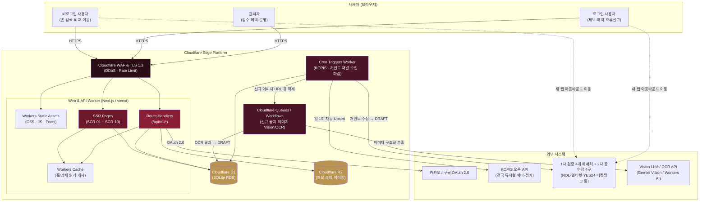
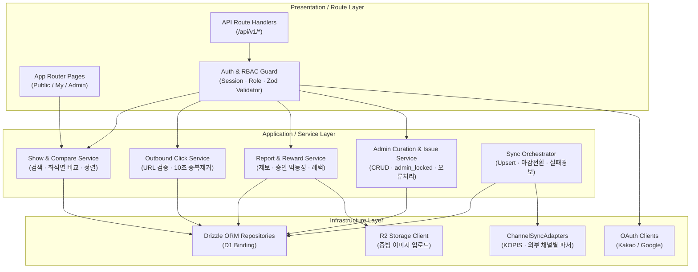
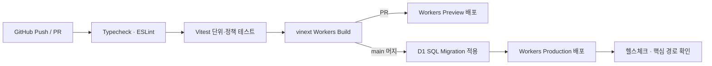

# 시스템 아키텍처 설계서 (SAD) — MuDeal

> System Architecture Document
> 본 문서는 [요구사항명세서-SRS.md](../01-요구사항분석/요구사항명세서-SRS.md), [비즈니스정책서.md](../00-기획/비즈니스정책서.md), [DESIGN.md](../../DESIGN.md)를 기반으로 **Cloudflare Workers + D1 + Next.js(`vinext`)** 환경의 **MuDeal** 시스템 아키텍처를 정의한 **Phase 2(시스템 설계)** 산출물입니다.

| 항목 | 내용 |
|------|------|
| **문서 ID** | SAD-MUDEAL-v0.1 |
| **프로젝트명** | MuDeal (가칭) |
| **문서 버전** | v0.1 |
| **작성일** | 2026-11-24 |
| **작성자** | 아키텍처/개발팀 · Gemini (Antigravity) |
| **승인자** | 프로젝트 오너 (미결 — G2 승인 대기) |
| **문서 상태** | 초안 |

---

## 변경 이력

| 버전 | 날짜 | 작성자 | 변경 내용 |
|------|------|--------|-----------|
| v0.1 | 2026-11-24 | Gemini (Antigravity) | Cloudflare Workers + Next.js(`vinext`) + D1 + R2 + Cron Triggers 기반 시스템 아키텍처 초안 작성 |
| v0.2 | 2026-11-24 | Gemini (Antigravity) | 실제 검증 1차/2차 채널 엔드포인트, Cloudflare Queues/Workflows + Vision AI/OCR 공지 이미지 해석 파이프라인 및 `DRAFT` 초안 검수 아키텍처(ADR-005) 추가 |

---

## 1. 문서 개요

### 1.1 목적 및 범위
- **목적**: 전국 뮤지컬 할인·이벤트 가격 비교 서비스 MuDeal의 아키텍처 구조, Cloudflare 기반 기술 스택, 배포 파이프라인, 보안·성능 대응 전략 및 아키텍처 결정 기록(ADR)을 정의한다.
- **참조 문서**: [PRD.md](../../PRD.md), [DESIGN.md](../../DESIGN.md), [서비스기획서.md](../00-기획/서비스기획서.md), [비즈니스정책서.md](../00-기획/비즈니스정책서.md), [요구사항명세서-SRS.md](../01-요구사항분석/요구사항명세서-SRS.md), [요구사항추적매트릭스-RTM.md](../01-요구사항분석/요구사항추적매트릭스-RTM.md).

---

## 2. 아키텍처 개요

### 2.1 아키텍처 스타일 선택

**선정 스타일: 모듈러 모놀리스(Modular Monolith) on Cloudflare Workers + 별도 스케줄 배치 워커**

| 평가 항목 | 모듈러 모놀리스 (Workers 단일 앱 + Sync 워커) | 마이크로서비스 (다중 Worker 분리) | 정적 SPA + 외부 API 서버 |
|-----------|----------------------------------------------|----------------------------------|--------------------------|
| 구현·운영 복잡도 | **낮음** (단일 저장소, 통합 배포) | 높음 (서비스 간 RPC/버전 관리) | 중간 (CORS·이중 배포) |
| SSR / SEO 적합성 | **최적** (Next.js App Router SSR) | 중간 | 낮음 (CSR 한계) |
| Cloudflare 비용/성능 | **최적** (D1/R2 직접 바인딩, 콜드스타트 최소) | 중간 | 중간 |
| MVP 일정 적합성 | **높음** | 낮음 | 높음 |

**선정 근거**:
1. MVP 규모에서 웹 SSR, REST API(`/api/v1/*`), 어드민 UI를 하나의 **Next.js (`vinext`) on Cloudflare Workers** 앱으로 통합하면 타입(Drizzle 스키마·DTO)을 공유하면서 운영 복잡도를 최소화할 수 있다.
2. 정기 배치 수집(KOPIS + 외부 할인/예매처 + 자동 마감)은 웹 요청 수명과 분리해 **Cloudflare Cron Triggers** 전용 엔트리(또는 동일 프로젝트 내 `scheduled` 핸들러)로 실행한다.
3. 결제/발권 기능이 없으므로(`EX-001`) 분산 트랜잭션이나 무거운 메시지 브로커 없이 D1 단일 RDB로 데이터 정합성을 단순하게 보장할 수 있다.

### 2.2 아키텍처 원칙

| 원칙 | 적용 방법 |
|------|-----------|
| **단순성 우선 (Simplicity First)** | Cloudflare 올인원(Workers + Static Assets + D1 + R2 + Cron Triggers + Workers Cache)으로 외부 인프라 의존성 최소화 |
| **경계 명확화 (Adapter Pattern)** | 외부 연동 소스(KOPIS, 각 할인/예매처)를 `ChannelSyncAdapter` 인터페이스로 격리해 특정 사이트 구조 변경 시 파급 차단 (`BP-SYNC-003`) |
| **서버 측 권한 통제 (Zero Trust API)** | 모든 `/api/v1/admin/*` 및 쓰기 API는 서버 미들웨어에서 세션/JWT와 Role(`USER`/`ADMIN`)을 검증 (`BP-AUTH-002-3`) |
| **KST 단일 기준·UTC 저장** | DB에는 ISO-8601 UTC로 저장하고, 모든 마감 판정·D-Day·일일 리셋은 `KST (UTC+9)` 유틸리티로 통일 (`BP-RESET-001`) |

### 2.3 시스템 컨텍스트 및 컨테이너 다이어그램

### 2.4 애플리케이션 내부 모듈 구조

---

## 3. 기술 스택 선정

| 영역 | 선정 기술 | 선정 근거 |
|------|-----------|-----------|
| **런타임 / 배포** | **Cloudflare Workers + Workers Static Assets** | 신규 풀스택 앱에 대한 Cloudflare 공식 권장 플랫폼(Pages 대체), 글로벌 엣지 저지연, D1/R2/Cron 네이티브 바인딩 |
| **웹 프레임워크** | **Next.js (App Router via `vinext`) + React + TypeScript** | SSR/메타태그 기반 검색 유입(SEO) 최적화, 익숙한 React 생태계, `vinext`로 Vite + Workers 네이티브 빌드 지원 |
| **스타일링** | **Tailwind CSS + CSS Variables (`DESIGN.md` 토큰)** | 와인/버건디 5-Tier 토큰, `tabular-nums`, 표준 반응형 브레이크포인트의 빠른 일관 구현 |
| **API / 검증** | **Next.js Route Handlers + Zod** | 별도 API 서버 없이 단일 Workers 배포, 입력/URL 스킴(`BP-DEAL-003-2`) 런타임 검증 일원화 |
| **데이터베이스** | **Cloudflare D1 (SQLite) + Drizzle ORM** | 별도 DB 호스팅 없는 서버리스 RDB, 무료 티어 넉넉, Drizzle 타입 안전 마이그레이션 및 `db.batch` 원자 실행 |
| **오브젝트 스토리지** | **Cloudflare R2** | 사용자 제보 증빙 이미지(최대 5MB) 저장, 송신(Egress) 비용 0 |
| **정기 배치 & 비동기 OCR** | **Cloudflare Cron Triggers + Queues / Workflows** | KOPIS 일일 수집, 검증된 4개 예매처·4개 공연장 저빈도 수집, 자동 마감 전환 + 신규 공지 이미지 비동기 Vision/OCR 오케스트레이션(자동 재시도·속도 제한) |
| **공지 이미지 OCR / 해석** | **Gemini Vision API (또는 Cloudflare Workers AI Vision)** | NOL·YES24·엘티켓 공지 이미지에서 싱어롱 회차, 커튼콜 날짜, 특전/굿즈 조건, 상세 할인표를 JSON 스키마로 구조화 추출 (`ocr_image_jobs` 해시 중복 방지) |
| **캐싱** | **Workers Cache** | 읽기 비중이 압도적인 홈(`/`)·작품 상세(`/shows/[id]`) 응답 캐싱 및 배치/관리자 변경 시 무효화 |
| **인증** | **OAuth 2.0 (카카오/구글) + 서명 JWT (HttpOnly Cookie)** | 자체 비밀번호 관리 제거(`EX-003`), Web Crypto API(`jose`) 기반 Workers 네이티브 검증 |
| **관측성 / 분석** | **Workers Logs & Traces + Cloudflare Web Analytics** | 별도 모니터링 서버 없이 오류 추적 및 방문/성능(LCP) 측정 |
| **테스트 / CI** | **Vitest (Miniflare/Workers) + Playwright + GitHub Actions / Workers Builds** | 정책 경계값 단위/통합 테스트 및 주요 흐름 E2E 검증 |

**불채택 대안 요약**:
- *Cloudflare Pages*: 신규 프로젝트는 Workers + Static Assets가 공식 권장되어 불채택.
- *OpenNext*: 신규 Next.js on Workers 프로젝트는 Cloudflare 가이드 기준 `vinext` 우선 채택.
- *외부 PostgreSQL / Redis / Elasticsearch*: MVP 규모(전국 활성 뮤지컬 수백~수천 건)에서 별도 인프라 운영비·커넥션 풀링 부담이 과도하므로 D1 + Workers Cache로 단순화.

---

## 4. 배포 아키텍처 및 환경 구성

### 4.1 환경 구성

| 환경 | 용도 | 배포 트리거 | 바인딩 리소스 |
|------|------|-------------|---------------|
| **Local** | 개발 및 단위/통합 테스트 | 로컬 개발 서버 (`workerd` / Miniflare) | 로컬 D1, 로컬 R2, `.dev.vars` |
| **Preview / Staging** | PR 단위 시각·통합 검수 | PR 생성/푸시 시 **Workers Previews** 자동 배포 | Preview용 격리 D1/R2 |
| **Production** | 실서비스 운영 | `main` 브랜치 머지 + CI 검증 통과 후 **Workers Builds** 배포 | Production D1, R2, Secrets, Cron Triggers |

### 4.2 CI/CD 파이프라인

- **롤백 전략**: 코드 오류 시 Cloudflare Workers Versions & Deployments에서 직전 정상 버전으로 즉시 트래픽 롤백. 데이터 오류 시 D1 Time Travel로 특정 시점 복구.
- **시크릿 관리**: `KOPIS_API_KEY`, `KAKAO_CLIENT_SECRET`, `GOOGLE_CLIENT_SECRET`, `JWT_SECRET`은 코드에 커밋하지 않고 **Workers Secrets**에 환경별로 주입.

---

## 5. 아키텍처 결정 기록 (ADR)

### ADR-001: Cloudflare Workers + Next.js (`vinext`) 단일 풀스택 채택
- **상태**: 승인 (Accepted, 2026-11-24)
- **컨텍스트**: 뮤지컬 할인 검색 유입(SEO)과 빠른 외부 예매처 이동(반응형 웹)이 핵심이며, Cloudflare 배포를 전제로 최소 운영 비용이 요구됨.
- **결정**: Cloudflare Workers + Workers Static Assets 위에 Next.js App Router(`vinext`) 단일 풀스택으로 SSR 페이지와 `/api/v1/*` API를 함께 배포한다.
- **트레이드오프**: 일부 Node.js 전용 네이티브 라이브러리는 Workers 런타임(Web Standard API) 호환 버전을 사용해야 함(예: `jose`, Web Crypto, `fetch`).

### ADR-002: 서버리스 RDB로 Cloudflare D1 + Drizzle ORM 채택
- **상태**: 승인 (Accepted, 2026-11-24)
- **컨텍스트**: 사용자 제보→승인→혜택 지급의 원자성, 관리자 잠금(`admin_locked`), 지역·좌석·할인유형 복합 검색/정렬을 처리할 관계형 저장소가 필요하나 별도 DB 서버 운영은 피하고 싶음.
- **결정**: Cloudflare D1(SQLite)과 Drizzle ORM을 채택한다.
- **트레이드오프**: D1은 단일 쓰기 리전 특성상 초고빈도 쓰기에는 한계가 있으나, MuDeal은 읽기 비중 95%+ 서비스이므로 완벽히 부합한다. 쓰기 경쟁(제보 중복 승인)은 조건부 `UPDATE` + `UNIQUE` 제약으로 DB 레벨에서 차단한다.

### ADR-003: HttpOnly Cookie 기반 서명 JWT + DB Refresh Session 채택
- **상태**: 승인 (Accepted, 2026-11-24)
- **컨텍스트**: XSS로 인한 토큰 탈취를 막고, 소셜 로그인 사용자의 로그아웃·권한 변경을 서버에서 제어해야 함.
- **결정**: Access Token(30분, `HttpOnly; Secure; SameSite=Lax`)과 Refresh Token(14일, 해시하여 D1 `user_sessions`에 저장, 로테이션 적용)을 사용한다.

### ADR-004: 외부 연동 채널별 어댑터 격리 및 장애 보존
- **상태**: 승인 (Accepted, 2026-11-24)
- **컨텍스트**: 외부 할인 사이트의 마크업·API 변경이나 일시 장애가 전체 서비스 장애나 딜 소실로 이어지면 안 됨(`BP-SYNC-003`).
- **결정**: KOPIS 및 각 외부 채널을 독립 `ChannelSyncAdapter`로 구현하고, 채널별 실패 카운트를 D1 `sync_runs`에 기록한다. 실패 시 기존 정상 딜을 삭제하지 않으며, 연속 3회 실패 시 관리자 경고를 기록한다. (JS 렌더링이 필수인 사이트는 약관 검토 `DEC-002` 통과 시에만 선택적으로 Cloudflare Browser Run 검토.)

### ADR-005: 외부 수집·Vision/OCR 공지 해석의 비동기 초안(`DRAFT`) 검수 파이프라인
- **상태**: 승인 (Accepted, 2026-11-24)
- **컨텍스트**: 뮤지컬 핵심 이벤트(싱어롱 데이, 커튼콜 데이, 포토카드/굿즈 특전, 카드/재관람 상세 할인표)의 상당수가 NOL·YES24·엘티켓 공지 이미지 안에 존재하며, 외부 예매처 데이터는 약관·저작권·OCR 오인식 리스크가 있음.
- **결정**:
  1. KOPIS 오픈 API만 기준 DB에 직접 자동 Upsert한다.
  2. 1차 검증 4개 예매처(NOL·엘티켓·YES24·티켓링크) 및 2차 공연장 4곳(샤롯데·예술의전당·세종·클립서비스)은 저빈도 HTTP 배치로 수집하고, 신규 공지 이미지 URL만 `image_url`/`image_hash` 중복 검사 후 **Cloudflare Queues/Workflows → Vision LLM/OCR**으로 비동기 구조화 추출한다.
  3. 모든 외부 수집 및 OCR 결과는 **`DRAFT(검수 대기 초안)`**으로 적재하며, 관리자가 원문 링크와 추출값을 대조·승인한 뒤에만 게시한다. 원본 공지 이미지는 사용자 화면에 재배포하지 않고 원문 예매처 링크로 연결한다.
- **트레이드오프**: 자동 즉시 게시 대비 관리자 검수 공수가 발생하지만, 저작권 안전성·봇 차단 예방·정보 정확도(할루시네이션 방지)를 동시에 확보한다.

---

## 6. 비기능 요구사항 대응 설계

| NFR-ID | 목표 | 아키텍처 대응 방안 |
|--------|------|-------------------|
| **NFR-001** (성능) | 조회/비교 p95 < 500ms, 검색 p95 < 1s, LCP < 2.5s | SSR + Workers Cache(홈 60초, 작품 상세 60초 TTL, 관리자 변경/배치 시 무효화), D1 복합 인덱스, 5:7 포스터 지연 로딩 |
| **NFR-002** (보안) | `/admin/*` 100% 403, 비안전 URL 0건, HTTPS, 감사 로그 | Cloudflare WAF/TLS 1.3, 서버 미들웨어 Role 검증, Zod `https://` 화이트리스트 검증, `audit_logs` 기록, (선택) 제보 폼 Turnstile |
| **NFR-003** (정합성) | KST 마감 100%, 중복 승인 0건, 배치 보존 100% | 조회 쿼리 + Cron 이중 마감 필터(`expires_at > now`), 조건부 `UPDATE` + `UNIQUE(report_id)` 원자성, 배치 실패 시 기존 행 미삭제 |
| **NFR-004** (호환·접근성) | 전 브레이크포인트 가로 스크롤 0px, WCAG AA | [DESIGN.md](../../DESIGN.md) 표준 CSS 브레이크포인트·시맨틱 HTML·`tabular-nums` |
| **NFR-005** (신뢰성) | 3회 실패 경고, 제보 로컬 보존, 10초 클릭 중복 제거 | `sync_runs` 연속 실패 카운터, 브라우저 `localStorage` 자동 임시 저장, `outbound_clicks` 세션 해시+10초 중복 체크 |

---

## 7. 검증된 외부 연동 채널 및 파이프라인 상세

| 구분 | 채널 / 소스 | 검증된 엔드포인트 및 추출 항목 | 실행 방식 / 반영 정책 | 주의사항 |
|------|------------|-------------------------------|----------------------|----------|
| **기준 DB** | **KOPIS 오픈 API** | `kopis.or.kr/openApi/restful/pblprfr` — 전국 뮤지컬 메타, 좌석 공식 정가(`pcseguidance`), 공식 예매처 링크 | Cron 일 1회 → `shows` **자동 Upsert** | 법적·차단 리스크 0 |
| **1차 검증** | **NOL티켓** | `/ticket/genre/musical`, `/display/upcoming?genre=musical`, `/products/{id}` — `__next_f` SSR JSON(`originPrice`, `discountPrice`, `discountRate`, `benefitBadges`, 로터리/마티네) + 공지 이미지 URL | 저빈도 Cron → **`DRAFT` 초안** + 신규 이미지 OCR 큐 | Cloudflare 적용 — 저빈도 호출 필수 |
| **1차 검증** | **엘티켓 (L.TICKET)** | `/`, `/product/list?condition=BFYSAL`, `/product/detail/{id}` — 좌석별 정가·최대할인가·할인율 + 안내 이미지 URL | 저빈도 Cron → **`DRAFT` 초안** + 신규 이미지 OCR 큐 | 봇 방어 스크립트 — 저빈도 호출 필수 |
| **1차 검증** | **YES24티켓** | `GenreList_Data.aspx?genre=15457`, `axList.aspx`(티켓오픈 공지), `/Perf/{PerfID}` — YES24데이/엔젤티켓/싱어롱 제목·공지 감지 + 좌석 정가/할인 최저~최고가 + 이미지 URL | 저빈도 Cron → **`DRAFT` 초안** + 신규 이미지 OCR 큐 | STCLab BotManager — 고빈도 금지 |
| **1차 검증** | **티켓링크** | `mapi.ticketlink.co.kr/mapi/ranking/genre/daily?categoryId=10&categoryId2=16`, `/mapi/notice/list`, `/mapi/product/{id}` — 랭킹 50위 + 티켓오픈 공지 본문 JSON(단독/선예매/할인/이벤트) | 저빈도 Cron → **`DRAFT` 초안** | 웹 상세(`/product/{id}`)는 EverSafe 적용 → `mapi` JSON만 사용 |
| **2차 보조** | **공연장·기획사 공식 SSR** | 샤롯데씨어터(`current.asp`), 예술의전당(`sac.or.kr`), 세종문화회관(`sejongpac.or.kr`), 클립서비스(`clipservice.co.kr`) — 자체 기획작·선예매·회원 할인 | 저빈도 Cron → **`DRAFT` 초안** | `robots.txt` 준수 |
| **OCR 해석** | **Vision AI / OCR** | NOL·YES24·엘티켓 신규 공지 이미지 URL → 싱어롱 회차, 커튼콜 날짜, 특전/굿즈 조건, 상세 할인표 JSON 추출 | Queues/Workflows 비동기 → **`DRAFT` 초안** | URL/해시 중복 실행 금지, 원본 이미지 미재배포 |
| **3차 조건부** | **타임티켓 · LG/충무아트센터** | CSR/SPA 구조 (`timeticket.co.kr` 마감임박 타임세일 등) | MVP는 관리자 등록·사용자 제보 병행, 후속 Cloudflare Browser Run 또는 XHR 검토 | 조건부 확장 |
| **자동 마감** | **내부 마감 배치** | `expires_at <= now` 딜 `EXPIRED`, `end_date < today(KST)` 작품 `ENDED` | Cron 15분 간격 + 조회 시점 이중 필터 | KST 단일 기준 |
| **인증** | **카카오 / 구글 OAuth** | OAuth 2.0 Authorization Code Flow + `state` CSRF 검증 | 사용자 로그인 요청 시 | 실패 시 로그인 화면 복귀 |
