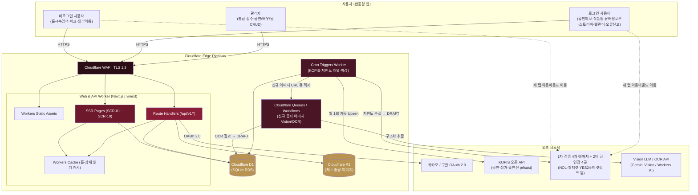

# 시스템 아키텍처 설계서 (SAD) — MuDeal

> System Architecture Document (`SAD-MUDEAL-v1.0`)
> [요구사항명세서-SRS.md](../01-요구사항분석/요구사항명세서-SRS.md) (`v1.0`) 기반으로 **Cloudflare Workers + Next.js(`vinext`) + D1 + R2 + Cron/Queues/Workflows** 기반 시스템 아키텍처를 정의합니다.

| 항목 | 내용 |
|------|------|
| **문서 ID** | SAD-MUDEAL-v1.0 |
| **프로젝트명** | MuDeal (가칭) |
| **문서 버전** | v1.0 (기획 확정 기준선) |
| **작성일** | 2026-11-25 |
| **문서 상태** | 검토 준비 |

---

## 1. 아키텍처 개요

### 1.1 선정 스타일: 모듈러 모놀리스 on Cloudflare Workers + 비동기 수집/OCR 파이프라인
- **Web & API 단일 Worker**: Next.js App Router(`vinext`) SSR + `/api/v1/*` Route Handlers + Workers Static Assets를 하나로 배포해 타입·도메인 로직을 공유하고 운영 복잡도를 최소화한다.
- **배치 & 비동기 OCR 분리**: KOPIS(공연·정가·출연진 `prfcast`) 일일 수집, 1차/2차 외부 채널 저빈도 수집, 자동 마감은 **Cloudflare Cron Triggers**로 실행하고, NOL·YES24·엘티켓 신규 공지 이미지 해석은 **Cloudflare Queues / Workflows → Vision LLM/OCR**으로 비동기 오케스트레이션한다.
- **경량 운영 구조**: 자체 결제(`EX-001`) 및 금전 보상(`EX-002`)을 제거하여 분산 정산 복잡도 없이 D1 단일 RDB로 완결한다.

### 1.2 시스템 컨텍스트 및 컨테이너 다이어그램

### 1.3 내부 도메인 모듈
- **Search & Compare Module**: 4축 복합 필터(날짜·작품/배우명·가격대·`대학로` 분리 지역), 좌석별 비교표, 싱어롱·특전 분리, `제보해주신 딜` 조회
- **Personalization Module**: 작품 찜, KOPIS `prfcast` 기반 배우 팔로우(`내 뮤배 극`), 게시 이벤트 시 인앱 소식(`user_notifications`) 팬아웃 생성
- **Community Report & Curation Module**: 회원 전용 제보(URL 필수 · 일 10건), `도움이 됐어요` 반응, 관리자 통합 검수(`사용자 제보` + `자동 수집·OCR 초안` 승인/반려), 공연·배우 매핑·딜 CRUD
- **Sync & OCR Module**: `KopisAdapter`, `NolAdapter`, `LTicketAdapter`, `Yes24Adapter`, `TicketlinkAdapter`, 공연장 보조 어댑터, `OcrPipeline`

---

## 2. 기술 스택 선정

| 영역 | 선정 기술 | 선정 근거 |
|------|-----------|-----------|
| **런타임 / 배포** | Cloudflare Workers + Workers Static Assets | 신규 풀스택 앱 공식 권장(Pages 대체), 글로벌 엣지, D1/R2/Cron 네이티브 바인딩 |
| **웹 프레임워크** | Next.js (App Router via `vinext`) + React + TypeScript | SSR/SEO(작품·배우·할인 검색 유입) + `vinext` Workers 네이티브 빌드 |
| **스타일링** | Tailwind CSS + CSS Variables (`DESIGN.md`) | 5-Tier 와인/버건디 + Champagne Gold + `tabular-nums` + 표준 반응형 |
| **DB / ORM** | Cloudflare D1 (SQLite) + Drizzle ORM | 별도 DB 호스팅·비용 없는 서버리스 RDB, 복합 인덱스·`UNIQUE` 정합성·Time Travel 백업 |
| **스토리지** | Cloudflare R2 | 회원 제보 증빙 이미지(5MB, egress 0) 저장 |
| **배치 / 비동기 OCR** | Cloudflare Cron Triggers + Queues / Workflows + Gemini Vision (또는 Workers AI) | 저빈도 배치와 공지 이미지 비동기 Vision/OCR 오케스트레이션(자동 재시도·속도 제어) |
| **캐싱 / 인증** | Workers Cache + OAuth 2.0(카카오/구글) HttpOnly Cookie JWT | 홈·상세 읽기 캐싱 + XSS 안전한 세션 관리 |

---

## 3. 아키텍처 결정 기록 (ADR)

- **ADR-001**: Cloudflare Workers + Next.js(`vinext`) 단일 풀스택 채택 (SSR/SEO + 최소 운영비)
- **ADR-002**: Cloudflare D1 + Drizzle ORM 채택 (복합 4축 검색·찜/팔로우·제보 검수 멱등성을 별도 DB 서버 없이 해결)
- **ADR-003**: HttpOnly Cookie JWT(30분) + DB 해시 Refresh(14일 로테이션)로 소셜 로그인 개인화 세션 관리
- **ADR-004**: 외부 채널별 `ChannelSyncAdapter` 격리 + 장애 시 기존 정상 딜 보존 + 3회 연속 실패 관리자 경고
- **ADR-005**: KOPIS 외 수집·Vision/OCR 공지 해석은 모두 **`DRAFT` 초안**으로 적재해 관리자 승인 후 게시, 원본 공지 이미지는 무단 재배포하지 않고 원문 링크 연결
- **ADR-006**: 악성 링크·스팸 방지를 위해 제보는 **로그인 회원(`USER`) 전용 + `https://` URL 필수**로 제한하고(금전 보상 `Reward` 폐지 → `제보해주신 딜` 기여 지표), 최초 `ADMIN` 계정은 개발 시 `ADMIN_OAUTH_EMAILS` 환경변수/초기 시드로 부트스트랩한다. Vision/OCR은 일일 호출 상한(`OCR_DAILY_LIMIT`, 기본 100건/일)을 적용해 운영 비용 폭탄을 원천 차단한다.

---

## 4. 검증된 외부 연동 채널 상세

| 구분 | 채널 / 소스 | 검증된 엔드포인트 및 추출 항목 | 반영 정책 | 주의사항 |
|------|------------|-------------------------------|-----------|----------|
| **기준 DB** | **KOPIS 오픈 API** | `kopis.or.kr/openApi/restful/pblprfr` — 공연 메타, 좌석 정가(`pcseguidance`), **출연진(`prfcast` → 배우 매핑)**, 공연장 주소(`대학로` 분류) | Cron 일 1회 → `shows`/`actors`/`show_actors` **자동 Upsert** | 법적·차단 리스크 0 |
| **1차 검증** | **NOL티켓** | `/ticket/genre/musical`, `/display/upcoming?genre=musical`, `/products/{id}` — `__next_f` SSR JSON(`originPrice`, `discountPrice`, `discountRate`, `benefitBadges`, 로터리) + 공지 이미지 URL | 저빈도 Cron → `DRAFT` + 신규 이미지 OCR 큐 | Cloudflare 적용 — 저빈도 필수 |
| **1차 검증** | **엘티켓 (L.TICKET)** | `/`, `/product/list?condition=BFYSAL`, `/product/detail/{id}` — 좌석별 정가·최대할인가·할인율 + 안내 이미지 URL | 저빈도 Cron → `DRAFT` + 신규 이미지 OCR 큐 | 봇 방어 — 저빈도 필수 |
| **1차 검증** | **YES24티켓** | `GenreList_Data.aspx?genre=15457`, `axList.aspx`(티켓오픈 공지), `/Perf/{PerfID}` — YES24데이/엔젤티켓/싱어롱 감지 + 정가/할인 최저~최고가 + 이미지 URL | 저빈도 Cron → `DRAFT` + 신규 이미지 OCR 큐 | STCLab BotManager — 고빈도 금지 |
| **1차 검증** | **티켓링크** | `mapi.ticketlink.co.kr/mapi/ranking/genre/daily?categoryId=10&categoryId2=16`, `/mapi/notice/list`, `/mapi/product/{id}` — 랭킹 50위 + 공지 본문 JSON | 저빈도 Cron → `DRAFT` | 웹 상세는 EverSafe → `mapi` JSON만 사용 |
| **2차 보조** | **공연장·기획사 공식 SSR** | 샤롯데씨어터, 예술의전당, 세종문화회관, 클립서비스 | 저빈도 Cron → `DRAFT` | `robots.txt` 준수 |
| **OCR 해석** | **Vision AI / OCR** | NOL·YES24·엘티켓 신규 공지 이미지 → 싱어롱·커튼콜·특전/굿즈·할인표 JSON | Queues/Workflows 비동기 → `DRAFT` | `image_url`/`image_hash` 중복 방지, 이미지 미재배포 |
| **3차 조건부** | **타임티켓 · LG/충무아트센터** | CSR/SPA 구조 | MVP는 수동/제보 병행, 후속 Browser Run/XHR 검토 | 조건부 확장 |

---

## 5. 배포 · CI/CD 및 비기능 대응
- **CI/CD**: GitHub Push/PR → Typecheck/ESLint → Vitest(정책 경계 테스트) → `vinext` Build → PR **Workers Previews** / `main` D1 Migration + **Workers Production** 배포.
- **비기능 대응**: Workers Cache(홈/상세 60초 TTL, 승인/배치 시 무효화), WAF/TLS 1.3, `audit_logs` 전수 기록, `KST (UTC+9)` 단일 마감 판정(Cron 15분 + 조회 시점 이중 필터), OCR 일일 호출 상한(`OCR_DAILY_LIMIT`).
