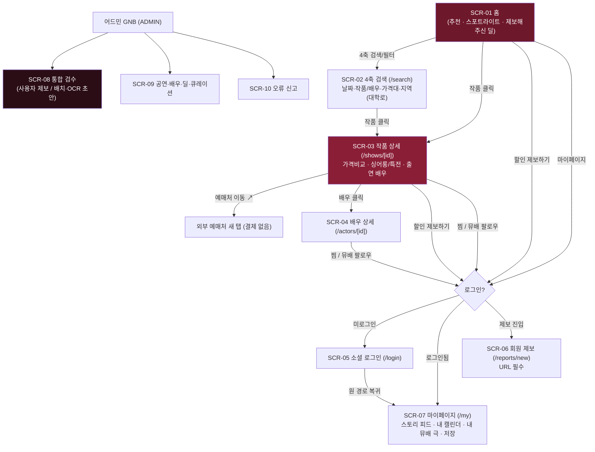

# 화면(UI/UX) 설계서 — MuDeal

> `UIX-MUDEAL-v1.0` · [DESIGN.md](../../DESIGN.md)의 **Velvet Burgundy 와인/버건디 디자인 시스템**과 기획 확정본(`PRD v1.0`, `SRS v1.0`)을 연결한 화면 설계서입니다.
> **4축 검색 필터(날짜·이름/배우·가격대·대학로 분리 지역)**, **`티켓오픈 임박`**, **`제보해주신 딜` 기여 섹션**, **회원 전용 제보**, **작품 찜 · 뮤배 팔로우 · 스토리 바 자동읽음/저장 · 내장 캘린더**가 반영되어 있습니다.

---

## 1. 전체 화면 목록 (`SCR-01` ~ `SCR-10`)

| 화면 ID | 화면명 | URL | 접근 권한 | 관련 API | 관련 UC |
|---|---|---|---|---|---|
| **SCR-01** | 홈 (`제보해주신 딜` 포함) | `/` | 전체 | `GET /api/v1/home`, `POST /deals/{id}/helpful` | UC-001 |
| **SCR-02** | **4축 복합 필터 검색** | `/search` | 전체 | `GET /api/v1/shows`, `/shows/suggest` | UC-002 |
| **SCR-03** | 작품 상세 · 비교 · 특전 · 출연 배우 | `/shows/[id]` | 전체 | `GET /shows/{id}`, `POST /clicks`, `POST /helpful`, `POST /issues` | UC-003, UC-004, UC-010 |
| **SCR-04** | **배우 상세 / 출연극 모아보기** | `/actors/[id]` | 전체 (팔로우: USER) | `GET /actors/{id}`, `POST/DELETE /me/follows/actors/{id}` | UC-003, UC-007 |
| **SCR-05** | 카카오/구글 소셜 로그인 | `/login` | 비로그인 | `GET /auth/oauth/{provider}`, `POST /complete-signup` | UC-005 |
| **SCR-06** | **회원 전용 할인·이벤트 제보** | `/reports/new` | **`USER` 필수** | `POST /uploads/report-evidence`, `POST /reports` | UC-006 |
| **SCR-07** | **마이페이지 (스토리 바 피드 · 내 캘린더 · 찜 · 내 뮤배 극 · 내 기여)** | `/my` | `USER` 필수 | `GET /me/notifications`, `/me/calendar`, `/me/bookmarks/shows`, `/me/actors/shows`, `/me/search-presets`, `/me/reports` | UC-007 |
| **SCR-08** | 어드민 통합 검수 (제보 · 배치/OCR 초안) | `/admin/reports` | `ADMIN` 필수 | `GET/POST /admin/reports/*`, `/admin/drafts/*`, `/admin/ocr-jobs/*` | UC-008 |
| **SCR-09** | 어드민 공연·배우 매핑·딜·큐레이션 CRUD | `/admin/deals` | `ADMIN` 필수 | `CRUD /admin/shows`, `/deals`, `/actors`, `/curations`, `/sync/*` | UC-009, UC-011 |
| **SCR-10** | 어드민 오류 신고 처리 | `/admin/issues` | `ADMIN` 필수 | `GET/PATCH /admin/issues/*` | UC-010 |

---

## 2. 화면 흐름도



---

## 3. 핵심 화면 상세 명세

### 3.1 `SCR-01`: 홈 (`/`)
```text
+------------------------------------------------------------------------+
| [MuDeal]   홈 | 티켓오픈 임박 | 제보해주신 딜 | 로터리·특가 | 싱어롱·특전 | [🔍검색] [제보] [MY●3] |
+------------------------------------------------------------------------+
| [ 3열 1:1 히어로 배너 캐러셀 (버건디 스크림 + 2px 프로그레스바) ]        |
| ---------------------------------------------------------------------- |
| 마감임박 특가 (6열 가로 5:7 포스터 레일 · D-Day 배지)                   |
| ---------------------------------------------------------------------- |
| ⏰ 티켓오픈 임박 (NOL·YES24·티켓링크 오픈 예정 카운트다운 레일)          |
| ---------------------------------------------------------------------- |
| [Full-Width Curtain Noir #2B0D16 다크 스포트라이트 밴드]                 |
|  TODAY'S LOTTERY & SPECIAL EVENT · YES24데이 / NOL 로터리 / 싱어롱      |
| ---------------------------------------------------------------------- |
| 🍷 관객들이 제보해주신 딜 (전용 섹션)                  [전체 보기 / 제보+] |
|  [카드: 작품명 · 45% 38,500원 · "대학로산책님 제보" · 128명 확인 · 👍 24] |
| ---------------------------------------------------------------------- |
| [전체][타임세일][로터리][할인사이트][싱어롱·커튼콜][굿즈·특전][오늘마감]  |
| [ 5열 5:7 포스터 그리드 ]                                               |
+------------------------------------------------------------------------+
| MuDeal · 외부 예매처 비교 서비스 (결제·발권 미제공 · KOPIS)  © 2026 MuDeal |
+------------------------------------------------------------------------+
```
- **슬림 1단 헤더 & 초슬림 미니 푸터**: 글로벌 헤더에서 인라인 검색바와 `검색` 탭 중복을 제거하고 우측 `[🔍 검색]` 전용 버튼으로 분리한다(클릭 시 `SCR-02` 이동 및 검색창 자동 포커스). 하단은 3컬럼 대형 푸터 없이 1줄 면책·저작권 미니 푸터만 배치한다(약관/개인정보 링크는 공개·OAuth 연동 시점에만 미니 텍스트로 연결).
- **모바일 (`< 640px`)**: `52px` 상단 GNB, `2`열 그리드, 하단 `56px` 고정 탭바 (`홈` · `검색` · `제보` · `마이(미읽음 배지)`).

### 3.2 `SCR-02`: 4축 복합 필터 검색 (`/search`)
```text
+------------------------------------------------------------------------+
| [MuDeal]   홈 | 티켓오픈 임박 | 제보해주신 딜 | 로터리·특가 | 싱어롱·특전 | [🔍검색*] [제보] [MY●3] |
+------------------------------------------------------------------------+
| ┌─ 통합 4축 검색·필터 패널 (단일 #FFFFFF 카드, 헤더 검색바 없음) ──────┐ |
| │ [ 🔍 작품명 · 뮤지컬 배우 · 공연장 · 이벤트 검색...           [검색] ] │ |
| │ 1) 📅 날짜/기간: [오늘] [이번 주말] [이번 달] [기간 선택 ▼]           │ |
| │ 2) 📍 지역:      [전체] [서울·대학로(혜화)] [서울(기타)] [경기·인천]  │ |
| │                  [부산] [대구] [대전·충청] [광주·전라] [강원·제주]    │ |
| │ 3) 💸 가격대:    [전체] [3만원 이하] [5만원 이하] [7만원 이하] [직접] │ |
| │ 4) 🎟 유형/조건: [무조건 할인만] [로터리] [싱어롱·커튼콜] [굿즈·특전] │ |
| │                  [마티네] [재관람] [청년/학생] [직장인] [카드/제휴]   │ |
| │ [내 프리셋: 대학로 5만원 이하] [+ 현재 조건 저장]  [🔗 조건 링크 공유] │ |
| └──────────────────────────────────────────────────────────────────────┘ |
| 검색 결과 N건  [선택된 필터 태그 x] [초기화]        정렬: [최저가순 ▼]   |
| [ Desktop 4열 5:7 포스터 그리드 / Mobile 단일 열 104px 가로 카드 ]      |
+------------------------------------------------------------------------+
```
- 검색 결과 0건 시: *"현재 진행 중인 할인/이벤트가 없어요"* 안내 + 선택된 필터 초기화 + **`없는 할인 제보하기` CTA (`SCR-06`, 로그인 필요)**.

### 3.3 `SCR-03` 작품 상세 (`/shows/[id]`) & `SCR-04` 배우 상세 (`/actors/[id]`)
- **`SCR-03` (Desktop `670px` 좌 + `400px` 스티키 우 · SSR 동적 OG 공유 카드 지원)**:
  - 상단 헤더: `700:320` 블러 포스터 + 5:7 포스터 + 지역 태그(`[서울·대학로]`) + 작품명(H1) + **공연장명(클릭 시 `/search?q={공연장명}` 해당 공연장 진행 작품 모아보기)** + **`찜하기 ♥`** / 공유 버튼.
  - 가격 비교표: 좌석등급 탭(`VIP/R/S/A/전석`) + `일반 최저가` vs `추첨/조건부 최저가` 분리 요약 + 예매처별 행(`예매처 이동 ↗`, 제보 출처 행에는 `○○님 제보 · N명 확인 · 👍 도움` + `오류 신고`) + 최종 확인 시각·외부 기준 면책 고지.
  - **`현장 이벤트 · 특전 안내`** 섹션: 싱어롱 데이 회차, 커튼콜 데이 날짜, 포토카드/굿즈 증정 조건 + 원문 예매처 링크 (공지 이미지 무단 재배포 금지).
  - **`출연 배우`** 섹션: KOPIS `prfcast` 기반 배우 필(와인/골드 모노그램 또는 최근 출연작 포스터 아바타) — 클릭 시 `SCR-04` 이동, 우측 `+ 팔로우` / `팔로우 중 ✓` 토글.
- **`SCR-04` (`/actors/[id]`)**: 배우명 헤더 + 팔로워 수 + **`뮤배 팔로우` 버튼** + 해당 배우가 출연 중인 현재/예정 뮤지컬 목록(**진행 중 할인이 없어도 KOPIS 기본 공연 정보 상시 노출**).

### 3.4 `SCR-06` 제보 작성 (`/reports/new`) & `SCR-07` 마이페이지 (`/my`)
- **`SCR-06` 회원 전용 제보 (`/reports/new`, `USER` 필수)**:
  - 상단 안내: *"승인되면 홈 '제보해주신 딜' 판에 닉네임과 확인·도움 수가 함께 올라갑니다. 원문 예매처 링크(`https://`)를 꼭 입력해주세요."*
  - 입력 폼: 작품 선택/직접 입력, 예매처, URL(`https://` 필수), 할인가·할인율 또는 이벤트/특전 내용, 표시 닉네임(기본 회원 닉네임), 증빙 이미지(선택 5MB) + 로컬 임시 저장.
- **`SCR-07` 마이페이지 (`/my`, `USER` 전용)**:
  - **상단 스토리 바 (인스타그램형 가로 원형 썸네일 바 — 중복 타임라인 없음)**:
    - 팔로우한 배우(모노그램/최근 포스터 아바타) + 찜한 작품 썸네일 가로 스크롤. **미확인 새 소식이 있는 대상에만 와인(`#8A1E37`)·골드(`#B89352`) 링** 표시.
    - **특정 썸네일을 탭하면** 아래에 **해당 대상의 미확인 새 소식만 X/인스타 피드 카드 형식으로 스크롤 표시되고 열람 시 자동 읽음 처리(링 해제)**된다.
    - 선택한 배우/작품 프로필에 **`최근 소식 다시 보기 (30일)`** 버튼을 배치해 읽은 소식도 재확인할 수 있으며, 각 피드 카드에 **`🔖 저장하기`** · `📅 내 캘린더에 담기` · `예매처 이동 ↗` · `링크 공유` 액션을 제공한다.
  - **하위 탭 5개**:
    1. **`내 캘린더`**: 월간 캘린더에 찜/팔로우 작품의 **티켓오픈 일시**·로터리 마감·싱어롱/커튼콜 회차 자동 표시 + 담은 소식 + **`+ 일정 직접 추가`** 모달(CRUD).
    2. **`내 뮤배 극`**: 팔로우 중인 배우 칩 필터 + 해당 배우 출연 뮤지컬 모아보기(할인 없어도 기본정보 표시).
    3. **`찜한 뮤지컬`**: 찜한 작품 목록(할인 없어도 기본정보 표시) + 저장한 검색 조건 프리셋 관리.
    4. **`저장한 소식`**: 피드에서 `🔖 저장하기` 해둔 소식 영구 보관함.
    5. **`내 제보 기여`**: *"내가 제보한 딜로 총 **N명** 확인 · **M명** 도움"* 배너 + 내 제보 검수 상태(`검수중`/`승인됨`/`반려됨`+사유).

### 3.5 `SCR-08` ~ `SCR-10` 경량 관리자 콘솔 (`/admin/*`, `ADMIN` 전용)
- Curtain Noir(`#2B0D16`) 좌측 `240px` 사이드바: `통합 검수 [대기 N]` · `공연·배우·딜 관리` · `오류 신고 [N]` · `연동/OCR 상태` (**혜택 지급 메뉴 없음**).
- **`SCR-08` 통합 검수 (`/admin/reports`)**: 상단 2탭(**`사용자 제보`** / **`자동 수집·OCR 초안`**) + 좌측 원문 링크/OCR 추출 JSON·신뢰도 + 우측 기존 활성 딜 대조 및 보정 폼 → `승인 및 게시` / `반려(사유 필수)` / `폐기`.
- **`SCR-09` 운영 CRUD (`/admin/deals`)**: 공연·딜 등록/수정/`admin_locked` + **배우 동명이인 병합/매핑 보정** + 홈 배너/스포트라이트 큐레이션 + 배치 실패 경고/수동 재수집.
- **`SCR-10` 오류 신고 (`/admin/issues`)**: 접수된 오류 확인 → 대상 딜 즉시 수정/마감 후 완료 처리.
