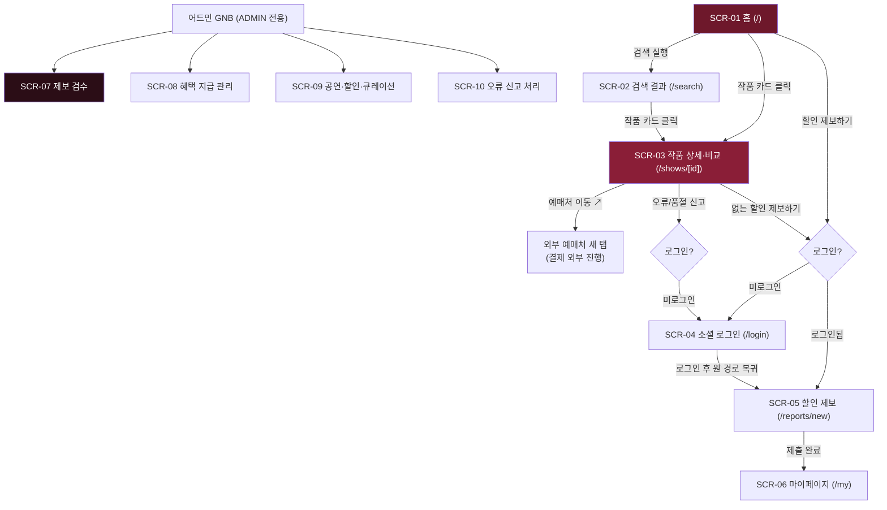

# 화면(UI/UX) 설계서 — MuDeal

> 본 문서는 [DESIGN.md](../../DESIGN.md)의 **Velvet Burgundy 와인/버건디 디자인 시스템**과 [요구사항명세서-SRS.md](../01-요구사항분석/요구사항명세서-SRS.md)·[유스케이스명세서.md](../01-요구사항분석/유스케이스명세서.md)를 연결한 **Phase 2** 화면 설계서입니다. 모든 컬러·타이포·간격·반응형 토큰의 단일 기준(Source of Truth)은 [DESIGN.md](../../DESIGN.md)입니다.

| 항목 | 내용 |
|------|------|
| **문서 ID** | UIX-MUDEAL-v0.1 |
| **프로젝트명** | MuDeal (가칭) |
| **문서 버전** | v0.1 |
| **작성일** | 2026-11-24 |
| **작성자** | UX/프론트엔드팀 · Gemini (Antigravity) |
| **승인자** | 프로젝트 오너 (미결 — G2 승인 대기) |
| **문서 상태** | 초안 |

---

## 1. 설계 원칙 및 반응형 기준

- **비주얼 아이덴티티**: [DESIGN.md](../../DESIGN.md)의 5-Tier 와인/버건디(`#6E182B`, `#8A1E37`, `#2B0D16`, `#4A1525`, `#F9ECEF`) + 희소성 전용 `Champagne Gold (#B89352)` + 웜 포슬린 뉴트럴(`#FFFFFF`, `#FCF8F7`, `#F6EFEF`, `#EAE0E1`).
- **숫자 가독성**: 모든 가격·할인율·D-Day·비교 예매처 수에 `Pretendard Variable` + `tabular-nums` 필수 적용.
- **자체 결제 없음 명확화**: 구매 버튼은 항상 `예매처 이동 ↗` 외부 링크 아이콘을 동반하고, 비교표 하단에 외부 예매처 기준 면책 문구와 최종 확인 시각을 고정 노출한다(`BP-DEAL-003-4`).
- **반응형 브레이크포인트** (`DESIGN.md §8` 준수, 표준 CSS `@media`):
  - **Mobile (`< 640px`)**: `52px` 상단 GNB + `56px` 하단 고정 탭바, `2`열 포스터 그리드 / 단일 열 리스트, 바텀시트 필터, PDP 하단 고정 `예매처 비교` CTA 바
  - **Tablet (`640px ~ 1023px`)**: `2`열 히어로, `3`열 그리드, 단일 컬럼 PDP
  - **Desktop (`1024px+`, 최대 셸 `1100px`)**: `158px` 2단 헤더 + 풀필 검색바, `3`열 히어로, `6`열 마감임박 레일, `5`열 추천 / `4`열 검색 그리드, `670px + 400px` 스티키 PDP 스플릿

---

## 2. 전체 화면 목록 (`SCR-01` ~ `SCR-10`)

| 화면 ID | 화면명 | URL | 접근 권한 | 관련 API | 관련 UC |
|---------|--------|-----|-----------|----------|---------|
| **SCR-01** | 홈 | `/` | 전체 (비로그인 허용) | `GET /api/v1/home` | UC-001 |
| **SCR-02** | 검색 결과 | `/search` | 전체 | `GET /api/v1/shows`, `/shows/suggest` | UC-002 |
| **SCR-03** | 작품 상세 · 가격 비교 | `/shows/[id]` | 전체 | `GET /api/v1/shows/{id}`, `POST /deals/{id}/clicks`, `POST /deals/{id}/issues` | UC-003, UC-004, UC-010 |
| **SCR-04** | 소셜 로그인 / 약관 동의 | `/login` | 비로그인 | `GET /auth/oauth/{provider}`, `POST /auth/oauth/complete-signup` | UC-005 |
| **SCR-05** | 할인·이벤트 제보 작성 | `/reports/new` | `USER` 필수 | `POST /uploads/report-evidence`, `POST /reports` | UC-006 |
| **SCR-06** | 마이페이지 (제보·혜택) | `/my` | `USER` 필수 | `GET /me/reports`, `GET /me/rewards` | UC-007 |
| **SCR-07** | 어드민 제보 검수 | `/admin/reports` | `ADMIN` 필수 | `GET /admin/reports`, `POST /approve`, `POST /reject` | UC-008 |
| **SCR-08** | 어드민 혜택 지급 관리 | `/admin/rewards` | `ADMIN` 필수 | `GET /admin/rewards`, `PATCH /admin/rewards/{id}` | UC-008 |
| **SCR-09** | 어드민 공연·할인·큐레이션 | `/admin/deals` | `ADMIN` 필수 | `CRUD /admin/shows`, `/deals`, `/curations`, `/sync/*` | UC-009, UC-011 |
| **SCR-10** | 어드민 오류 신고 처리 | `/admin/issues` | `ADMIN` 필수 | `GET /admin/issues`, `PATCH /admin/issues/{id}` | UC-010 |

---

## 3. 화면 흐름도



---

## 4. 핵심 화면 상세 명세

### 4.1 `SCR-01`: 홈 (`/`)

- **레이아웃 (Desktop `1100px` 셸 / `DESIGN.md` 컬러 블록 리듬)**:
```text
+----------------------------------------------------------------------+
| [MuDeal 로고]          [   뮤지컬·공연장·이벤트 검색... (pill)  ] [제보][로그인/마이] |
| [오늘날짜] 홈 | 전국 뮤지컬 | 로터리·특가 | 타임세일     [할인 제보하기] |
+----------------------------------------------------------------------+
| [ 3열 1:1 히어로 배너 캐러셀 (하단 버건디 스크림 + 2px 프로그레스바) ]  |
| -------------------------------------------------------------------- |
| 마감임박 특가 (6열 가로 5:7 포스터 레일 · D-Day 배지)                 |
| -------------------------------------------------------------------- |
| [Full-Width Curtain Noir #2B0D16 다크 스포트라이트 밴드]               |
|  TODAY'S LOTTERY & SECRET DEAL (Gold) · Yes24데이 / NOL 로터리 강조   |
| -------------------------------------------------------------------- |
| [전체] [타임세일] [로터리] [할인사이트] [싱어롱·커튼콜] [굿즈·특전] [오늘 마감] [지역▼] |
| [ 5열 5:7 포스터 카드 그리드: 지역|예매처수 / 제목 / 할인율% 최저가~ · 이벤트 배지 ] |
+----------------------------------------------------------------------+
| Footer: 좌측 브랜드/면책 안내 · 우측 3열 링크 + 하단 Porcelain 바      |
+----------------------------------------------------------------------+
```
- **상태별 처리**: 로딩 시 5:7 포스터 `#F6EFEF` 스켈레톤 / 필터 결과 0건 시 빈 상태 + `전체 보기` 버튼 / API 오류 시 수동 `다시 시도` 버튼.
- **모바일 (`< 640px`)**: `52px` 미니 헤더, `3.2`열 가로 레일, `2`열 카드 그리드, 하단 `56px` 고정 탭바 (`홈` · `검색` · `제보` · `마이`).

### 4.2 `SCR-02`: 검색 결과 (`/search`)

- **구성 요소**:
  - 상단 헤더: `"{검색어}" 검색 결과 N건` (`22px/600 #1F1719`) + 우측 `36px` 필 필터 칩(`지역`, `좌석등급`, `할인유형`, `무조건 할인만` 토글) + 정렬 드롭다운(`최저가순`, `할인율순`, `마감임박순`, `인기순`)
  - 본문: Desktop `4`열 5:7 포스터 그리드 / Mobile 단일 열 가로 카드(`104px` 포스터 + 우측 메타·최저가·예매처 수)
  - 필터 모달(Desktop `480px`, `20px` 라운드) / 바텀시트(Mobile)
  - 결과 0건 시: "찾으시는 뮤지컬의 할인이 아직 없나요?" + **`할인 제보하기` CTA (`SCR-05`)**

### 4.3 `SCR-03`: 작품 상세 · 가격 비교 (`/shows/[id]`) — 서비스 핵심 화면

- **레이아웃 (Desktop `#F6F4F4` 백드롭 위 `1100px` = `670px` 좌 + `30px` 갭 + `400px` 우측 스티키)**:
```text
+----------------------------------------------------------------------+
| 좌측 670px (스크롤 영역)                 | 우측 400px (Sticky top:20px)|
| +--------------------------------------+ | +-----------------------+ |
| | 700:320 블러 포스터 헤더 + 5:7 포스터  | | | [VIP][R석][S석][A석]  | |
| +--------------------------------------+ | | [x] 무조건 할인만     | |
| | 지역 > 뮤지컬 · 작품명(H1) · 공연장    | | | 일반 최저가 98,000원  | |
| | 공연 기간 · KOPIS 기준 좌석별 정가     | | | 로터리 최저 40,000원  | |
| +--- 8px #F1ECEC 구분 띠 ---------------+ | | --------------------- | |
| | [예매처별 전체 가격 비교표]            | | | [1위 최저가 이동 ↗]   | |
| | - 1위(Gold 좌측 3px): 채널·조건·수수료 | | |  (#8A1E37 50px CTA)   | |
| |   할인율% 할인가  [예매처 이동 ↗]      | | | [없는 할인 제보하기]  | |
| | - 2위~: 동일 행 구조 + [오류 신고]     | | +-----------------------+ |
| | * 최종 확인 시각 + 외부 기준 면책 고지 | |                           |
| +--- 8px #F1ECEC 구분 띠 ---------------+ |                           |
| | [현장 이벤트 · 특전 안내]              | |                           |
| | · [싱어롱 데이] 12/5(토), 12/12(토)   | |                           |
| | · [커튼콜 데이] 12/8(화)~12/10(목)    | |                           |
| | · [굿즈·특전] 포토카드 증정 [원문 ↗]   | |                           |
| +--------------------------------------+ |                           |
+----------------------------------------------------------------------+
```
- **핵심 UX 규칙**:
  - `일반(무조건) 최저가`와 `추첨/조건부 최저가`를 요약 박스에서 분리 표기(`BP-DEAL-002-2`).
  - `무조건` 배지(`#EBF5EE`/`#266D45`) vs `추첨/조건부` 배지(`#FBF2E2`/`#8C6214`) 색상+텍스트 병기(색상 단독 구분 금지).
  - **현장 이벤트·특전 섹션**: 싱어롱·커튼콜(`#6E182B` on `#F9ECEF`)과 굿즈/포토카드 특전(`#B89352` on `#FAF6EE`)을 가격 비교표와 명확히 구분해 회차·증정 조건·원문 예매처 링크만 표시(원본 공지 이미지는 저작권 보호를 위해 무단 재배포하지 않음).
  - 최종 확인 시각이 24시간 초과(`isStale=true`)한 연동 딜은 *"변동 가능성 있음"* 보조 태그 표시(`BP-SYNC-003-2`).
  - **모바일 (`< 1024px`)**: 우측 스티키 대신 단일 컬럼 상단에 비교표 배치 + 하단 고정 `buy-bar`(최저가 요약 + `#8A1E37` `최저가 예매처 이동 ↗` 버튼).

### 4.4 `SCR-04` ~ `SCR-06`: 로그인 · 제보 작성 · 마이페이지

- **`SCR-04` 소셜 로그인 (`/login`)**: 중앙 카드(`max-width: 420px`)에 서비스 가치 1줄 요약 + **카카오 로그인** / **Google 로그인** 버튼 배치. 최초 가입 시 필수 약관(이용약관, 개인정보 처리방침) 체크박스 모달/단계 표시 후 `redirectUrl` 복귀.
- **`SCR-05` 할인·이벤트 제보 (`/reports/new`)**:
  - 필수: 작품 선택(자동완성 검색 또는 "목록에 없는 작품 직접 입력" 토글), 예매처/사이트명, 할인 URL(`https://` 실시간 형식 검증), 할인가 또는 할인율.
  - 선택: 좌석등급, 무조건/조건부 라디오, 조건 메모, 마감일(KST), 증빙 이미지 드래그&업로드(5MB 미리보기).
  - 입력 도중 브라우저 로컬 임시 저장(`BP-ERROR-002-1`), 하단 `#8A1E37` `제보 제출하기` CTA + "승인 시 혜택 지급(세부 혜택 정책 안내)" 고지.
- **`SCR-06` 마이페이지 (`/my`)**:
  - 상단 요약 카드: 총 제보 수 · 승인 건수 · 혜택 지급 현황(지급대기/지급완료).
  - 탭 1 `내 제보 내역`: 상태 필터(`전체`/`검수중`/`승인됨`/`반려됨`), 승인 건은 게시된 작품 비교표 링크, 반려 건은 반려 사유 박스 노출.
  - 탭 2 `혜택 내역`: 승인 제보별 혜택 유형·상태(`지급대기`/`지급완료`)·지급일·관리자 메모 표시.

### 4.5 `SCR-07` ~ `SCR-10`: 관리자 콘솔 (`/admin/*`, `ADMIN` 전용)

- **공통 레이아웃**: 좌측 `240px` Curtain Noir(`#2B0D16`) 사이드바 (`제보 검수 [대기 N]`, `혜택 관리`, `공연·할인·큐레이션`, `오류 신고 [미처리 N]`, `연동 상태`) + 우측 화이트 작업 테이블.
- **`SCR-07` 통합 검수 (`/admin/reports`)**:
  - 상단 2개 탭: **`사용자 제보 [대기 N]`** (승인 시 혜택 생성) / **`자동 수집·OCR 초안 [대기 N]`** (NOL·엘티켓·YES24·티켓링크 배치 및 Vision/OCR 추출분, 승인 시 혜택 미생성).
  - 좌우 2분할 검토 뷰: 좌측 제보 원문 또는 **OCR 추출 JSON·신뢰도·원문 공지/이미지 링크 새 탭 열기 ↗** / 우측 **동일 작품 기존 활성 딜 대조 표** + 보정 입력 폼(가격·싱어롱/커튼콜 회차·특전 조건) + `승인 및 게시` (`#8A1E37`) / `반려(사유 필수)` 또는 `폐기` 버튼.
- **`SCR-08` 혜택 지급 관리 (`/admin/rewards`)**: 지급대기 필터, 제보자 닉네임·승인 제보·혜택 유형/메모 입력 후 `지급완료 처리` 버튼.
- **`SCR-09` 공연·할인·큐레이션 (`/admin/deals`)**: 공연/딜 검색·등록·수정·`admin_locked` 토글·강제 마감, 홈 배너/스포트라이트 편집, 배치 실패 경고 배너 및 수동 재수집 버튼.
- **`SCR-10` 오류 신고 처리 (`/admin/issues`)**: 접수된 `매진/가격다름/링크오류` 목록에서 대상 딜 즉시 수정·마감 후 신고 `처리완료` 전환.

---

## 5. UX 및 접근성 검증 체크리스트 (Phase 4~5 검증 기준)

- [ ] **색상 대비**: Velvet Burgundy(`#6E182B`), Wine Accent(`#8A1E37`), Muted(`#736468`) 모두 White 대비 WCAG 2.1 AA(`4.5:1+`) 충족
- [ ] **색상 비의존성**: `무조건`/`조건부`, `승인`/`반려`, `최저가` 모두 색상 외 텍스트 라벨 병기
- [ ] **키보드·시맨틱**: `header`/`nav`/`main`/`footer` 시맨틱 마크업, 모달/바텀시트 포커스 트랩 및 `Esc` 닫기, 모든 포스터 `alt` 제공
- [ ] **모바일 터치 & 반응형**: `< 640px`에서 가로 스크롤 `0px`, 버튼/탭 터치 영역 `>= 44px`
- [ ] **외부 이동 안전성**: 모든 아웃바운드 링크에 `rel="noopener noreferrer"` 및 외부 사이트 면책 고지 노출
