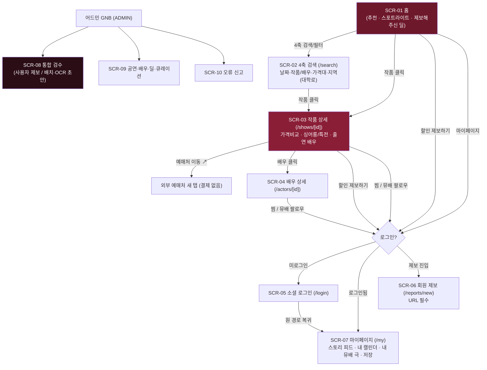

# 화면(UI/UX) 설계서 — MuDeal

> `UIX-MUDEAL-v1.2` · [DESIGN.md](../../DESIGN.md)의 **Velvet Burgundy 와인/버건디 디자인 시스템**과 구현 확정본(`PRD v1.2`)을 동기화한 화면 설계서입니다.
> **1단 헤더**, **홈 3분류 탐색(할인 · 특전 · 싱어롱/특별 커튼콜)**, **4축 검색 필터**, **`제보해주신 딜` 기여 섹션**, **회원 전용 제보**, **작품 찜 · 뮤배 팔로우 · 상세 피드 · 내 캘린더**가 반영되어 있으며, 일반 티켓오픈(`TICKET_OPEN`)과 모바일 하단 고정 탭바는 제외했습니다.

---

## 1. 전체 화면 목록 (`SCR-01` ~ `SCR-10`)

| 화면 ID | 화면명 | URL | 접근 권한 | 관련 API | 관련 UC |
|---|---|---|---|---|---|
| **SCR-01** | 홈 (`제보해주신 딜` 포함) | `/` | 전체 | `GET /api/v1/home`, `POST /deals/{id}/helpful` | UC-001 |
| **SCR-02** | **4축 복합 필터 검색** | `/search` | 전체 | `GET /api/v1/shows`, `/shows/suggest` | UC-002 |
| **SCR-03** | 작품 상세 · 비교 · 특전 · 출연 배우 | `/shows/[id]` | 전체 | `GET /shows/{id}`, `POST /clicks`, `POST /helpful`, `POST /issues` | UC-003, UC-004, UC-010 |
| **SCR-04** | **배우 상세 / 출연극 모아보기** | `/actors/[id]` | 전체 (팔로우: USER) | `GET /actors/{id}`, `POST/DELETE /me/follows/actors/{id}` | UC-003, UC-007 |
| **SCR-05** | 카카오/구글 소셜 로그인 | `/login` | 비로그인 | `GET /auth/oauth/{provider}`, `POST /complete-signup` | UC-005 |
| **SCR-06** | **회원 전용 할인·이벤트 제보** | `/reports/new` | **`USER` 필수** | `POST /uploads/report-evidence`, `POST /reports` | UC-006 |
| **SCR-07** | **마이페이지 (스토리 바 피드 · 내 캘린더 · 찜 · 내 뮤배 극 · 내 기여)** | `/my` | `USER` 필수 | `GET /me/notifications`, `/me/calendar`, `/me/bookmarks/shows`, `/me/actors/shows`, `/me/search-presets`, `/me/reports` | UC-007 |
| **SCR-08** | 어드민 통합 검수 (제보 · 배치/OCR 초안) | `/admin/reports` | `ADMIN` 필수 | `GET/POST /admin/reports/*`, `/admin/drafts/*`, `/admin/ocr-jobs/*` | UC-008 |
| **SCR-09** | 어드민 공연·배우 매핑·딜·큐레이션 CRUD | `/admin/deals` | `ADMIN` 필수 | `CRUD /admin/shows`, `/deals`, `/actors`, `/curations`, `/sync/*` | UC-009, UC-011 |
| **SCR-10** | 어드민 오류 신고 처리 | `/admin/issues` | `ADMIN` 필수 | `GET/PATCH /admin/issues/*` | UC-010 |

---

## 2. 화면 흐름도



---

## 3. 핵심 화면 상세 명세

### 3.1 `SCR-01`: 홈 (`/`)
```text
+------------------------------------------------------------------------+
| [MuDeal]   [🔍 작품명 · 배우 · 공연장 검색]   [맞춤 검색] [할인 제보] [MY●3] |
+------------------------------------------------------------------------+
| [ 3열 1:1 히어로 배너 (할인 · 특전 · 싱어롱/특별 커튼콜) ]              |
| ---------------------------------------------------------------------- |
| 혜택별로 뮤지컬 둘러보기                    [할인 조건 검색 >]          |
| [할인 N]  [특전 N]  [싱어롱 · 특별 커튼콜 N]                            |
| [ 5열 5:7 포스터 그리드 — 포스터 좌상단 단일 뱃지 + 하단 1줄 슬롯 ]     |
| ---------------------------------------------------------------------- |
| 마감임박 특가 (5열 5:7 포스터 그리드 · D-Day)           [전체보기 >]    |
| ---------------------------------------------------------------------- |
| 관객들이 제보해주신 딜 (3열 카드 · 닉네임 · 확인/도움)  [할인 제보하기+] |
+------------------------------------------------------------------------+
| MuDeal · 외부 예매처 비교 서비스 (결제·발권 미제공 · KOPIS)  © 2026 MuDeal |
+------------------------------------------------------------------------+
```
- **슬림 1단 헤더 & 초슬림 미니 푸터**: 검색으로 리다이렉트되던 2단 탭을 제거하고, 1단 헤더(`MuDeal` · 인라인 검색창 · `맞춤 검색` · `할인 제보` · `MY/로그인`) + 홈 내 3분류 탭(`할인` · `특전` · `싱어롱·특별 커튼콜`)으로 간결하게 구성합니다. 모든 뷰포트에서 하단 고정 탭바는 사용하지 않습니다.
- **포스터 카드(`ShowCard`) 규칙**: 포스터 이미지 위에는 좌상단 혜택 뱃지 1개만 배치(제목·지역 중복 오버레이 금지), 하단 구분선 아래 1줄 슬롯은 제보 딜이면 `OO님 제보 · 도움 N`, 일반 딜이면 `예매처 N곳 비교` + 우측 `D-Day`로 높이를 통일합니다.

### 3.2 `SCR-02`: 4축 복합 필터 검색 (`/search`)
```text
+------------------------------------------------------------------------+
| [MuDeal]   [🔍 작품명 · 배우 · 공연장 검색]   [맞춤 검색] [할인 제보] [MY●3] |
+------------------------------------------------------------------------+
| ┌─ 통합 4축 필터 패널 ────────────────────────────────────────────────┐ |
| │ 1) 혜택 유형: [전체] [할인] [특전] [싱어롱·특별 커튼콜] [관객 제보]  │ |
| │ 2) 날짜·기간: [오늘] [이번 주말] [이번 달] [시작일 ~ 종료일 적용]    │ |
| │ 3) 지역:      [전체] [서울·대학로] [서울(기타)] [경기·인천] [지방]   │ |
| │ 4) 가격·조건: [3만~10만원 이하] [무조건 할인만] [마티네/재관람/청년] │ |
| │ [내 프리셋] [+ 현재 조건 저장]  [필터 초기화]       [조건 링크 공유] │ |
| └──────────────────────────────────────────────────────────────────────┘ |
| 검색 결과 N건                           [최저가순][할인율순][마감임박순] |
| [ 4열 5:7 포스터 그리드 ]                                               |
+------------------------------------------------------------------------+
```
- 검색 결과 0건 시: *"조건에 맞는 진행 중인 혜택이 없어요"* 안내 + `필터 초기화` + `혜택 제보하기` CTA.

### 3.3 `SCR-03` 작품 상세 (`/shows/[id]`) & `SCR-04` 배우 상세 (`/actors/[id]`)
- **`SCR-03` (Desktop `670px` 좌 + `400px` 스티키 우 · SSR 동적 OG 공유 카드 지원)**:
  - 상단 헤더: `700:320` 블러 포스터 + 5:7 포스터 + 지역 태그(`[서울·대학로]`) + 작품명(H1) + **공연장명(클릭 시 `/search?q={공연장명}` 해당 공연장 진행 작품 모아보기)** + **`찜하기 ♥`** / 공유 버튼.
  - 가격 비교표: 좌석등급 탭(`VIP/R/S/A/전석`) + `일반 최저가` vs `추첨/조건부 최저가` 분리 요약 + 예매처별 행(`예매처 이동 ↗`, 제보 출처 행에는 `○○님 제보 · N명 확인 · 👍 도움` + `오류 신고`) + 최종 확인 시각·외부 기준 면책 고지.
  - **`현장 이벤트 · 특전 안내`** 섹션: 싱어롱 데이 회차, 커튼콜 데이 날짜, 포토카드/굿즈 증정 조건 + 원문 예매처 링크 (공지 이미지 무단 재배포 금지).
  - **`출연 배우`** 섹션: KOPIS `prfcast` 기반 배우 필(와인/골드 모노그램 또는 최근 출연작 포스터 아바타) — 클릭 시 `SCR-04` 이동, 우측 `+ 팔로우` / `팔로우 중 ✓` 토글.
- **`SCR-04` (`/actors/[id]`)**: 배우명 헤더 + 팔로워 수 + **`뮤배 팔로우` 버튼** + 해당 배우가 출연 중인 현재/예정 뮤지컬 목록(**진행 중 할인이 없어도 KOPIS 기본 공연 정보 상시 노출**).

### 3.4 `SCR-06` 제보 작성 (`/reports/new`) & `SCR-07` 마이페이지 (`/my`)
- **`SCR-06` 회원 전용 제보 (`/reports/new`, `USER` 필수)**:
  - 제보 유형 3분류(`할인` · `특전` · `싱어롱·특별 커튼콜`), 작품 선택/직접 입력, 예매처, URL(`https://` 실시간 인라인 검증), 할인가·할인율 또는 이벤트/특전 내용, 표시 닉네임, 증빙 이미지(선택 5MB) + 로컬 임시 저장.
- **`SCR-07` 마이페이지 (`/my`, `USER` 전용)**:
  - **상단 스토리 바**: 팔로우한 배우 + 찜한 작품 프로필 썸네일 가로 스크롤(미확인 새 소식 시 와인/골드 테두리). 각 프로필 클릭 시 `/shows/[id]#news-feed` 또는 `/actors/[id]#news-feed`로 바로 이동해 상세 피드를 열람·저장·캘린더 담기 처리.
  - **하위 탭 2개 + 하단 별도 섹션**:
    1. **`내 캘린더`**: 월간 캘린더에 로터리 마감·싱어롱/커튼콜·특전 회차 자동 표시 + 담은 소식 + 일정 직접 추가/2단계 삭제 확인.
    2. **`저장한 소식`**: 피드에서 저장해 둔 소식 보관함.
    3. **하단 `내가 제보한 내역`**: 누적 확인/도움 수 및 제보 검수 상태(`검수 중`/`승인 완료`/`반려`+사유).

### 3.5 `SCR-08` ~ `SCR-10` 경량 관리자 콘솔 (`/admin/*`, `ADMIN` 전용)
- Curtain Noir(`#2B0D16`) 좌측 `240px` 사이드바: `통합 검수 [대기 N]` · `공연·배우·딜 관리` · `오류 신고 [N]` · `연동/OCR 상태` (**혜택 지급 메뉴 없음**).
- **`SCR-08` 통합 검수 (`/admin/reports`)**: 상단 2탭(**`사용자 제보`** / **`자동 수집·OCR 초안`**) + 좌측 원문 링크/OCR 추출 JSON·신뢰도 + 우측 기존 활성 딜 대조 및 보정 폼 → `승인 및 게시` / `반려(사유 필수)` / `폐기`.
- **`SCR-09` 운영 CRUD (`/admin/deals`)**: 공연·딜 등록/수정/`admin_locked` + **배우 동명이인 병합/매핑 보정** + 홈 배너/스포트라이트 큐레이션 + 배치 실패 경고/수동 재수집.
- **`SCR-10` 오류 신고 (`/admin/issues`)**: 접수된 오류 확인 → 대상 딜 즉시 수정/마감 후 완료 처리.
