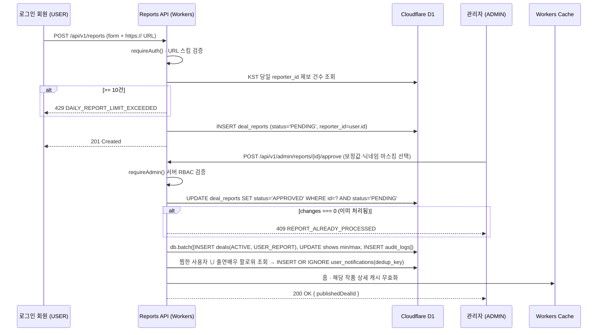
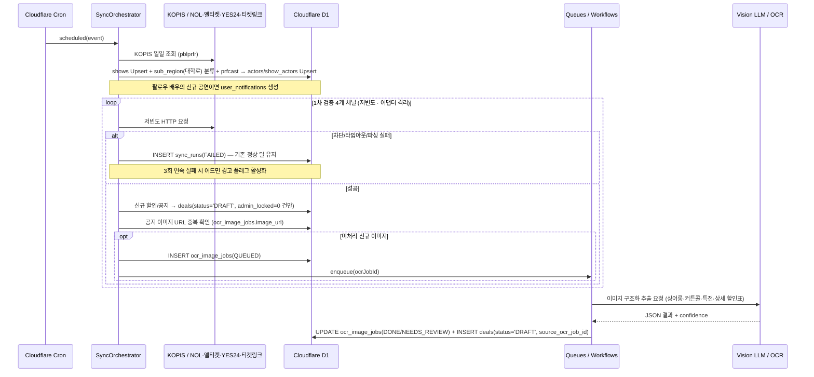
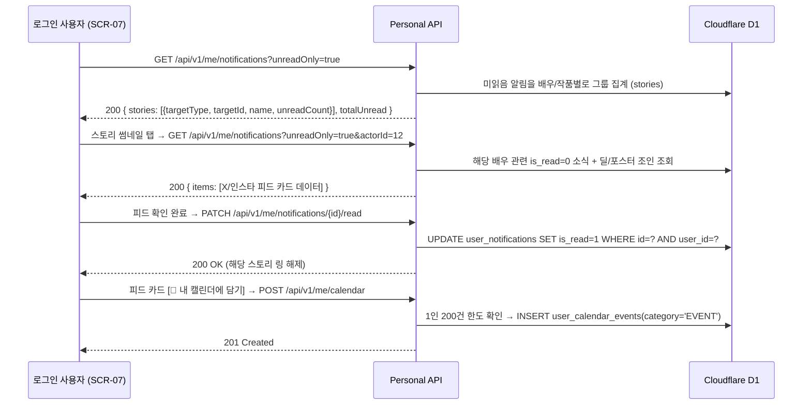
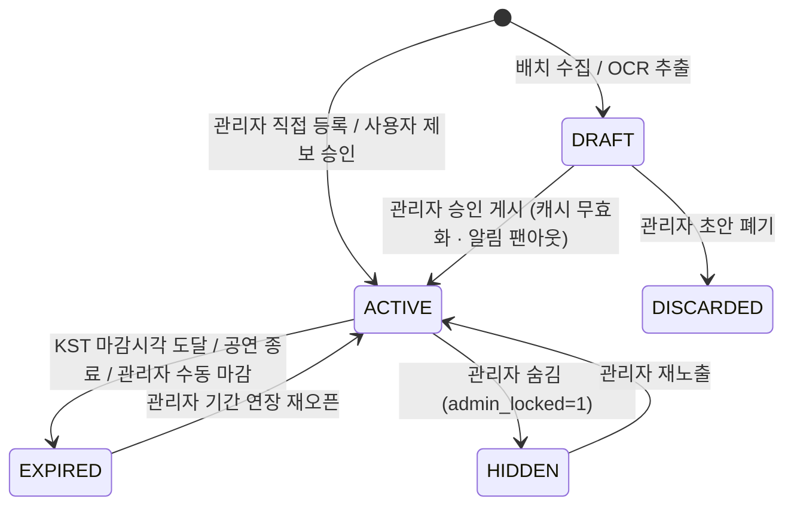

# 상세 설계서 (Detailed Design Document) — MuDeal

> `DDS-MUDEAL-v1.0` · Phase 2 시스템 설계서(SAD · DBS · API · UIX)를 실제 구현 가능한 모듈 단위(`DD-001`~`DD-008`), 시퀀스 흐름, 상태 전이, 핵심 알고리즘/파서, 코딩·검증 기준까지 구체화한 **Phase 3(상세 설계)** 기준선입니다.

| 항목 | 내용 |
|------|------|
| **문서 ID** | DDS-MUDEAL-v1.0 |
| **프로젝트명** | MuDeal (가칭) |
| **문서 버전** | v1.0 |
| **작성일** | 2026-11-25 |
| **작성자** | 개발/아키텍처팀 · Gemini (Antigravity) |
| **승인자** | 프로젝트 오너 (G3 검토 대기) |
| **실행 환경** | Cloudflare Workers + Workers Static Assets (`Next.js / vinext` + Tailwind CSS + D1/Drizzle + R2 + Cron/Queues/Workflows) |

---

## 1. 프로젝트 디렉터리 및 모듈 구조 (`DD-001` ~ `DD-008`)

```text
src/
├── app/                              # Next.js App Router (vinext on Workers)
│   ├── (public)/                     # 비로그인 허용: 홈(/), 4축 검색(/search), 상세(/shows/[id]), 배우(/actors/[id]), 제보(/reports/new)
│   ├── (auth)/login/                 # 카카오/구글 소셜 로그인 & 최초 약관 동의
│   ├── my/                           # 로그인 개인화: 스토리 바 피드, 내 캘린더, 내 뮤배 극, 찜, 내 제보 기여
│   ├── admin/                        # ADMIN 전용: 통합 검수, 공연/배우/딜/큐레이션, 오류 신고
│   └── api/v1/                       # REST Route Handlers (API설계서 계약 구현)
├── server/
│   ├── modules/
│   │   ├── auth/                     # [DD-001] OAuth, JWT Cookie, Refresh 로테이션, RBAC 가드
│   │   ├── shows/                    # [DD-002] 4축 복합 검색, 작품 상세 가격/이벤트 비교, 배우 조회
│   │   ├── deals/                    # [DD-003] 아웃바운드 이동(10초 중복제거), 도움이 됐어요, URL 검증
│   │   ├── reports/                  # [DD-004] 회원 제보(URL 필수), 통합 검수 멱등 승인/반려
│   │   ├── personal/                 # [DD-005] 찜, 뮤배 팔로우, 스토리 바 미확인 피드, 내 캘린더, 검색 프리셋
│   │   └── admin/                    # [DD-007] 공연/딜 CRUD, admin_locked, 배우 병합, 큐레이션, 오류 처리
│   └── sync/                         # [DD-006] Cron/Queue 배치: KOPIS, 1차/2차 채널 어댑터, Vision/OCR, 마감
├── db/
│   ├── schema.ts                     # Drizzle ORM D1 19개 테이블 스키마 (DBS v1.0 일치)
│   └── client.ts                     # env.DB Drizzle 바인딩 래퍼
├── lib/
│   ├── kst.ts                        # KST(UTC+9) 날짜·기간·마감·D-Day 단일 유틸
│   ├── pricing.ts                    # 할인율(floor)·최저가 요약·정렬 순수 함수
│   ├── url.ts                        # https:// 화이트리스트 URL 검증 & 4축 쿼리 직렬화
│   └── errors.ts                     # 표준 AppError 및 HTTP 상태 매핑
└── components/                       # [DD-008] DESIGN.md 와인/버건디 UI 컴포넌트
migrations/                           # Drizzle 순차 SQL 마이그레이션
```

### 구현 단위 ↔ 요구사항 매핑

| 설계 ID | 모듈 / 구현 단위 | 담당 요구사항 (SRS) | 핵심 정책 (`BP-*`) |
|---|---|---|---|
| **DD-001** | Auth & RBAC (`server/modules/auth`) | `FR-007`, `NFR-002` | `BP-AUTH-001~003` |
| **DD-002** | 4축 검색 · 작품 비교 (`server/modules/shows`) | `FR-002`, `FR-003`, `FR-004`, `NFR-001` | `BP-SEARCH-001~005`, `BP-DEAL-001~002` |
| **DD-003** | 아웃바운드 이동 · 도움 반응 (`server/modules/deals`) | `FR-005`, `FR-006`, `NFR-005` | `BP-DEAL-003`, `BP-STAT-001` |
| **DD-004** | 회원 제보 · 통합 검수 (`server/modules/reports`) | `FR-006`, `FR-009`, `NFR-002`, `NFR-003` | `BP-REPORT-001~003`, `BP-SYNC-001-3` |
| **DD-005** | 개인화 (스토리 바 자동읽음/저장 · 캘린더 · 찜 · 뮤배 · 프리셋) (`server/modules/personal`) | `FR-008`, `NFR-003` | `BP-PERSONAL-001~005` |
| **DD-006** | KOPIS · 채널 배치(3요소 매칭) · Vision/OCR(일일 상한) · 마감 (`server/sync`) | `FR-001`, `NFR-003`, `NFR-005`, `NFR-006` | `BP-SYNC-001~003`, `BP-RESET-001` |
| **DD-007** | 관리자 운영 CRUD · 배우 병합 · 오류 신고 · 최초 ADMIN (`server/modules/admin`) | `FR-010`, `FR-011`, `FR-012`, `NFR-002` | `BP-SYNC-002-3`, `BP-REPORT-004`, `BP-AUTH-003` |
| **DD-008** | 프론트엔드 UI · 디자인 토큰 · 동적 OG · 공연장 링크 (`components/`, `app/`) | `FR-002~012`, `NFR-004`, `NFR-006` | `DESIGN.md` 전체 |

---

## 2. 핵심 시퀀스 다이어그램

### 2.1 회원 제보 → 관리자 통합 검수 승인 → 인앱 소식 팬아웃 (`DD-004`, `DD-005`)



### 2.2 KOPIS + 1차 검증 채널 저빈도 배치 + 신규 공지 이미지 Vision/OCR (`DD-006`)



### 2.3 마이페이지 스토리 바 → 미확인 새 소식 피드 & 내 캘린더 담기 (`DD-005`)



---

## 3. 엔티티 상태 전이

### 3.1 `deals.status` (초안 검수 → 게시 → 마감)



### 3.2 `deal_reports.status` & `ocr_image_jobs.ocr_status`
- **`deal_reports`**: `PENDING` → `APPROVED` (단방향, 중복 요청 `409`) | `PENDING` → `REJECTED` (단방향, 사유 미입력 `400`).
- **`ocr_image_jobs`**: `QUEUED` → `PROCESSING` → `DONE` (`confidence >= 0.7`) | `NEEDS_REVIEW` (`< 0.7`, 어드민 강조 표시) | `FAILED` (관리자 수동 재시도 시 `QUEUED` 복귀).

---

## 4. 핵심 모듈별 알고리즘 및 경계값 명세

### 4.1 KST 시간대 · 날짜/기간 겹침 · 마감 판정 (`src/lib/kst.ts`)
- DB 저장값은 항상 UTC ISO-8601(`Z`)을 사용하되, 비즈니스 연산은 전용 유틸로 `UTC+9` 변환한다.
- **마감 판정 (`BP-RESET-001-3`)**: `expiresAt !== null && nowUtc >= expiresAt`이면 즉시 만료로 간주한다. (15분 Cron 배치 + 모든 공개 `SELECT`의 `WHERE status = 'ACTIVE' AND (expires_at IS NULL OR expires_at > :nowUtc)` 이중 방어).
- **날짜/기간 4축 필터 (`BP-SEARCH-001`)**: 입력 `[dateFrom, dateTo]` (`YYYY-MM-DD`, KST)에 대해 `shows.start_date <= :dateTo AND shows.end_date >= :dateFrom` 조건을 적용한다. 프리셋 `THIS_WEEKEND`는 현재 KST 기준 다가오는(또는 진행 중인) 토요일~일요일로 계산한다.
- **일일 제보 한도 리셋 (`BP-REPORT-001-1`)**: KST 당일 `00:00:00+09:00`의 UTC 환산 시각(`startOfKstDayUtc`) 이후 `created_at >= startOfKstDayUtc` 건수를 카운트해 `>= 10`이면 `429` 반환.

### 4.2 KOPIS 파서 — 정가 · 출연진 · 대학로 지역 분류 (`DD-006`)
1. **좌석별 기준 정가 (`pcseguidance`)**: 예 `"VIP석 170,000원, R석 140,000원, S석 110,000원, A석 80,000원"` 또는 `"전석 66,000원"`을 정규식으로 파싱해 `{ VIP: 170000, R: 140000, S: 110000, A: 80000 }` JSON으로 정규화. 파싱 불가 문자열은 `null`로 두고 관리자 보정 허용.
2. **출연진 파싱 (`prfcast`)**: `"홍광호, 김준수, 박은태 등"`에서 `" 등"` 꼬리표 제거 → 쉼표 분리 → 공백 트림 → `normalized_name` 기준 `actors` 조회/생성 후 `show_actors`에 `INSERT OR IGNORE`. 동명이인은 어드민 `POST /api/v1/admin/actors/merge`로 안전 병합(연관 `show_actors`, `user_actor_follows`, `user_notifications`를 대상 `actor_id`로 이관).
3. **`서울 · 대학로(혜화)` 자동 분류 (`BP-SEARCH-004`)**: KOPIS 공연장 주소(`adres`)에 `대학로`, `동숭동`, `혜화동`, `명륜`, `이화동`, `연건동` 또는 종로구 소극장 화이트리스트가 포함되면 `sub_region = 'DAEHAKRO'`, 그 외 서울은 `'SEOUL_OTHER'`, 타 시/도는 광역 코드로 매핑.
4. **지역 투어 오매핑 방지 3요소 매칭 (`BP-SYNC-002-2`)**: 외부 예매처 딜을 KOPIS `shows`에 매핑할 때는 반드시 `normalized_title 일치 + (region/sub_region 또는 venue_name 유사 일치) + 공연기간 겹침` 3요소로 매칭하며, 다중 후보 충돌 시 `show_id = NULL` `DRAFT`로 올려 관리자가 확정하게 한다.
5. **Vision/OCR 일일 호출 상한 (`BP-SYNC-002-1`)**: OCR 큐 컨슈머는 KST 당일 `ocr_image_jobs` 처리 건수가 `env.OCR_DAILY_LIMIT`(기본 `100`)에 도달하면 신규 호출을 중단하고 남은 `QUEUED` 건을 다음 날로 이월한다(대극장·인기작 우선순위 정렬).
6. **동적 OG & 공연장 링크 (`DD-008`)**: `/shows/[id]`와 `/search`의 `generateMetadata()`에서 최저가·할인율·필터 요약이 반영된 OpenGraph 메타태그를 SSR 생성하며, 작품 상세 공연장명에 `/search?q={venueName}` 링크를 연결한다.
7. **최초 `ADMIN` 부트스트랩 (`DD-001`)**: 소셜 로그인 콜백 시 이메일이 `env.ADMIN_OAUTH_EMAILS`(쉼표 구분 Workers Secret)에 포함되면 자동으로 `role = 'ADMIN'`을 부여한다.

### 4.3 가격 계산 · 최저가 요약 · 정렬 (`src/lib/pricing.ts`, `DD-002`)
```ts
// 할인율 산출 (BP-DEAL-001-1)
export function calcDiscountRate(basePrice: number | null, salePrice: number | null): number | null {
  if (!basePrice || basePrice <= 0 || salePrice === null || salePrice >= basePrice) return null;
  return Math.floor(((basePrice - salePrice) / basePrice) * 100);
}
```
- **정렬 비교기 (`BP-DEAL-002-3`)**: `salePrice ASC` → `isUnconditional DESC (1 먼저)` → `expiresAt DESC (NULL 최우선)` → `lastVerifiedAt DESC`.
- **최저가 요약 분리 (`BP-DEAL-002-2`)**: `generalLowest`는 `isUnconditional === 1` 중 최저가, `conditionalLowest`는 `isUnconditional === 0` 중 최저가(`generalLowest`보다 저렴할 때만 하이라이트).
- **순수 이벤트·특전 분리**: `dealType IN ('SINGALONG','CURTAIN_CALL','PERK_GOODS')`는 `events[]` 배열로 분리 반환(단, 할인가가 함께 존재하는 경우 가격 비교표에도 노출 가능).

### 4.4 Vision/OCR 구조화 JSON 스키마 (`DD-006`)
```ts
const OcrExtractSchema = z.object({
  hasRelevantInfo: z.boolean(),
  confidence: z.number().min(0).max(1),
  discounts: z.array(z.object({
    seatGrade: z.enum(["VIP", "R", "S", "A", "ALL"]).default("ALL"),
    salePrice: z.number().int().nonnegative().nullable(),
    discountRate: z.number().int().min(1).max(99).nullable(),
    isUnconditional: z.boolean(),
    conditionTags: z.array(z.enum(["MATINEE","REWATCH","YOUTH_STUDENT","OFFICE_WORKER","CARD_PARTNER"])).default([]),
    conditionSummary: z.string().max(200),
    expiresAtKst: z.string().nullable(),
  })).default([]),
  events: z.array(z.object({
    dealType: z.enum(["SINGALONG", "CURTAIN_CALL", "PERK_GOODS", "SPECIAL_DAY"]),
    eventDates: z.array(z.string()).default([]),
    perkSummary: z.string().max(300).nullable(),
    conditionSummary: z.string().max(200).nullable(),
  })).default([]),
});
```
- `hasRelevantInfo === false`이면 `DRAFT`를 생성하지 않고 `ocr_image_jobs.ocr_status = 'DONE'`으로 종료(노이즈 차단).
- `confidence < 0.7`이면 `NEEDS_REVIEW`로 표기해 어드민 검수 화면(`SCR-08`) 상단에 주의 배지를 표시한다.
- 원본 이미지 바이트는 OCR 호출 시 메모리에서만 처리하고 R2나 공개 스토리지에 재저장하지 않는다(`BP-SYNC-002-2`).

### 4.5 외부 URL 검증 & 보안 (`src/lib/url.ts`, `DD-003`)
- `new URL(raw)` 파싱 후 `protocol === 'https:'` (관리자 명시 허용 시만 `http:`) 및 공백/제어문자 없음 검증. `javascript:`, `data:`, `vbscript:` 100% 차단(`400`).
- 모든 `<a>` 외부 이동 링크에 `target="_blank" rel="noopener noreferrer"` 강제.

### 4.6 마이페이지 내장 캘린더 통합 조회 (`DD-005`)
- `GET /api/v1/me/calendar?from=YYYY-MM-DD&to=YYYY-MM-DD`:
  1. `autoEvents`: 사용자가 찜한 `show_id` ∪ 팔로우 배우의 `show_id` 중, `deals.expires_at` 또는 `deals.event_dates_json`(싱어롱·커튼콜 회차)이 `[from, to]` KST 범위 안에 걸리는 항목을 동적 생성(`readOnly: true`).
  2. `savedEvents`: `user_calendar_events WHERE user_id = ? AND event_date BETWEEN ? AND ?` 조회(`readOnly: false`, 수정·삭제 가능).

---

## 5. 코딩 표준 및 Phase 4 검증 기준

| 영역 | 기준 |
|------|------|
| **언어 / 런타임** | TypeScript `strict: true`, Cloudflare Workers Web Standard API 사용(Node 전용 `fs`·네이티브 바이너리 금지, JWT는 `jose`, 해시는 `crypto.subtle`) |
| **입력 / 경계 검증** | 모든 API Route Handler 진입부에서 Zod 스키마 검증 후 표준 에러 응답(`{ error: { code, message, details, requestId } }`) 반환 |
| **권한 가드** | `requireAuth(req)` / `requireAdmin(req)` 공통 미들웨어 필수 — 클라이언트 숨김에 의존 금지 |
| **DB 접근** | Drizzle ORM 파라미터 바인딩만 사용(원시 SQL 문자열 보간 금지), 상태 변경(승인·반려·병합·잠금)은 `audit_logs` 기록 필수 |
| **UI / 디자인** | [DESIGN.md](../../DESIGN.md) CSS 변수(`--md-primary: #6E182B` 등) 준수, 모든 가격/할인율/날짜에 `tabular-nums`, 가로 스크롤 `0px` |
| **필수 단위·통합 테스트 (Vitest)** | ① `calcDiscountRate` & 최저가 동점 정렬 ② KST 마감 경계(`17:59:59` 활성 vs `18:00:00` 만료) ③ KOPIS `pcseguidance`/`prfcast`/`대학로` 파서 및 3요소 매칭 ④ 4축 복합 검색 쿼리 & OCR 일일 상한 ⑤ 제보 미로그인 `401` · 비안전 URL `400` · 일 10건 초과 `429` ⑥ 제보 중복 승인 멱등(`409`) & `admin_locked` 배치 보호 ⑦ `/api/v1/admin/*` 비관리자 `403` ⑧ 스토리 바 자동 읽음·30일 다시 보기·`is_saved` 저장 & 캘린더 200건 한도 |
